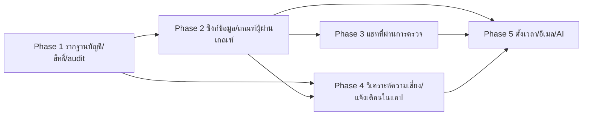

# Release Plan

แผนแบ่ง phase/release จาก [[../backlog|Backlog]] และ [[../../02-design/feature-list|Feature List]] (ผู้ใช้ยืนยันแผนเมื่อ 2026-10-20) เขียนแบบไม่ผูก tech stack รายละเอียดเทคโนโลยีอยู่ที่ [[../../02-design/02-technical/technology-stack]] เท่านั้น

## ภาพรวม

แบ่งเป็น 5 phase ลำดับตามระดับความสำคัญใน backlog dependency เชิงธุรกิจ/เทคนิค และกลุ่มฟีเจอร์ที่ทำงานร่วมกัน

## ตารางสรุป phase

| Phase | ชื่อ | FR/NFR | ไฟล์ task | เหตุผลการจัดลำดับ |
|-------|------|--------|-----------|-------------------|
| 1 | รากฐานบัญชี สิทธิ์ตามบทบาท และ audit การตั้งค่า | FR-25, FR-26, NFR-01, NFR-07 | [[../03-task/phase-1-account-access-foundation-tasks]] | ต้องมีการยืนยันตัวตนและสิทธิ์ตามบทบาทก่อนใช้ข้อมูลจริง FR-26 (กลาง) ถูกดันขึ้น เพราะขอบเขตการมองเห็นของครูใน NFR-01 และ FR-07 พึ่งพา |
| 2 | ซิงก์ข้อมูลจากระบบเดิม และเกณฑ์ผู้ผ่านเกณฑ์ | FR-01, FR-19, FR-23, FR-27 | [[../03-task/phase-2-data-sync-eligibility-tasks]] | FR-16 (phase 3) ต้องใช้ผลประเมินจาก FR-27 ซึ่งต้องใช้ข้อมูลซิงก์ ข้อมูลซิงก์เป็นฐานของการประเมินความเสี่ยงใน phase 4 FR-19/FR-23 เป็นพฤติกรรมของการซิงก์เอง |
| 3 | แชทแนะนำที่ผ่านการตรวจ | FR-10, FR-11, FR-12, FR-13, FR-14, FR-15, FR-16, FR-18, FR-20, FR-21, FR-22, FR-24, NFR-04, NFR-05, NFR-06 | [[../03-task/phase-3-moderated-advice-chat-tasks]] | การเขียนทุกอย่างต้องตรวจล็อกและ audit ในหน่วยการทำงานเดียว (FR-18/21/22/24, NFR-04/05) จึงจัดไว้ phase เดียว การแจ้งผู้ส่งเมื่อถูกปฏิเสธ (FR-15) ใช้ช่องทางในแอปก่อน |
| 4 | วิเคราะห์ความเสี่ยง แจ้งเตือนในแอป คำแนะนำ และมุมมองผู้ใช้ | FR-02, FR-03, FR-08, FR-04 (เฉพาะในแอป), NFR-02, FR-05, FR-06, FR-07 | [[../03-task/phase-4-risk-analysis-in-app-alerts-tasks]] | FR-08 ทำคู่กับกฎประเมิน FR-06/FR-07 แสดงผลที่ได้จากการประเมิน |
| 5 | งานที่รอการตัดสินใจเรื่องการตั้งเวลา อีเมล และ AI | FR-04 (ส่วนอีเมล), NFR-03 (ซิงก์ตามรอบอัตโนมัติ), FR-09, FR-17 | [[../03-task/phase-5-deferred-integrations-tasks]] | การตั้งเวลา อีเมล และ AI ยังไม่ตัดสินใจ จึงอยู่ท้ายสุด FR-09 และ FR-17 เป็นระดับต่ำ |

หมายเหตุ: FR-04 แยกเป็นสองส่วนข้าม phase 4 และ 5 เพราะช่องทางอีเมลยังไม่ตัดสินใจ รหัสใน backlog ไม่เปลี่ยน

## ผังลำดับ phase

Phase 3 และ 4 ทำขนานกันได้หลัง phase 2 เสร็จ

## ความครอบคลุม

FR-01 ถึง FR-27 และ NFR-01 ถึง NFR-07 ทุกรหัสใน backlog อยู่ใน phase อย่างน้อยหนึ่ง phase

## ความคืบหน้าและงานที่ค้างรอข้อมูล (อัปเดต 2026-10-20)

- งานที่ค้างรอข้อมูลจากระบบเดิม (ผู้ใช้ยังไม่มีตัวอย่างข้อมูลหรือเอกสาร API จะแจ้งเมื่อได้มา): T-1-02 นำเข้าบัญชีและบทบาทตั้งต้น, T-1-04 ข้อมูลที่ Admin แก้ไม่ถูกนำเข้าทับ, T-1-05 นำเข้าความสัมพันธ์ครู-ผู้เรียน (ส่วนจัดเก็บความสัมพันธ์และ Admin จัดการเสร็จแล้ว) ข้ามไปทำ phase 3 ก่อนโดยผู้ใช้ตัดสินใจ
- phase 3 ทำก่อนครบ phase 2: ผลผ่านเกณฑ์ (T-3-02) อ่านจากผลที่เก็บไว้ ไม่มีผล = ไม่ผ่านเกณฑ์ phase 2 (T-2-11) ต้องเป็นผู้เขียนผลนั้น

- อัปเดต 2026-10-26: ปิดงานค้างในโค้ด Phase 1/3 แล้ว: T-3-15 (นโยบายระบบ + audit), หน้าจอ Admin `web/admin/`, เทสต์ Firestore rules, สคริปต์ย้ายล็อกเดิม (ดู [[../../05-log/20261026-log]]) ที่เหลือค้างคือ T-1-02/04/05 (รอข้อมูลระบบเดิม) และ deploy
