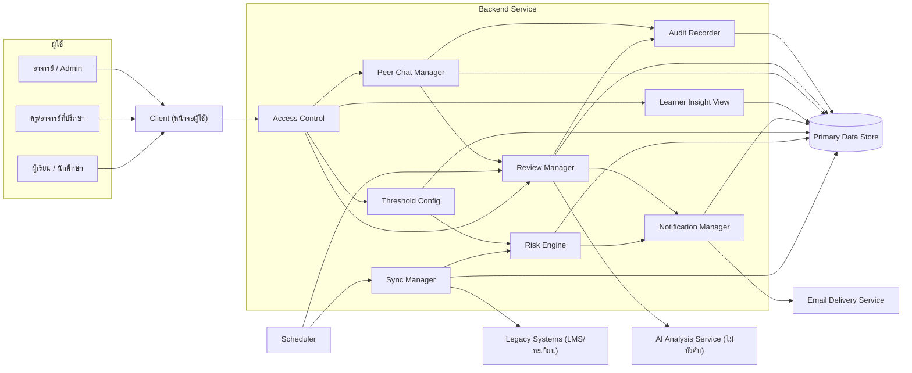
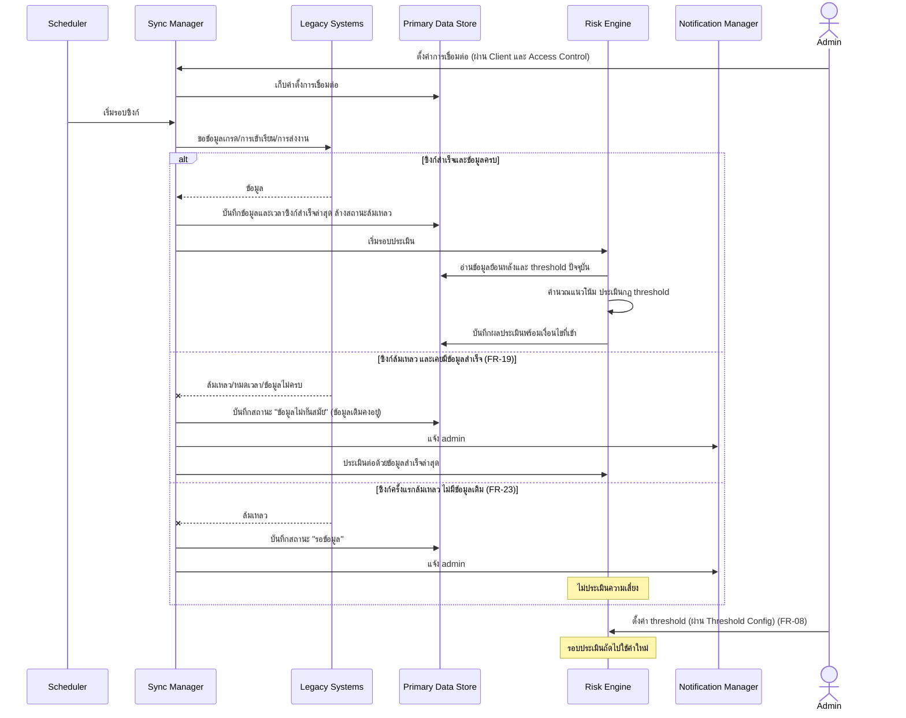
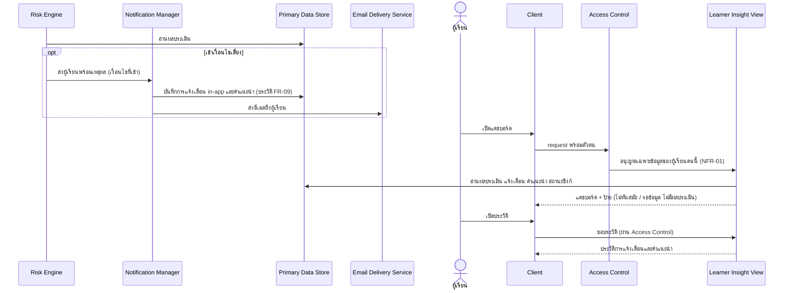
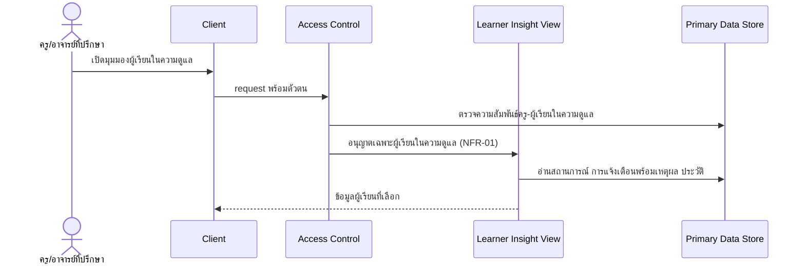
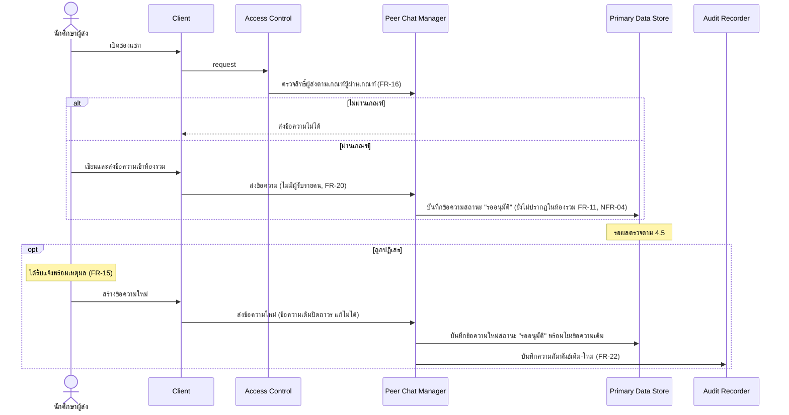
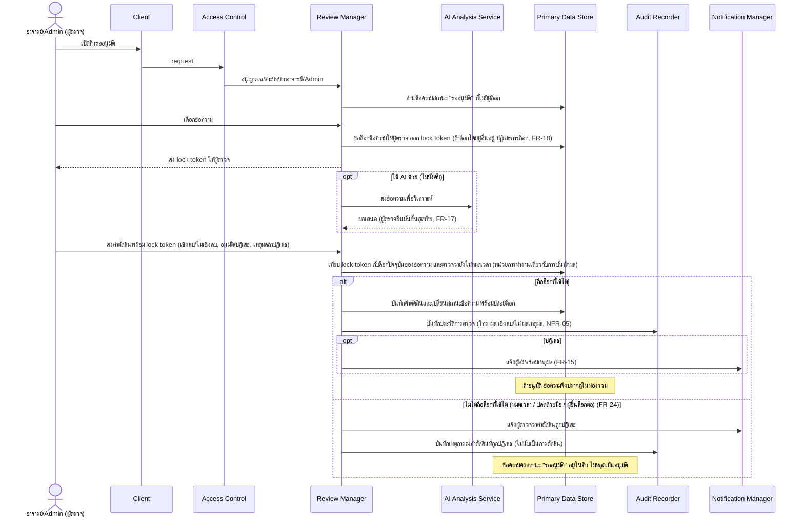
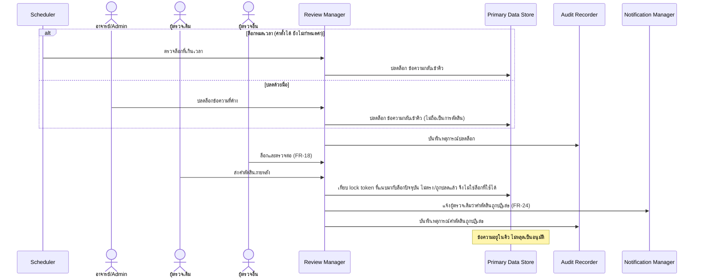
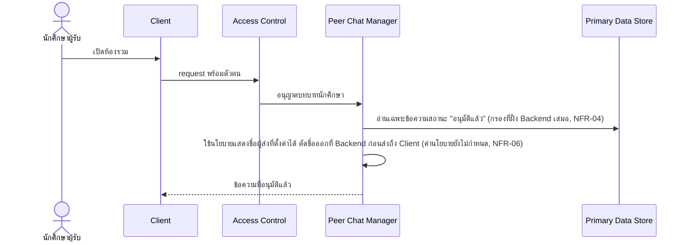

# High Level Architecture

สถาปัตยกรรมระดับ logical/conceptual ของระบบ ที่มาจาก [[../feature-list|Feature List]], [[../user-journey|User Journey]] และ NFR ใน [[../../01-requirements/backlog|Backlog]]

เอกสารนี้เขียนเป็น logical component ล้วน ไม่ระบุ technology ใดๆ เพราะ `technology-stack.md` ยังไม่มีเนื้อหา (ยังไม่ตัดสินใจ) รายละเอียดระดับ implementation เป็นงานของ detailed-design ชั้นถัดไป

Spec ต้นทาง: [[../../01-requirements/01-spec/20261014-01-student-risk-alert|REQ-01 ติดตามและแจ้งเตือนความเสี่ยง]], [[../../01-requirements/01-spec/20261014-02-peer-advice-chat|REQ-02 ช่องแชทแนะนำแนวทางการเรียน]], [[../../01-requirements/01-spec/20261016-01-sync-failure-handling|REQ-03 ซิงก์ล้มเหลว]], [[../../01-requirements/01-spec/20261016-02-peer-chat-recipients-lock-resubmit|REQ-04 ห้องรวม ปลดล็อก ส่งใหม่]], [[../../01-requirements/01-spec/20261016-03-first-sync-failure-and-expired-lock-decision|REQ-05 ซิงก์ครั้งแรกล้มเหลว และคำตัดสินเมื่อไม่ถือล็อก]]

## 1. ภาพรวม

ระบบมี 2 กลุ่มความสามารถที่ใช้ผู้ใช้และข้อมูลร่วมกัน

1. **ติดตามและแจ้งเตือนความเสี่ยงของผู้เรียน** (ฟีเจอร์ 1-9, 18): ดึงข้อมูลจากระบบเดิมเป็นระยะ คำนวณแนวโน้ม ประเมินความเสี่ยงด้วยกฎ threshold แจ้งเตือนพร้อมเหตุผล และให้คำแนะนำ
2. **ช่องแชทแนะนำแนวทางการเรียนที่ผ่านการตรวจ** (ฟีเจอร์ 10-17, 19-22): นักศึกษาผู้ผ่านเกณฑ์ส่งข้อความเข้าห้องรวม ข้อความต้องผ่านการตรวจของอาจารย์/Admin ก่อนผู้อื่นเห็น

หลักการออกแบบที่ขับเคลื่อนโดย NFR
- ทุกการเข้าถึงข้อมูลต้องผ่านการตรวจสิทธิ์ตามบทบาทที่ Backend Service จุดเดียว (NFR-01, NFR-04)
- สถานะของข้อความและการตัดสินเปลี่ยนได้ผ่านขั้นตอนที่ควบคุมเท่านั้น และการตรวจสอบล็อก การบันทึกผล และการเปลี่ยนสถานะต้องสำเร็จพร้อมกันหรือไม่สำเร็จเลย (FR-18, FR-21, FR-24, NFR-04, NFR-05)
- ผลการประเมินความเสี่ยงต้องย้อนอธิบายได้ว่าเข้าเงื่อนไขใด (NFR-02)

## 2. Logical Component

| Component | ประเภท | ขอบเขตความรับผิดชอบ |
|-----------|--------|----------------------|
| Client (หน้าจอผู้ใช้) | ภายในระบบ | แสดงหน้าจอตามบทบาท (ผู้เรียน, ครู/อาจารย์ที่ปรึกษา, นักศึกษาผู้ส่ง/ผู้รับ, อาจารย์/Admin) รับ input และแสดงผล ไม่ตัดสินสิทธิ์เอง และไม่ถือข้อมูลที่ผู้ใช้ไม่มีสิทธิ์เห็น |
| Backend Service | ภายในระบบ | ศูนย์กลาง business logic ทั้งหมด ประกอบด้วยโมดูลเชิงตรรกะตามตารางข้างล่าง |
| Primary Data Store | ภายในระบบ | เก็บข้อมูลถาวรทั้งหมด: ข้อมูลที่ซิงก์ ผลประเมิน การแจ้งเตือน คำแนะนำ ข้อความ สถานะข้อความ ล็อก คำตัดสิน audit trail ค่า threshold ค่าตั้งการเชื่อมต่อ |
| Scheduler (ตัวกำหนดเวลา) | ภายในระบบ | กระตุ้นงานตามเวลา: รอบซิงก์ข้อมูล (ความถี่ยังไม่กำหนด, NFR-03) และการปลดล็อกอัตโนมัติเมื่อล็อกหมดเวลา (FR-21) |
| Legacy Systems (LMS/ทะเบียน) | ภายนอก | แหล่งข้อมูลเกรด การเข้าเรียน การส่งงาน เปิดให้ดึงผ่าน API (FR-01) |
| Email Delivery Service (บริการส่งอีเมล) | ภายนอก | ส่งอีเมลแจ้งเตือนความเสี่ยงถึงผู้เรียน (FR-04) |
| AI Analysis Service (บริการวิเคราะห์ด้วย AI) | ภายนอก/ไม่บังคับ | เสนอผลวิเคราะห์เชิงลบ/ไม่เชิงลบให้ผู้ตรวจ (FR-17 ระดับต่ำ) ผู้ตรวจยืนยันขั้นสุดท้ายเสมอ |

### โมดูลเชิงตรรกะภายใน Backend Service

| โมดูล | ความรับผิดชอบ | FR/NFR |
|-------|----------------|--------|
| Access Control | ตรวจตัวตนและสิทธิ์ตามบทบาททุก request ก่อนเข้าถึงข้อมูลหรือสั่งงาน กำหนดว่าผู้เรียนเห็นเฉพาะข้อมูลตน ครูเห็นเฉพาะผู้เรียนในความดูแล นักศึกษาเห็นเฉพาะข้อความที่อนุมัติ | NFR-01, NFR-04, FR-16 |
| Sync Manager | ดึงข้อมูลจาก Legacy Systems ตรวจความครบถ้วน/รูปแบบ ตัดสินผลซิงก์ (สำเร็จ/ล้มเหลว/ล้มเหลวครั้งแรก) เก็บข้อมูลซิงก์สำเร็จล่าสุดและสถานะซิงก์ แจ้ง admin เมื่อล้มเหลว | FR-01, FR-19, FR-23, NFR-03 |
| Risk Engine | คำนวณแนวโน้ม ประเมินความเสี่ยงหลายตัวแปรด้วยกฎ threshold บันทึกเงื่อนไขที่เข้าเป็นเหตุผล สร้างคำแนะนำเฉพาะบุคคล (ผู้เรียนใหม่ใช้กฎพื้นฐาน) ไม่ประเมินถ้ายังไม่เคยมีข้อมูลซิงก์สำเร็จ | FR-02, FR-03, FR-05, FR-23, NFR-02 |
| Threshold Config | รับและเก็บค่า threshold จาก admin ให้ Risk Engine ใช้ในรอบประเมินถัดไป | FR-08 |
| Notification Manager | สร้างและส่งการแจ้งเตือนผ่านช่องทางในระบบ (in-app) และอีเมล แจ้ง admin เมื่อซิงก์ล้มเหลว แจ้งผู้ส่งเมื่อถูกปฏิเสธ แจ้งผู้ตรวจเมื่อคำตัดสินถูกปฏิเสธ | FR-04, FR-15, FR-19, FR-23, FR-24 |
| Learner Insight View | รวมข้อมูลแดชบอร์ดผู้เรียน มุมมองครู ประวัติการแจ้งเตือน/คำแนะนำ และป้ายสถานะข้อมูล (ไม่ทันสมัย/รอข้อมูล) | FR-06, FR-07, FR-09, FR-19, FR-23 |
| Peer Chat Manager | ตรวจสิทธิ์ผู้ส่งตามเกณฑ์ รับข้อความเข้าสถานะรออนุมัติ สร้างข้อความใหม่หลังถูกปฏิเสธและโยงกับข้อความเดิม ให้บริการห้องรวมที่คืนเฉพาะข้อความอนุมัติแล้ว | FR-10, FR-11, FR-16, FR-20, FR-22, NFR-04, NFR-06 |
| Review Manager | จัดคิวรออนุมัติ ล็อกข้อความกันตรวจซ้ำ ตรวจความถูกต้องของล็อกตอนรับคำตัดสิน รับการระบุเชิงลบ/ไม่เชิงลบ อนุมัติ/ปฏิเสธ (ต้องมีเหตุผล) ปลดล็อกอัตโนมัติ/ด้วยมือ ปฏิเสธคำตัดสินที่ไม่ถือล็อกที่ใช้ได้ | FR-12, FR-13, FR-14, FR-15, FR-17, FR-18, FR-21, FR-24 |
| Audit Recorder | บันทึกประวัติการตรวจ (ใคร ผลตัดสิน เชิงลบ/ไม่เชิงลบ เหตุผล) ความสัมพันธ์ข้อความเดิม-ใหม่ และเหตุการณ์ล็อก/ปลดล็อก/คำตัดสินที่ถูกปฏิเสธ | NFR-05, FR-22 |

## 3. Component Diagram

ทิศทางลูกศรคือทิศทางการเรียก Client ไม่เข้าถึง Primary Data Store หรือบริการภายนอกโดยตรง

## 4. Data Flow ตาม Journey หลัก

### 4.1 ซิงก์ข้อมูล ประเมินความเสี่ยง และตั้งค่า threshold
Journey: [[../user-journey#Journey: ผู้ดูแลระบบตั้งค่าการเชื่อมต่อและ threshold|ผู้ดูแลระบบตั้งค่าการเชื่อมต่อและ threshold]], ฟีเจอร์ 1, 2, 3, 18 (FR-01, FR-02, FR-03, FR-08, FR-19, FR-23, NFR-03)

### 4.2 ผู้เรียนรับแจ้งเตือน ดูแดชบอร์ด คำแนะนำ และประวัติ
Journey: [[../user-journey#Journey: ผู้เรียนรับแจ้งเตือนความเสี่ยงและคำแนะนำ|ผู้เรียนรับแจ้งเตือนความเสี่ยงและคำแนะนำ]], ฟีเจอร์ 4, 5, 6, 8, 9, 18 (FR-04, FR-05, FR-06, FR-09, FR-19, FR-23, NFR-01, NFR-02)

### 4.3 ครู/อาจารย์ที่ปรึกษาติดตามผู้เรียนในความดูแล
Journey: [[../user-journey#Journey: ครู/อาจารย์ที่ปรึกษาติดตามผู้เรียนในความดูแล|ครู/อาจารย์ที่ปรึกษาติดตามผู้เรียนในความดูแล]], ฟีเจอร์ 7, 8, 9 (FR-07, FR-09, NFR-01, NFR-02)

### 4.4 นักศึกษาผู้ส่งข้อความ และการส่งใหม่หลังถูกปฏิเสธ
Journey: [[../user-journey#Journey: นักศึกษาผู้ส่งข้อความแนะนำแนวทางการเรียน|นักศึกษาผู้ส่งข้อความแนะนำแนวทางการเรียน]], ฟีเจอร์ 10, 11, 13, 19, 21 (FR-10, FR-11, FR-15, FR-16, FR-20, FR-22, NFR-04)

### 4.5 อาจารย์/Admin ตรวจและตัดสินข้อความ (รวมกรณีไม่ถือล็อกที่ใช้ได้)
Journey: [[../user-journey#Journey: อาจารย์/Admin ตรวจและอนุมัติข้อความ|อาจารย์/Admin ตรวจและอนุมัติข้อความ]], ฟีเจอร์ 12, 13, 14, 15, 16, 22 (FR-12, FR-13, FR-14, FR-15, FR-17, FR-18, FR-24, NFR-04, NFR-05)

### 4.6 ปลดล็อกข้อความที่ผู้ตรวจค้าง (อัตโนมัติและด้วยมือ)
Journey: [[../user-journey#Journey: อาจารย์/Admin ปลดล็อกข้อความที่ผู้ตรวจค้างด้วยมือ|อาจารย์/Admin ปลดล็อกข้อความที่ผู้ตรวจค้างด้วยมือ]], ฟีเจอร์ 14, 20, 22 (FR-18, FR-21, FR-24, NFR-04, NFR-05)

### 4.7 นักศึกษาผู้รับอ่านห้องรวม
Journey: [[../user-journey#Journey: นักศึกษาผู้รับอ่านข้อความแนะนำ|นักศึกษาผู้รับอ่านข้อความแนะนำ]], ฟีเจอร์ 11, 17, 19 (FR-11, FR-20, NFR-04, NFR-06)

## 5. NFR Mapping

| NFR | คำอธิบายสั้น | Component หลัก | แนวทางเชิงหลักการ |
|-----|--------------|----------------|--------------------|
| [[../../01-requirements/01-spec/20261014-01-student-risk-alert\|NFR-01]] | ความเป็นส่วนตัว จำกัดการมองเห็นตามบทบาท | Access Control (Backend Service) | ตรวจสิทธิ์ทุก request ก่อนเข้าถึงข้อมูล ผู้เรียนเห็นเฉพาะข้อมูลตน ครูเห็นเฉพาะผู้เรียนในความดูแล Client ไม่ถือข้อมูลเกินสิทธิ์ นโยบาย PDPA ที่ต้องยืนยันเป็นข้อกำหนดเพิ่มต่อ Access Control และการเก็บข้อมูลใน Primary Data Store |
| [[../../01-requirements/01-spec/20261014-01-student-risk-alert\|NFR-02]] | อธิบายได้ว่าเข้าเงื่อนไขใด | Risk Engine, Notification Manager | บันทึกเงื่อนไข/ค่าที่ทำให้เข้าเกณฑ์พร้อมผลประเมิน แล้วนำไปแสดงในแจ้งเตือนและมุมมองครู |
| [[../../01-requirements/01-spec/20261014-01-student-risk-alert\|NFR-03]] | ความทันสมัยของข้อมูล (ความถี่ยังไม่กำหนด) | Scheduler, Sync Manager | ความถี่รอบซิงก์เป็นค่าตั้งได้ ไม่ฝังตายตัว บันทึกเวลาซิงก์สำเร็จล่าสุดเพื่อแสดงสถานะไม่ทันสมัย (ดูบันทึกการตัดสินใจ หัวข้อ 6 ประเด็น 3) |
| [[../../01-requirements/01-spec/20261014-02-peer-advice-chat\|NFR-04]] | ผู้รับไม่เห็นข้อความที่ยังไม่อนุมัติ/ถูกปฏิเสธ | Peer Chat Manager, Access Control, Review Manager | ห้องรวมอ่านเฉพาะสถานะอนุมัติแล้ว กรองที่ Backend Service เสมอ ไม่พึ่งการซ่อนที่ Client การเปลี่ยนเป็นอนุมัติทำผ่าน Review Manager พร้อมตรวจล็อกเท่านั้น คำตัดสินที่ไม่ถือล็อกที่ใช้ได้ไม่เปลี่ยนสถานะ (FR-24) (ดูบันทึกการตัดสินใจ หัวข้อ 6 ประเด็น 1, 2) |
| [[../../01-requirements/01-spec/20261014-02-peer-advice-chat\|NFR-05]] | audit trail ของการตรวจ | Audit Recorder, Review Manager | บันทึกทุกการตัดสิน ผู้ตัดสิน เชิงลบ/ไม่เชิงลบ เหตุผล ความสัมพันธ์ข้อความเดิม-ใหม่ และเหตุการณ์ล็อก/ปลดล็อก/คำตัดสินที่ถูกปฏิเสธ การบันทึกอยู่ในหน่วยการทำงานเดียวกับการเปลี่ยนสถานะ ผลตัดสินจึงไม่เกิดโดยไม่มี audit |
| [[../../01-requirements/01-spec/20261014-02-peer-advice-chat\|NFR-06]] | การแสดงชื่อผู้ส่ง (ยังไม่กำหนด) | Peer Chat Manager | เก็บตัวตนผู้ส่งไว้เสมอ (จำเป็นต่อ audit และ FR-22) การแสดงชื่อเป็นนโยบายที่ชั้นแสดงผลของ Peer Chat Manager ปรับได้โดยไม่กระทบโครงสร้าง (ดูบันทึกการตัดสินใจ หัวข้อ 6 ประเด็น 4) |

หมายเหตุ: FR-24 และ FR-18/FR-21 (ระดับสูง/กลาง) ใช้กลไกเดียวกันที่ Review Manager จึงไม่เพิ่ม component ใหม่ ไม่พบความต้องการเชิงระบบที่ไม่มี FR/NFR รองรับ

## 6. บันทึกการตัดสินใจเชิงสถาปัตยกรรม

ผู้ใช้ตัดสินใจครบ 4 ประเด็นเมื่อ 2026-10-17 (ทุกประเด็นเลือกทาง A ที่แนะนำ)

| ประเด็น | ตัวเลือกที่เสนอ (ข้อดี/ข้อเสีย) | ทางที่ผู้ใช้เลือก | เหตุผล | วันที่ |
|---------|-------------------------------|-------------------|--------|--------|
| 1. กลไกยืนยันล็อกตอนรับคำตัดสิน (FR-18, FR-21, FR-24) | A lock token: ล็อกแต่ละครั้งมีเลขอ้างอิงเฉพาะ คำตัดสินต้องแนบเลข Review Manager เทียบกับล็อกปัจจุบันในหน่วยการทำงานเดียวกับการเปลี่ยนสถานะ ข้อดี: ครอบคลุมทั้ง 3 สาเหตุของ FR-24 แม่นยำ แยกล็อกเก่า/ใหม่ของผู้ตรวจคนเดิมได้ ข้อเสีย: ต้องเก็บและส่งเลขเพิ่ม / B ตรวจผู้ถือล็อกและเวลาหมดอายุ: ข้อดี: เรียบง่าย ข้อเสีย: แยกล็อกเก่า/ใหม่ของคนเดิมไม่ได้ NFR-04 เสี่ยงกรณีขอบ / C เลขเวอร์ชันสถานะข้อความ: ข้อดี: ไม่ต้องมีแนวคิดล็อกแยก ข้อเสีย: ไม่สะท้อนล็อกหมดเวลา/ปลดมือโดยตรง ต้องมีกฎเสริม | A lock token | ป้องกันคำตัดสินหลุดเป็นอนุมัติได้แน่นที่สุด ตอบ NFR-04 และ NFR-05 | 2026-10-17 |
| 2. การแยกข้อความที่อนุมัติแล้วออกจากข้อความรออนุมัติ/ถูกปฏิเสธ (NFR-04, FR-20) | A ที่เก็บเดียว ห้องรวมอ่านผ่านจุดเดียวใน Peer Chat Manager ที่กรองเฉพาะสถานะอนุมัติแล้ว ข้อดี: เรียบง่าย สถานะเป็นแหล่งความจริงเดียว ข้อเสีย: พึ่งวินัยของทุกเส้นทางอ่าน / B published view แยก: ข้อดี: ข้อความที่ยังไม่อนุมัติไม่อยู่ในเส้นทางอ่านของห้องรวม ข้อเสีย: ต้องซิงก์สองที่ / C แยกที่เก็บเชิงตรรกะ 2 ส่วน: ข้อดี: แยกชัดที่สุด ข้อเสีย: ซับซ้อนสุด โยง audit/FR-22 ข้ามส่วน | A จุดอ่านเดียวกรองสถานะ | โครงสร้างเรียบง่ายและเพียงพอต่อ NFR-04 เมื่อบังคับว่าต้องอ่านผ่านจุดเดียว | 2026-10-17 |
| 3. จังหวะเริ่มรอบประเมินความเสี่ยง (FR-01, FR-03, NFR-03) | A ประเมินหลังทุกรอบซิงก์ (สำเร็จ หรือล้มเหลวแล้วใช้ข้อมูลเดิม) ข้อดี: ผลตามข้อมูลล่าสุด แจ้งเตือนทันเวลา ข้อเสีย: ประเมินซ้ำแม้ข้อมูลไม่เปลี่ยน / B ประเมินเมื่อข้อมูลเปลี่ยนจริง: ข้อดี: ลดงานซ้ำ ข้อเสีย: ต้องมีกลไกตรวจการเปลี่ยนแปลงและกระตุ้นเมื่อ threshold เปลี่ยน / C ประเมินเมื่อมีผู้เปิดดู: ข้อดี: ไม่เสียงานกับผู้ที่ไม่เปิดดู ข้อเสีย: แจ้งเตือนเชิงรุก (FR-04) ทำไม่ได้ | A ประเมินหลังทุกรอบซิงก์ | ได้ผลล่าสุดและรองรับการแจ้งเตือนเชิงรุก ตอบ NFR-03 | 2026-10-17 |
| 4. นโยบายแสดงชื่อผู้ส่ง (NFR-06 ยังไม่กำหนดใน spec) | A เก็บตัวตนผู้ส่งเสมอ Backend ตัดชื่อออกจากข้อมูลที่ส่งให้ Client ตามนโยบายที่ตั้งค่าได้ ข้อดี: เปลี่ยนนโยบายได้โดยไม่แตะข้อมูล รองรับ audit และ FR-22 ข้อเสีย: ต้องมีค่าตั้งนโยบาย / B แสดงชื่อเสมอ: ข้อดี: ง่ายที่สุด ข้อเสีย: เสี่ยงขัดความเป็นส่วนตัว / C ซ่อนชื่อเสมอ: ข้อดี: ส่วนตัวสูงสุดฝั่งผู้รับ ข้อเสีย: เปลี่ยนภายหลังต้องแก้ชั้นแสดงผล | A เก็บตัวตนไว้เสมอ ตัดชื่อที่ Backend ตามนโยบายที่ตั้งค่าได้ | spec ยังไม่กำหนดนโยบาย ทางนี้เปลี่ยนนโยบายได้โดยไม่กระทบโครงสร้างและ audit ตอบ NFR-06, NFR-01, NFR-05 | 2026-10-17 |

ผลต่อโครงสร้าง
- Review Manager ออก lock token ทุกครั้งที่ล็อก คำตัดสินต้องแนบ token และการเทียบ token การบันทึกผล และการเปลี่ยนสถานะอยู่ในหน่วยการทำงานเดียวกัน (4.5, 4.6)
- ห้องรวมอ่านผ่านจุดเดียวใน Peer Chat Manager ที่กรองสถานะอนุมัติแล้ว (4.7)
- รอบประเมินเริ่มต่อจากทุกรอบซิงก์ (4.1)
- นโยบายแสดงชื่อผู้ส่งเป็นค่าตั้งที่ Backend (4.7)

## 7. ประเด็นรอตัดสินใจ

ประเด็นเชิงโครงสร้าง 4 ข้อที่เคยรอตัดสินใจ ได้ตัดสินแล้วและย้ายไปหัวข้อ 6 เหลือเฉพาะประเด็นเชิง technology

### ประเด็นเชิง technology (รอ technology-stack.md)
- รูปแบบการรันงานตามเวลา การเก็บข้อมูล การส่งอีเมล และบริการ AI ภายนอก (FR-17 ระดับต่ำ ยังไม่ชัดว่าใช้ในช่วงแรกหรือไม่) ให้ตัดสินใจที่ [[technology-stack]]

## 8. เอกสารที่เกี่ยวข้อง
- [[../feature-list|Feature List]]
- [[../user-journey|User Journey]]
- [[../../01-requirements/backlog|Backlog]]
- [[technology-stack]] (ยังไม่มีเนื้อหา)
