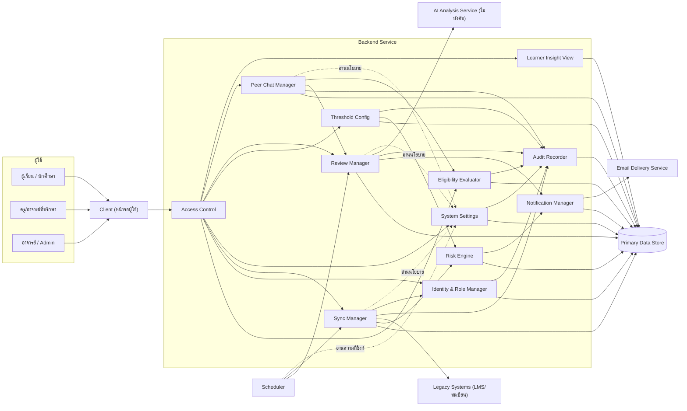
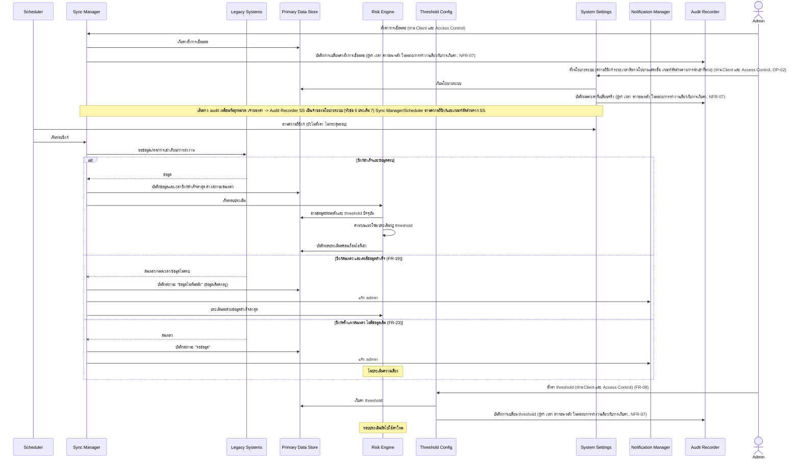
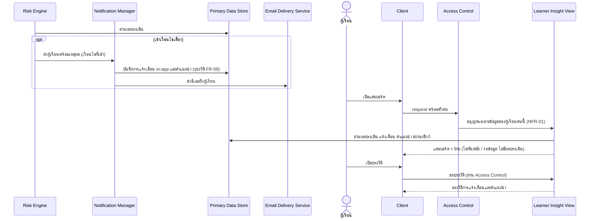
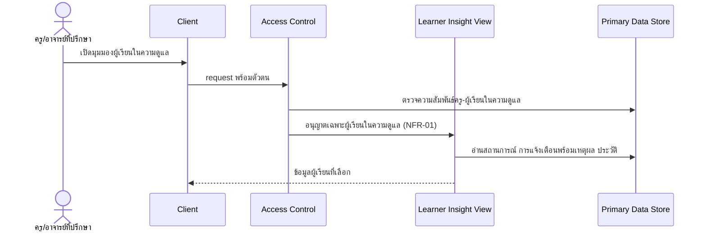
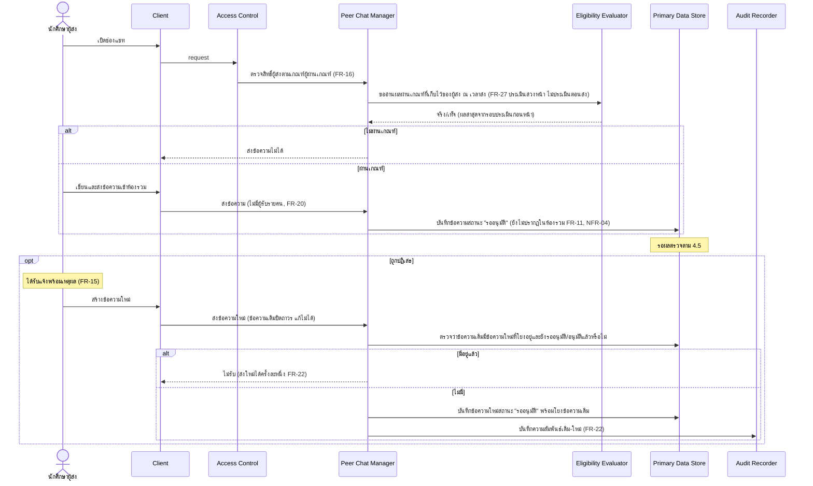
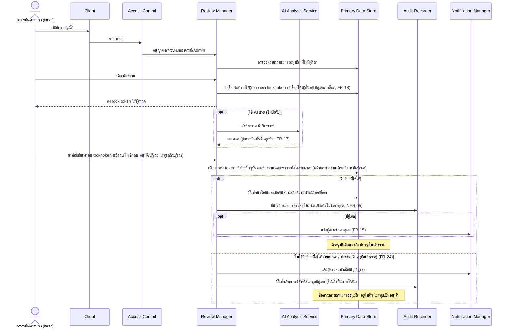
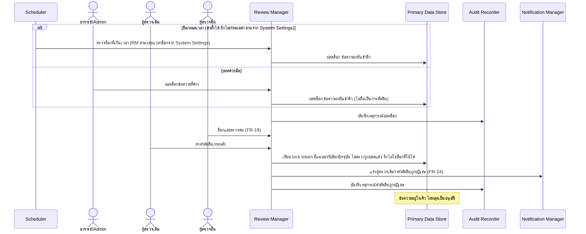
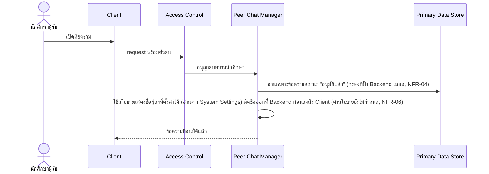
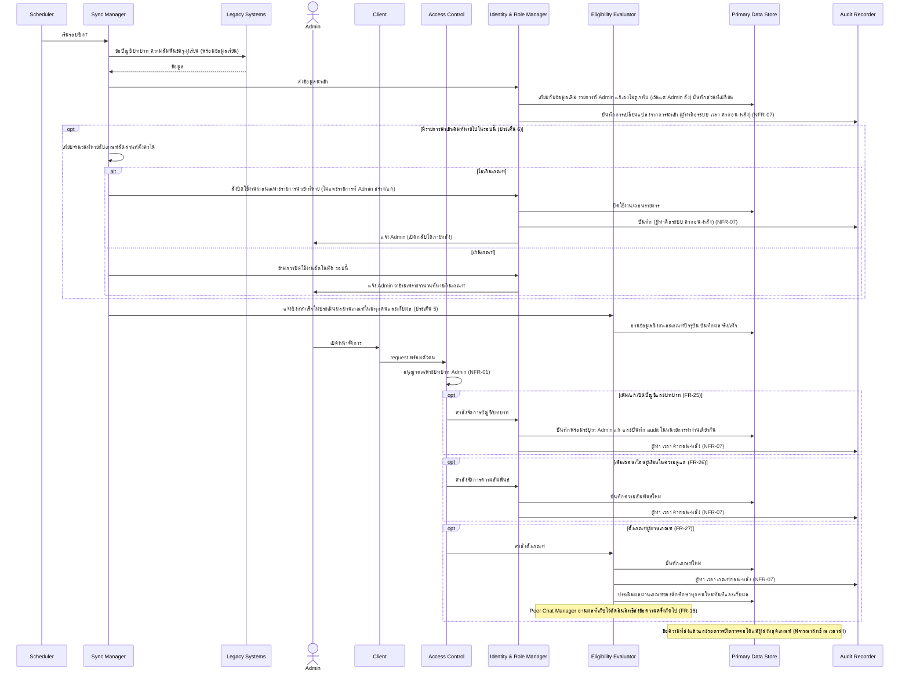

# High Level Architecture

สถาปัตยกรรมระดับ logical/conceptual ของระบบ ที่มาจาก [[../feature-list|Feature List]], [[../user-journey|User Journey]] และ NFR ใน [[../../01-requirements/backlog|Backlog]]

เอกสารนี้เขียนเป็น logical component ล้วน ไม่ระบุ technology ใดๆ โดยตั้งใจ technology ที่ตัดสินใจแล้วอยู่ใน [[technology-stack]] (ตอนนี้ตัดสินใจเฉพาะที่เก็บข้อมูล) รายละเอียดระดับ implementation เป็นงานของ detailed-design ชั้นถัดไป

Spec ต้นทาง: [[../../01-requirements/01-spec/20261014-01-student-risk-alert|REQ-01 ติดตามและแจ้งเตือนความเสี่ยง]], [[../../01-requirements/01-spec/20261014-02-peer-advice-chat|REQ-02 ช่องแชทแนะนำแนวทางการเรียน]], [[../../01-requirements/01-spec/20261016-01-sync-failure-handling|REQ-03 ซิงก์ล้มเหลว]], [[../../01-requirements/01-spec/20261016-02-peer-chat-recipients-lock-resubmit|REQ-04 ห้องรวม ปลดล็อก ส่งใหม่]], [[../../01-requirements/01-spec/20261016-03-first-sync-failure-and-expired-lock-decision|REQ-05 ซิงก์ครั้งแรกล้มเหลว และคำตัดสินเมื่อไม่ถือล็อก]], [[../../01-requirements/01-spec/20261017-01-user-role-advisor-eligibility-management|REQ-06 จัดการบัญชี บทบาท ความสัมพันธ์ครู-ผู้เรียน และเกณฑ์ผู้ผ่านเกณฑ์]]

## 1. ภาพรวม

ระบบมี 3 กลุ่มความสามารถที่ใช้ผู้ใช้และข้อมูลร่วมกัน

1. **ติดตามและแจ้งเตือนความเสี่ยงของผู้เรียน** (ฟีเจอร์ 1-9, 18): ดึงข้อมูลจากระบบเดิมเป็นระยะ คำนวณแนวโน้ม ประเมินความเสี่ยงด้วยกฎ threshold แจ้งเตือนพร้อมเหตุผล และให้คำแนะนำ
2. **ช่องแชทแนะนำแนวทางการเรียนที่ผ่านการตรวจ** (ฟีเจอร์ 10-17, 19-22): นักศึกษาผู้ผ่านเกณฑ์ส่งข้อความเข้าห้องรวม ข้อความต้องผ่านการตรวจของอาจารย์/Admin ก่อนผู้อื่นเห็น
3. **จัดการบัญชี บทบาท ความสัมพันธ์ครู-ผู้เรียน และเกณฑ์ผู้ผ่านเกณฑ์** (ฟีเจอร์ 23-26): เป็นที่มาของข้อมูลบทบาท ความสัมพันธ์ และผลผ่านเกณฑ์ที่สองกลุ่มแรกพึ่งพา นำเข้าจากระบบเดิมผ่านกลไกซิงก์เดียวกับ FR-01 และ Admin แก้ไขในระบบนี้ได้ ทุกการเปลี่ยนแปลงมี audit trail (NFR-07) การยืนยันตัวตน/สมัครเองอยู่นอกขอบเขตตาม spec

หลักการออกแบบที่ขับเคลื่อนโดย NFR
- ทุกการเข้าถึงข้อมูลต้องผ่านการตรวจสิทธิ์ตามบทบาทที่ Backend Service จุดเดียว (NFR-01, NFR-04)
- สถานะของข้อความและการตัดสินเปลี่ยนได้ผ่านขั้นตอนที่ควบคุมเท่านั้น และการตรวจสอบล็อก การบันทึกผล และการเปลี่ยนสถานะต้องสำเร็จพร้อมกันหรือไม่สำเร็จเลย (FR-18, FR-21, FR-24, NFR-04, NFR-05)
- ผลการประเมินความเสี่ยงต้องย้อนอธิบายได้ว่าเข้าเงื่อนไขใด (NFR-02)
- สิทธิ์ที่ขึ้นกับบทบาทตัดสินจากข้อมูลบทบาทในระบบนี้เท่านั้น และการเปลี่ยนบัญชี/บทบาท/ความสัมพันธ์/เกณฑ์ต้องย้อนตรวจสอบได้ (FR-25, FR-26, NFR-07)

## 2. Logical Component

| Component | ประเภท | ขอบเขตความรับผิดชอบ |
|-----------|--------|----------------------|
| Client (หน้าจอผู้ใช้) | ภายในระบบ | แสดงหน้าจอตามบทบาท (ผู้เรียน, ครู/อาจารย์ที่ปรึกษา, นักศึกษาผู้ส่ง/ผู้รับ, อาจารย์/Admin) รับ input และแสดงผล ไม่ตัดสินสิทธิ์เอง และไม่ถือข้อมูลที่ผู้ใช้ไม่มีสิทธิ์เห็น |
| Backend Service | ภายในระบบ | ศูนย์กลาง business logic ทั้งหมด ประกอบด้วยโมดูลเชิงตรรกะตามตารางข้างล่าง |
| Primary Data Store | ภายในระบบ | เก็บข้อมูลถาวรทั้งหมด: ข้อมูลที่ซิงก์ ผลประเมิน การแจ้งเตือน คำแนะนำ ข้อความ สถานะข้อความ ล็อก คำตัดสิน audit trail ค่า threshold ค่าตั้งการเชื่อมต่อ บัญชีผู้ใช้ บทบาท ความสัมพันธ์ครู-ผู้เรียน เกณฑ์ผู้ผ่านเกณฑ์และผลประเมินเกณฑ์ |
| Scheduler (ตัวกำหนดเวลา) | ภายในระบบ | กระตุ้นงานตามเวลา: รอบซิงก์ข้อมูล (ความถี่ยังไม่กำหนด, NFR-03) และการปลดล็อกอัตโนมัติเมื่อล็อกหมดเวลา (FR-21) |
| Legacy Systems (LMS/ทะเบียน) | ภายนอก | แหล่งข้อมูลเกรด การเข้าเรียน การส่งงาน เปิดให้ดึงผ่าน API (FR-01) |
| Email Delivery Service (บริการส่งอีเมล) | ภายนอก | ส่งอีเมลแจ้งเตือนความเสี่ยงถึงผู้เรียน (FR-04) |
| AI Analysis Service (บริการวิเคราะห์ด้วย AI) | ภายนอก/ไม่บังคับ | เสนอผลวิเคราะห์เชิงลบ/ไม่เชิงลบให้ผู้ตรวจ (FR-17 ระดับต่ำ) ผู้ตรวจยืนยันขั้นสุดท้ายเสมอ |

### โมดูลเชิงตรรกะภายใน Backend Service

| โมดูล | ความรับผิดชอบ | FR/NFR |
|-------|----------------|--------|
| Access Control | ตรวจตัวตนและสิทธิ์ตามบทบาททุก request ก่อนเข้าถึงข้อมูลหรือสั่งงาน อ่านบทบาทและสถานะบัญชีจาก Identity & Role Manager (บัญชีที่ปิดใช้งานไม่ผ่านสิทธิ์) และความสัมพันธ์ครู-ผู้เรียนจากโมดูลเดียวกัน กำหนดว่าผู้เรียนเห็นเฉพาะข้อมูลตน ครูเห็นเฉพาะผู้เรียนในความดูแล นักศึกษาเห็นเฉพาะข้อความที่อนุมัติ และเฉพาะ Admin เข้าถึงการจัดการบัญชี/บทบาท/ความสัมพันธ์/เกณฑ์ ส่วนสิทธิ์ส่งข้อความ (FR-16) อาศัยผลจาก Eligibility Evaluator | NFR-01, NFR-04, FR-16, FR-25, FR-26 |
| Sync Manager | ดึงข้อมูลจาก Legacy Systems ตรวจความครบถ้วน/รูปแบบ ตัดสินผลซิงก์ (สำเร็จ/ล้มเหลว/ล้มเหลวครั้งแรก) เก็บข้อมูลซิงก์สำเร็จล่าสุดและสถานะซิงก์ แจ้ง admin เมื่อล้มเหลว ดึงข้อมูลบัญชี บทบาท และความสัมพันธ์ครู-ผู้เรียนส่งต่อให้ Identity & Role Manager ด้วย (กลไกเดียวกับ FR-01) เทียบจำนวนรายการนำเข้าที่หายในรอบนี้กับเกณฑ์สัดส่วนที่ตั้งค่าได้ ถ้าเกินเกณฑ์ให้ข้ามการปิดใช้งานอัตโนมัติ (ดูหัวข้อ 6 ประเด็น 6) รับและเก็บค่าตั้งการเชื่อมต่อ (OP-01) และส่งการเปลี่ยนให้ Audit Recorder (NFR-07) ส่วนความถี่ซิงก์และเกณฑ์สัดส่วนอ่านจาก System Settings | FR-01, FR-19, FR-23, FR-25, FR-26, NFR-03 |
| Identity & Role Manager | เก็บบัญชีผู้ใช้ บทบาท (นักศึกษา, ครู/อาจารย์ที่ปรึกษา, อาจารย์, Admin) และความสัมพันธ์ครู-ผู้เรียน (ศูนย์ถึงหลายผู้ดูแลต่อผู้เรียน) รับข้อมูลนำเข้าจาก Sync Manager และรับการเพิ่ม/แก้/ปิดบัญชี/ถอน/โอนความสัมพันธ์จาก Admin ระบุแหล่งที่มาของข้อมูลแต่ละรายการ (นำเข้า/Admin แก้) เพื่อไม่ให้การนำเข้ารอบถัดไปทับค่าที่ Admin แก้ เว้นแต่ Admin สั่ง ส่งทุกการเปลี่ยนแปลงให้ Audit Recorder ในหน่วยการทำงานเดียวกัน เมื่อรายการนำเข้า (เฉพาะรายการที่มาจากการนำเข้า ไม่แตะรายการที่ Admin สร้างหรือแก้) หายไปในรอบนำเข้าถัดไป และ Sync Manager ไม่ได้สั่งข้าม จะปิดใช้งาน/ถอนอัตโนมัติ แจ้ง Admin และ Admin เปิดกลับได้ (ดูหัวข้อ 6 ประเด็น 6) ไม่ทำการยืนยันตัวตน/สมัครเอง | FR-25, FR-26, NFR-07 |
| Eligibility Evaluator | รับและเก็บเกณฑ์ "ผู้ผ่านเกณฑ์" ที่ Admin ตั้ง (องค์ประกอบของเกณฑ์ยังไม่กำหนด จึงเก็บเป็นค่าตั้งได้) ประเมินเกณฑ์จากข้อมูลที่ซิงก์ล่วงหน้าและเก็บผลจริง/เท็จต่อนักศึกษา ประเมินใหม่ทุกครั้งที่ซิงก์สำเร็จหรือ Admin เปลี่ยนเกณฑ์ ให้ Peer Chat Manager อ่านผลที่เก็บไว้เพื่อตัดสินสิทธิ์ส่ง ณ เวลาส่ง (ดูบันทึกการตัดสินใจ หัวข้อ 6 ประเด็น 5) ส่งการเปลี่ยนเกณฑ์ให้ Audit Recorder | FR-27, FR-16, NFR-07 |
| Risk Engine | คำนวณแนวโน้ม ประเมินความเสี่ยงหลายตัวแปรด้วยกฎ threshold บันทึกเงื่อนไขที่เข้าเป็นเหตุผล สร้างคำแนะนำเฉพาะบุคคล (ผู้เรียนใหม่ใช้กฎพื้นฐาน) ไม่ประเมินถ้ายังไม่เคยมีข้อมูลซิงก์สำเร็จ | FR-02, FR-03, FR-05, FR-23, NFR-02 |
| System Settings | เป็นเจ้าของนโยบายระบบชุดเดียว 4 ค่า: ความถี่ซิงก์ ระยะเวลาล็อกของ Review Manager นโยบายแสดงชื่อผู้ส่ง และเกณฑ์สัดส่วนรายการนำเข้าที่หาย รับคำสั่งตั้งค่าจาก Admin (OP-02) บันทึกเฉพาะค่าที่เปลี่ยนจริงพร้อมส่ง audit ให้ Audit Recorder ในหน่วยการทำงานเดียวกับการเก็บค่า ให้ Scheduler, Sync Manager, Review Manager และ Peer Chat Manager อ่านค่า (ค่าที่ออกไปแล้ว เช่น ล็อกที่ออกก่อนเปลี่ยนระยะเวลา คงเวลาเดิม) | NFR-03, NFR-06, NFR-07, FR-21 |
| Threshold Config | รับและเก็บค่า threshold จาก admin ให้ Risk Engine ใช้ในรอบประเมินถัดไป ส่งการเปลี่ยนค่าให้ Audit Recorder (ผู้ทำ เวลา ค่าก่อน-หลัง) | FR-08, NFR-07 |
| Notification Manager | สร้างและส่งการแจ้งเตือนผ่านช่องทางในระบบ (in-app) และอีเมล แจ้ง admin เมื่อซิงก์ล้มเหลว แจ้งผู้ส่งเมื่อถูกปฏิเสธ แจ้งผู้ตรวจเมื่อคำตัดสินถูกปฏิเสธ | FR-04, FR-15, FR-19, FR-23, FR-24 |
| Learner Insight View | รวมข้อมูลแดชบอร์ดผู้เรียน มุมมองครู (จำกัดเฉพาะผู้เรียนในความดูแลตามความสัมพันธ์จาก Identity & Role Manager) ประวัติการแจ้งเตือน/คำแนะนำ และป้ายสถานะข้อมูล (ไม่ทันสมัย/รอข้อมูล) | FR-06, FR-07, FR-09, FR-19, FR-23, FR-26 |
| Peer Chat Manager | ตรวจสิทธิ์ผู้ส่งโดยถามผลผ่านเกณฑ์จาก Eligibility Evaluator ณ เวลาส่ง (ผู้ส่งที่หลุดเกณฑ์ภายหลังไม่กระทบข้อความที่ส่งแล้ว) ก่อนรับข้อความส่งใหม่หลังถูกปฏิเสธ ตรวจว่าข้อความเดิมนั้นมีข้อความใหม่ที่โยงอยู่และยังรออนุมัติหรืออนุมัติแล้วหรือไม่ ถ้ามีไม่รับ (ส่งใหม่ได้ครั้งละหนึ่ง FR-22) รับข้อความเข้าสถานะรออนุมัติ สร้างข้อความใหม่หลังถูกปฏิเสธและโยงกับข้อความเดิม ให้บริการห้องรวมที่คืนเฉพาะข้อความอนุมัติแล้ว | FR-10, FR-11, FR-16, FR-20, FR-22, NFR-04, NFR-06 |
| Review Manager | จัดคิวรออนุมัติ ล็อกข้อความกันตรวจซ้ำ ตรวจความถูกต้องของล็อกตอนรับคำตัดสิน รับการระบุเชิงลบ/ไม่เชิงลบ อนุมัติ/ปฏิเสธ (ต้องมีเหตุผล) ปลดล็อกอัตโนมัติ/ด้วยมือ ปฏิเสธคำตัดสินที่ไม่ถือล็อกที่ใช้ได้ ตรวจข้อความที่รอตรวจต่อได้แม้ผู้ส่งหลุดเกณฑ์หลังส่ง (ไม่ตรวจเกณฑ์ซ้ำ) | FR-12, FR-13, FR-14, FR-15, FR-17, FR-18, FR-21, FR-24 |
| Audit Recorder | บันทึกประวัติการตรวจ (ใคร ผลตัดสิน เชิงลบ/ไม่เชิงลบ เหตุผล) ความสัมพันธ์ข้อความเดิม-ใหม่ และเหตุการณ์ล็อก/ปลดล็อก/คำตัดสินที่ถูกปฏิเสธ และประวัติการเปลี่ยนบัญชี บทบาท ความสัมพันธ์ครู-ผู้เรียน เกณฑ์ผู้ผ่านเกณฑ์ ค่าตั้งการเชื่อมต่อระบบเดิม นโยบายระบบ (ความถี่ซิงก์ ระยะเวลาล็อก นโยบายแสดงชื่อ เกณฑ์สัดส่วนรายการนำเข้าที่หาย) และ threshold ความเสี่ยง (ผู้ทำ เวลา ค่าก่อน-หลัง รวมการปิดใช้งาน/เปิดกลับอัตโนมัติจากการนำเข้า) | NFR-05, NFR-07, FR-22 |

## 3. Component Diagram

ทิศทางลูกศรคือทิศทางการเรียก Client ไม่เข้าถึง Primary Data Store หรือบริการภายนอกโดยตรง

## 4. Data Flow ตาม Journey หลัก

### 4.1 ซิงก์ข้อมูล ประเมินความเสี่ยง และตั้งค่า threshold
Journey: [[../user-journey#Journey: ผู้ดูแลระบบตั้งค่าการเชื่อมต่อและ threshold|ผู้ดูแลระบบตั้งค่าการเชื่อมต่อและ threshold]], ฟีเจอร์ 1, 2, 3, 18 (FR-01, FR-02, FR-03, FR-08, FR-19, FR-23, NFR-03)

### 4.2 ผู้เรียนรับแจ้งเตือน ดูแดชบอร์ด คำแนะนำ และประวัติ
Journey: [[../user-journey#Journey: ผู้เรียนรับแจ้งเตือนความเสี่ยงและคำแนะนำ|ผู้เรียนรับแจ้งเตือนความเสี่ยงและคำแนะนำ]], ฟีเจอร์ 4, 5, 6, 8, 9, 18 (FR-04, FR-05, FR-06, FR-09, FR-19, FR-23, NFR-01, NFR-02)

### 4.3 ครู/อาจารย์ที่ปรึกษาติดตามผู้เรียนในความดูแล
Journey: [[../user-journey#Journey: ครู/อาจารย์ที่ปรึกษาติดตามผู้เรียนในความดูแล|ครู/อาจารย์ที่ปรึกษาติดตามผู้เรียนในความดูแล]], ฟีเจอร์ 7, 8, 9 (FR-07, FR-09, NFR-01, NFR-02)

### 4.4 นักศึกษาผู้ส่งข้อความ และการส่งใหม่หลังถูกปฏิเสธ
Journey: [[../user-journey#Journey: นักศึกษาผู้ส่งข้อความแนะนำแนวทางการเรียน|นักศึกษาผู้ส่งข้อความแนะนำแนวทางการเรียน]], ฟีเจอร์ 10, 11, 13, 19, 21 (FR-10, FR-11, FR-15, FR-16, FR-20, FR-22, NFR-04)

### 4.5 อาจารย์/Admin ตรวจและตัดสินข้อความ (รวมกรณีไม่ถือล็อกที่ใช้ได้)
Journey: [[../user-journey#Journey: อาจารย์/Admin ตรวจและอนุมัติข้อความ|อาจารย์/Admin ตรวจและอนุมัติข้อความ]], ฟีเจอร์ 12, 13, 14, 15, 16, 22 (FR-12, FR-13, FR-14, FR-15, FR-17, FR-18, FR-24, NFR-04, NFR-05)

### 4.6 ปลดล็อกข้อความที่ผู้ตรวจค้าง (อัตโนมัติและด้วยมือ)
Journey: [[../user-journey#Journey: อาจารย์/Admin ปลดล็อกข้อความที่ผู้ตรวจค้างด้วยมือ|อาจารย์/Admin ปลดล็อกข้อความที่ผู้ตรวจค้างด้วยมือ]], ฟีเจอร์ 14, 20, 22 (FR-18, FR-21, FR-24, NFR-04, NFR-05)

### 4.7 นักศึกษาผู้รับอ่านห้องรวม
Journey: [[../user-journey#Journey: นักศึกษาผู้รับอ่านข้อความแนะนำ|นักศึกษาผู้รับอ่านข้อความแนะนำ]], ฟีเจอร์ 11, 17, 19 (FR-11, FR-20, NFR-04, NFR-06)

### 4.8 Admin จัดการบัญชี บทบาท ความสัมพันธ์ครู-ผู้เรียน และเกณฑ์ผู้ผ่านเกณฑ์
Journey: [[../user-journey#Journey: Admin จัดการบัญชี บทบาท ความสัมพันธ์ครู-ผู้เรียน และเกณฑ์ผู้ผ่านเกณฑ์|Admin จัดการบัญชี บทบาท ความสัมพันธ์ครู-ผู้เรียน และเกณฑ์ผู้ผ่านเกณฑ์]], ฟีเจอร์ 23, 24, 25, 26 (FR-25, FR-26, FR-27, FR-16, NFR-01, NFR-07)

## 5. NFR Mapping

| NFR | คำอธิบายสั้น | Component หลัก | แนวทางเชิงหลักการ |
|-----|--------------|----------------|--------------------|
| [[../../01-requirements/01-spec/20261014-01-student-risk-alert\|NFR-01]] | ความเป็นส่วนตัว จำกัดการมองเห็นตามบทบาท | Access Control (Backend Service) | ตรวจสิทธิ์ทุก request ก่อนเข้าถึงข้อมูล ผู้เรียนเห็นเฉพาะข้อมูลตน ครูเห็นเฉพาะผู้เรียนในความดูแล Client ไม่ถือข้อมูลเกินสิทธิ์ นโยบาย PDPA ที่ต้องยืนยันเป็นข้อกำหนดเพิ่มต่อ Access Control และการเก็บข้อมูลใน Primary Data Store |
| [[../../01-requirements/01-spec/20261014-01-student-risk-alert\|NFR-02]] | อธิบายได้ว่าเข้าเงื่อนไขใด | Risk Engine, Notification Manager | บันทึกเงื่อนไข/ค่าที่ทำให้เข้าเกณฑ์พร้อมผลประเมิน แล้วนำไปแสดงในแจ้งเตือนและมุมมองครู |
| [[../../01-requirements/01-spec/20261014-01-student-risk-alert\|NFR-03]] | ความทันสมัยของข้อมูล (ความถี่ยังไม่กำหนด) | Scheduler, Sync Manager, System Settings | ความถี่รอบซิงก์เป็นค่าตั้งได้ ไม่ฝังตายตัว เก็บที่ System Settings ให้ Scheduler อ่าน ไม่ตั้งค่าไม่กระตุ้นรอบ ตั้งค่าและ audit ผ่าน System Settings บันทึกเวลาซิงก์สำเร็จล่าสุดเพื่อแสดงสถานะไม่ทันสมัย (ดูบันทึกการตัดสินใจ หัวข้อ 6 ประเด็น 3) |
| [[../../01-requirements/01-spec/20261014-02-peer-advice-chat\|NFR-04]] | ผู้รับไม่เห็นข้อความที่ยังไม่อนุมัติ/ถูกปฏิเสธ | Peer Chat Manager, Access Control, Review Manager | ห้องรวมอ่านเฉพาะสถานะอนุมัติแล้ว กรองที่ Backend Service เสมอ ไม่พึ่งการซ่อนที่ Client การเปลี่ยนเป็นอนุมัติทำผ่าน Review Manager พร้อมตรวจล็อกเท่านั้น คำตัดสินที่ไม่ถือล็อกที่ใช้ได้ไม่เปลี่ยนสถานะ (FR-24) (ดูบันทึกการตัดสินใจ หัวข้อ 6 ประเด็น 1, 2) |
| [[../../01-requirements/01-spec/20261014-02-peer-advice-chat\|NFR-05]] | audit trail ของการตรวจ | Audit Recorder, Review Manager | บันทึกทุกการตัดสิน ผู้ตัดสิน เชิงลบ/ไม่เชิงลบ เหตุผล ความสัมพันธ์ข้อความเดิม-ใหม่ และเหตุการณ์ล็อก/ปลดล็อก/คำตัดสินที่ถูกปฏิเสธ การบันทึกอยู่ในหน่วยการทำงานเดียวกับการเปลี่ยนสถานะ ผลตัดสินจึงไม่เกิดโดยไม่มี audit |
| [[../../01-requirements/01-spec/20261014-02-peer-advice-chat\|NFR-06]] | การแสดงชื่อผู้ส่ง (ยังไม่กำหนด) | Peer Chat Manager, System Settings | เก็บตัวตนผู้ส่งไว้เสมอ (จำเป็นต่อ audit และ FR-22) นโยบายแสดงชื่อเก็บที่ System Settings และ Peer Chat Manager อ่านไปใช้ที่ชั้นแสดงผล ปรับได้โดยไม่กระทบโครงสร้าง (ดูบันทึกการตัดสินใจ หัวข้อ 6 ประเด็น 4) |
| [[../../01-requirements/01-spec/20261017-01-user-role-advisor-eligibility-management\|NFR-07]] | audit trail การเปลี่ยนบัญชี/บทบาท/ความสัมพันธ์/เกณฑ์ผู้ผ่านเกณฑ์ รวมค่าตั้งการเชื่อมต่อระบบเดิม นโยบายระบบ (ความถี่ซิงก์ ระยะเวลาล็อก นโยบายแสดงชื่อ เกณฑ์สัดส่วนรายการนำเข้าที่หาย) และ threshold ความเสี่ยง (FR-08) | Audit Recorder (ผู้บันทึก) และเจ้าของค่าแต่ละหมวดเป็นผู้ส่ง: Identity & Role Manager (บัญชี บทบาท ความสัมพันธ์ รวมการปิด/เปิดกลับอัตโนมัติ), Eligibility Evaluator (เกณฑ์ผ่านเกณฑ์), Sync Manager (ค่าตั้งการเชื่อมต่อ OP-01), Threshold Config (threshold OP-03), System Settings (นโยบายระบบ OP-02 ทั้ง 4 ค่า หัวข้อ 6 ประเด็น 7) โดยผู้ใช้ค่าตั้งที่อ่านจาก System Settings คือ Scheduler/Sync Manager (ความถี่ซิงก์ และเกณฑ์สัดส่วนรายการนำเข้าที่หาย), Review Manager (ระยะเวลาล็อก), Peer Chat Manager (นโยบายแสดงชื่อ) | ทุกการเปลี่ยน (ทั้งจาก Admin และจากการนำเข้า รวมการปิดใช้งาน/เปิดกลับอัตโนมัติ) บันทึกผู้ทำ เวลา ค่าก่อน-หลัง อยู่ในหน่วยการทำงานเดียวกับการเปลี่ยนข้อมูล โดยทุกหมวด (OP-01/02/03) ใช้เส้นทางเดียวกัน คือเจ้าของค่า -> Audit Recorder ค่าที่ออกแล้ว (เช่น ล็อกที่ออกก่อนเปลี่ยนระยะเวลา) คงเวลาเดิม จึงไม่มีการเปลี่ยนที่ไม่มี audit ผู้อ่านประวัติจำกัดเฉพาะ Admin (ต่อยอด NFR-01, NFR-05) |

หมายเหตุ NFR-01 เพิ่มเติม: สิทธิ์ตามบทบาทและขอบเขตครู-ผู้เรียนอ่านจาก Identity & Role Manager (FR-25, FR-26) ส่วนผลผ่านเกณฑ์สำหรับ FR-16 มาจาก Eligibility Evaluator (FR-27)

หมายเหตุ: ไม่พบความต้องการเชิงระบบที่ไม่มี FR/NFR รองรับจากการเพิ่ม REQ-06 (audit ครอบด้วย NFR-07) FR-24 และ FR-18/FR-21 (ระดับสูง/กลาง) ใช้กลไกเดียวกันที่ Review Manager จึงไม่เพิ่ม component ใหม่

## 6. บันทึกการตัดสินใจเชิงสถาปัตยกรรม

ผู้ใช้ตัดสินใจครบ 7 ประเด็นเมื่อ 2026-10-17 (ประเด็น 1-5 และ 7 เลือกทาง A ประเด็น 6 เลือกทาง C ประเด็น 5-7 ตัดสินใจเพิ่มหลังเพิ่ม REQ-06)

| ประเด็น | ตัวเลือกที่เสนอ (ข้อดี/ข้อเสีย) | ทางที่ผู้ใช้เลือก | เหตุผล | วันที่ |
|---------|-------------------------------|-------------------|--------|--------|
| 1. กลไกยืนยันล็อกตอนรับคำตัดสิน (FR-18, FR-21, FR-24) | A lock token: ล็อกแต่ละครั้งมีเลขอ้างอิงเฉพาะ คำตัดสินต้องแนบเลข Review Manager เทียบกับล็อกปัจจุบันในหน่วยการทำงานเดียวกับการเปลี่ยนสถานะ ข้อดี: ครอบคลุมทั้ง 3 สาเหตุของ FR-24 แม่นยำ แยกล็อกเก่า/ใหม่ของผู้ตรวจคนเดิมได้ ข้อเสีย: ต้องเก็บและส่งเลขเพิ่ม / B ตรวจผู้ถือล็อกและเวลาหมดอายุ: ข้อดี: เรียบง่าย ข้อเสีย: แยกล็อกเก่า/ใหม่ของคนเดิมไม่ได้ NFR-04 เสี่ยงกรณีขอบ / C เลขเวอร์ชันสถานะข้อความ: ข้อดี: ไม่ต้องมีแนวคิดล็อกแยก ข้อเสีย: ไม่สะท้อนล็อกหมดเวลา/ปลดมือโดยตรง ต้องมีกฎเสริม | A lock token | ป้องกันคำตัดสินหลุดเป็นอนุมัติได้แน่นที่สุด ตอบ NFR-04 และ NFR-05 | 2026-10-17 |
| 2. การแยกข้อความที่อนุมัติแล้วออกจากข้อความรออนุมัติ/ถูกปฏิเสธ (NFR-04, FR-20) | A ที่เก็บเดียว ห้องรวมอ่านผ่านจุดเดียวใน Peer Chat Manager ที่กรองเฉพาะสถานะอนุมัติแล้ว ข้อดี: เรียบง่าย สถานะเป็นแหล่งความจริงเดียว ข้อเสีย: พึ่งวินัยของทุกเส้นทางอ่าน / B published view แยก: ข้อดี: ข้อความที่ยังไม่อนุมัติไม่อยู่ในเส้นทางอ่านของห้องรวม ข้อเสีย: ต้องซิงก์สองที่ / C แยกที่เก็บเชิงตรรกะ 2 ส่วน: ข้อดี: แยกชัดที่สุด ข้อเสีย: ซับซ้อนสุด โยง audit/FR-22 ข้ามส่วน | A จุดอ่านเดียวกรองสถานะ | โครงสร้างเรียบง่ายและเพียงพอต่อ NFR-04 เมื่อบังคับว่าต้องอ่านผ่านจุดเดียว | 2026-10-17 |
| 3. จังหวะเริ่มรอบประเมินความเสี่ยง (FR-01, FR-03, NFR-03) | A ประเมินหลังทุกรอบซิงก์ (สำเร็จ หรือล้มเหลวแล้วใช้ข้อมูลเดิม) ข้อดี: ผลตามข้อมูลล่าสุด แจ้งเตือนทันเวลา ข้อเสีย: ประเมินซ้ำแม้ข้อมูลไม่เปลี่ยน / B ประเมินเมื่อข้อมูลเปลี่ยนจริง: ข้อดี: ลดงานซ้ำ ข้อเสีย: ต้องมีกลไกตรวจการเปลี่ยนแปลงและกระตุ้นเมื่อ threshold เปลี่ยน / C ประเมินเมื่อมีผู้เปิดดู: ข้อดี: ไม่เสียงานกับผู้ที่ไม่เปิดดู ข้อเสีย: แจ้งเตือนเชิงรุก (FR-04) ทำไม่ได้ | A ประเมินหลังทุกรอบซิงก์ | ได้ผลล่าสุดและรองรับการแจ้งเตือนเชิงรุก ตอบ NFR-03 | 2026-10-17 |
| 4. นโยบายแสดงชื่อผู้ส่ง (NFR-06 ยังไม่กำหนดใน spec) | A เก็บตัวตนผู้ส่งเสมอ Backend ตัดชื่อออกจากข้อมูลที่ส่งให้ Client ตามนโยบายที่ตั้งค่าได้ ข้อดี: เปลี่ยนนโยบายได้โดยไม่แตะข้อมูล รองรับ audit และ FR-22 ข้อเสีย: ต้องมีค่าตั้งนโยบาย / B แสดงชื่อเสมอ: ข้อดี: ง่ายที่สุด ข้อเสีย: เสี่ยงขัดความเป็นส่วนตัว / C ซ่อนชื่อเสมอ: ข้อดี: ส่วนตัวสูงสุดฝั่งผู้รับ ข้อเสีย: เปลี่ยนภายหลังต้องแก้ชั้นแสดงผล | A เก็บตัวตนไว้เสมอ ตัดชื่อที่ Backend ตามนโยบายที่ตั้งค่าได้ | spec ยังไม่กำหนดนโยบาย ทางนี้เปลี่ยนนโยบายได้โดยไม่กระทบโครงสร้างและ audit ตอบ NFR-06, NFR-01, NFR-05 | 2026-10-17 |
| 5. จังหวะประเมินผลผ่านเกณฑ์ (FR-27, FR-16) | A ประเมินล่วงหน้าแล้วเก็บผล ประเมินใหม่ทุกครั้งที่ซิงก์สำเร็จหรือ Admin เปลี่ยนเกณฑ์ Peer Chat Manager อ่านผลที่เก็บไว้ ข้อดี: ตอบเร็วตอนส่ง สอดคล้องประเด็น 3 ข้อเสีย: ผลอาจล้าหลังจนถึงรอบถัดไป ต้องประเมินนักศึกษาทั้งหมดเมื่อเกณฑ์เปลี่ยน / B ประเมินตอนส่งทุกครั้ง: ข้อดี: ตรง ณ เวลาส่งที่สุด ไม่ต้องเก็บผลซ้ำ ข้อเสีย: ภาระตอนส่ง ต้องเก็บข้อมูลประกอบการตัดสินเพื่อ audit / C ผสม ประเมินล่วงหน้าและประเมินซ้ำรายตอนส่งเมื่อข้อมูล/เกณฑ์เปลี่ยน: ข้อดี: สมดุลความสดและความเร็ว ข้อเสีย: ซับซ้อนที่สุด | A ประเมินล่วงหน้าแล้วเก็บผล | เรียบง่าย ตอบเร็ว และสอดรับกับจังหวะรอบประเมินหลังซิงก์ (ประเด็น 3) ตอบ FR-27, FR-16 | 2026-10-17 |
| 6. รายการนำเข้าจากระบบเดิมที่หายไปในรอบนำเข้าถัดไป (FR-25, FR-26, FR-01) | A ไม่แตะ (คงรายการเดิมไว้): ข้อดี: เรียบง่าย ไม่ปิดผิดพลาด ข้อเสีย: บัญชี/ความสัมพันธ์ที่ถูกถอนในระบบเดิมยังมีสิทธิ์ค้าง เสี่ยงต่อ NFR-01 / B ปิดใช้งานทันที: ข้อดี: สิทธิ์ตรงกับระบบเดิมเสมอ ข้อเสีย: ถ้านำเข้าพลาด (ข้อมูลขาดครึ่งหนึ่ง) จะปิดผู้ใช้จำนวนมากโดยไม่ตั้งใจ / C ปิดใช้งาน/ถอนอัตโนมัติเฉพาะรายการนำเข้า แจ้ง Admin เปิดกลับได้ และข้ามถ้าจำนวนที่หายเกินเกณฑ์ที่ตั้งค่า (ตาข่ายกันพลาด): ข้อดี: สิทธิ์ตามระบบเดิม กันความเสียหายจากการนำเข้าผิดพลาด ไม่แตะรายการที่ Admin สร้าง/แก้ ข้อเสีย: ต้องมีค่าเกณฑ์สัดส่วนและกลไกแจ้ง/เปิดกลับ | C ปิดอัตโนมัติ + แจ้ง Admin + ตาข่ายกันพลาด | สิทธิ์ตามระบบเดิมโดยไม่ทำให้การนำเข้าผิดพลาดสร้างความเสียหายวงกว้าง ตอบ NFR-01, NFR-07 (เกณฑ์สัดส่วนเป็นนโยบายที่ audit) | 2026-10-17 |
| 7. ผู้เป็นเจ้าของนโยบายระบบ OP-02 (ความถี่ซิงก์ ระยะเวลาล็อก นโยบายแสดงชื่อ เกณฑ์สัดส่วนรายการนำเข้าที่หาย) (NFR-03, NFR-06, NFR-07, FR-21) | A เพิ่มโมดูลใหม่ System Settings เป็นเจ้าของนโยบายระบบทั้งหมด: ข้อดี: ความรับผิดชอบชัด จุดเดียวรับ OP-02 และส่ง audit ตรงกับ SystemPolicy ชุดเดียว ข้อเสีย: เพิ่มโมดูล โมดูลอื่นต้องอ่านค่าจากโมดูลนี้ / B ขยาย Threshold Config เป็นเจ้าของค่าตั้งทั้งหมด: ข้อดี: ไม่เพิ่มโมดูล ข้อเสีย: ขอบเขตไม่ตรงกับเนื้อหา (นโยบายล็อก/ชื่อไม่เกี่ยวกับความเสี่ยง) ownership ปนกับ FR-08 / C แต่ละโมดูลเป็นเจ้าของค่าตั้งของตัวเอง: ข้อดี: ใกล้การใช้งาน ไม่เพิ่มโมดูล ข้อเสีย: OP-02 เป็นคำสั่งเดียวแต่กระจายหลายโมดูล ต้องคุมเส้นทาง audit ให้เหมือนกันเอง เสี่ยงหลุดบางหมวด | A โมดูล System Settings ใหม่ | จุดเดียวรับ OP-02 และส่ง audit ปิดช่องว่าง NFR-07 ชัดสุด ปรับค่าตาม NFR-03/NFR-06 ได้ที่เดียว | 2026-10-17 |

ผลต่อโครงสร้าง
- Review Manager ออก lock token ทุกครั้งที่ล็อก คำตัดสินต้องแนบ token และการเทียบ token การบันทึกผล และการเปลี่ยนสถานะอยู่ในหน่วยการทำงานเดียวกัน (4.5, 4.6)
- ห้องรวมอ่านผ่านจุดเดียวใน Peer Chat Manager ที่กรองสถานะอนุมัติแล้ว (4.7)
- รอบประเมินเริ่มต่อจากทุกรอบซิงก์ (4.1)
- นโยบายแสดงชื่อผู้ส่งเป็นค่าตั้งที่ Backend (4.7)
- Eligibility Evaluator ประเมินผลผ่านเกณฑ์ล่วงหน้าและเก็บผลประเมินใหม่ทุกครั้งที่ซิงก์สำเร็จหรือ Admin เปลี่ยนเกณฑ์ Peer Chat Manager อ่านผลที่เก็บไว้ ณ เวลาส่ง (4.4, 4.8)
- รายการนำเข้าที่หายไปในรอบนำเข้าถัดไปถูกปิดใช้งาน/ถอนอัตโนมัติเฉพาะรายการนำเข้า แจ้ง Admin เปิดกลับได้ และข้ามเมื่อจำนวนที่หายเกินเกณฑ์สัดส่วนที่ตั้งค่า (4.8)
- System Settings เป็นเจ้าของนโยบายระบบทั้ง 4 ค่า (OP-02) รับคำสั่งจาก Admin และส่ง audit ในหน่วยการทำงานเดียวกับการเก็บค่า Sync Manager/Scheduler, Review Manager และ Peer Chat Manager อ่านค่าจากโมดูลนี้ (4.1, 4.5-4.7)

## 7. ประเด็นรอตัดสินใจ

ประเด็นเชิงโครงสร้างทั้ง 7 ข้อที่เคยรอตัดสินใจ ได้ตัดสินแล้วและย้ายไปหัวข้อ 6 เหลือเฉพาะประเด็นเชิง technology

### ประเด็นเชิง technology (รอ technology-stack.md)
- รูปแบบการรันงานตามเวลา การเก็บข้อมูล การส่งอีเมล และบริการ AI ภายนอก (FR-17 ระดับต่ำ ยังไม่ชัดว่าใช้ในช่วงแรกหรือไม่) ให้ตัดสินใจที่ [[technology-stack]]

## 8. เอกสารที่เกี่ยวข้อง
- [[../../01-requirements/01-spec/20261017-01-user-role-advisor-eligibility-management|REQ-06 จัดการบัญชี บทบาท ความสัมพันธ์ และเกณฑ์ผ่านเกณฑ์]]
- [[../feature-list|Feature List]]
- [[../user-journey|User Journey]]
- [[../../01-requirements/backlog|Backlog]]
- [[technology-stack]] (ยังไม่มีเนื้อหา)
