# DB Spec (โมเดลข้อมูลเชิง logical)

โมเดลข้อมูลระดับ logical (Entity-Attribute-Relationship) ที่รองรับ [[api-spec|API Spec]] และ [[architecture|High Level Architecture]] ทุก entity ตรงกับสิ่งที่ "Primary Data Store" ใน architecture ต้องเก็บ ที่มา: [[../feature-list|Feature List]], [[../user-journey|User Journey]], [[../../01-requirements/backlog|Backlog]]

เอกสารนี้ไม่ระบุ technology ใดๆ ไม่ระบุว่าเป็นฐานข้อมูลแบบใด และใช้ชนิดข้อมูลเชิงตรรกะเท่านั้น (ข้อความ, ตัวเลข, วันที่-เวลา, จริง/เท็จ, ตัวเลือก, อ้างอิงถึง Entity อื่น) เพราะ `technology-stack.md` ยังไม่มีเนื้อหา (ยังไม่ตัดสินใจ) ประเด็นที่ต้องรอ technology อยู่ในหัวข้อ "ประเด็นรอตัดสินใจ"

Spec ต้นทาง: [[../../01-requirements/01-spec/20261014-01-student-risk-alert|REQ-01]], [[../../01-requirements/01-spec/20261014-02-peer-advice-chat|REQ-02]], [[../../01-requirements/01-spec/20261016-01-sync-failure-handling|REQ-03]], [[../../01-requirements/01-spec/20261016-02-peer-chat-recipients-lock-resubmit|REQ-04]], [[../../01-requirements/01-spec/20261016-03-first-sync-failure-and-expired-lock-decision|REQ-05]], [[../../01-requirements/01-spec/20261017-01-user-role-advisor-eligibility-management|REQ-06]]

## 1. ข้อตกลงการอ่านเอกสาร

- ชนิดข้อมูลเชิงตรรกะ: ข้อความ, ตัวเลข, วันที่-เวลา, จริง/เท็จ, ตัวเลือก (ค่าที่กำหนดไว้ล่วงหน้า ระบุค่าที่เป็นไปได้), อ้างอิง (ชี้ไป entity อื่น)
- "จำเป็น" = ต้องมีค่าเสมอ, "ไม่จำเป็น" = เว้นว่างได้ตามเงื่อนไขที่ระบุ
- ทุก entity มีรหัสเฉพาะของตัวเอง (ชนิด "ข้อความ" เชิงตรรกะ ไม่กำหนดรูปแบบ) ชื่อ attribute ตรงกับชื่อ field ใน [[api-spec]]
- ใน Mermaid ใช้ชนิด `text`/`number`/`datetime`/`boolean`/`choice`/`ref` เป็นป้ายเชิงตรรกะเท่านั้น (ไม่ใช่ชนิดของระบบจัดเก็บใด) และใช้ขีดล่างแทนช่องว่างในชื่อ attribute

## 2. สรุป Entity

| กลุ่ม | Entity | หน้าที่ | FR/NFR |
|-------|--------|---------|--------|
| ผู้ใช้ | User, UserRole, AdvisorAssignment | บัญชี บทบาท และความสัมพันธ์ครู-ผู้เรียนในความดูแล พร้อมแหล่งที่มา (นำเข้า/Admin แก้) | FR-25, FR-26, FR-07, NFR-01 |
| เกณฑ์ผู้ผ่านเกณฑ์ | EligibilityCriteria, EligibilityCriteriaItem, EligibilityResult | เกณฑ์ที่ Admin ตั้ง และผลจริง/เท็จที่ประเมินล่วงหน้าเก็บไว้ต่อนักศึกษา | FR-27, FR-16 |
| ค่าตั้ง | LegacyConnectionConfig, SystemPolicy, RiskThresholdRule | ค่าการเชื่อมต่อ นโยบายระบบ (ความถี่ซิงก์ เวลาล็อกหมดอายุ นโยบายแสดงชื่อ เกณฑ์สัดส่วนรายการนำเข้าที่หาย) และ threshold | FR-01, FR-08, FR-21, FR-25, FR-26, NFR-03, NFR-06 |
| ซิงก์และข้อมูลการเรียน | SyncRun, SyncState, GradeRecord, AttendanceRecord, AssignmentRecord | ผลแต่ละรอบซิงก์ สถานะข้อมูลปัจจุบัน และข้อมูลที่ดึงมา | FR-01, FR-19, FR-23, NFR-03 |
| ประเมินความเสี่ยง | RiskAssessment, RiskFinding, Recommendation | ผลประเมิน เงื่อนไขที่เข้า (ย้อนอธิบายได้) และคำแนะนำ | FR-02, FR-03, FR-05, FR-09, NFR-02 |
| แจ้งเตือน | Notification, NotificationDelivery | การแจ้งเตือนทุกชนิดและผลการส่งรายช่องทาง | FR-04, FR-09, FR-15, FR-19, FR-23, FR-24 |
| ห้องรวมและการตรวจ | ChatMessage, ReviewLock, ReviewDecision, AiSuggestion | ข้อความ สถานะ ล็อก (พร้อม lock token) คำตัดสิน และผลเสนอของ AI | FR-10..FR-18, FR-20..FR-22, FR-24, NFR-04 |
| Audit | AuditEvent, ConfigChangeAudit | ประวัติการตรวจ และประวัติการเปลี่ยนบัญชี/บทบาท/ความสัมพันธ์/เกณฑ์/ค่าตั้งการเชื่อมต่อ/นโยบายระบบ/threshold (ทั้งสองแบบเพิ่มอย่างเดียว) | NFR-05, FR-22, FR-24, NFR-07 |

## 3. รายละเอียด Entity

### 3.1 User (บัญชีผู้ใช้)
FR/NFR: FR-25, NFR-01, FR-04, NFR-07

| Attribute | ชนิด | จำเป็น | หมายเหตุ |
|-----------|------|--------|----------|
| รหัสผู้ใช้ | ข้อความ | จำเป็น | ระบุตัวตนเฉพาะในระบบนี้ |
| ชื่อ-นามสกุล | ข้อความ | จำเป็น | เก็บเสมอ (ตัวตนผู้ส่งต้องเก็บไว้เสมอตาม [[architecture#6. บันทึกการตัดสินใจเชิงสถาปัตยกรรม|หัวข้อ 6 ประเด็น 4]]) |
| อีเมล | ข้อความ | จำเป็น | ใช้ส่งอีเมลแจ้งเตือนความเสี่ยง (FR-04) |
| สถานะบัญชี | ตัวเลือก: ใช้งาน / ปิดใช้งาน | จำเป็น | บัญชีปิดใช้งานผ่านการตรวจสิทธิ์ไม่ได้ ข้อมูลและประวัติของบัญชียังอยู่ (FR-25) |
| รหัสในระบบเดิม | ข้อความ | ไม่จำเป็น | มีค่าเมื่อบัญชีมาจากการนำเข้า ใช้จับคู่กับข้อมูลนำเข้ารอบถัดไป ว่างสำหรับบัญชีที่ Admin สร้างเอง |
| แหล่งที่มา | ตัวเลือก: นำเข้า / Admin แก้ | จำเป็น | แหล่งที่มาของเนื้อหาปัจจุบัน บัญชีที่ Admin สร้างหรือแก้เองเป็น "Admin แก้" และการนำเข้ารอบถัดไปต้องไม่ทับ (เว้นแต่ Admin สั่ง) |

หมายเหตุ: attribute "ผ่านเกณฑ์ผู้ส่ง" เดิมถูกย้ายออกไปเป็นผลประเมินแยกใน [[#3.21 EligibilityResult (ผลผ่านเกณฑ์ที่เก็บล่วงหน้า)|EligibilityResult]] เพราะต้องย้อนตรวจได้ว่าประเมินจากเกณฑ์ใดและเมื่อใด (FR-27)

### 3.2 UserRole (บทบาทของผู้ใช้)
FR/NFR: FR-25, NFR-01, NFR-07

| Attribute | ชนิด | จำเป็น | หมายเหตุ |
|-----------|------|--------|----------|
| ผู้ใช้ | อ้างอิง User | จำเป็น | |
| บทบาท | ตัวเลือก: นักศึกษา / ครู-อาจารย์ที่ปรึกษา / อาจารย์ / Admin | จำเป็น | "ผู้เรียน", "นักศึกษาผู้ส่ง" และ "นักศึกษาผู้รับ" คือบทบาท "นักศึกษา" เดียวกัน อาจารย์และ Admin ตรวจข้อความด้วยสิทธิ์เท่ากัน (FR-13) มีเพียง 4 บทบาทนี้ (REQ-06) |
| สถานะรายการ | ตัวเลือก: ใช้งาน / ถอนแล้ว | จำเป็น | ถอนบทบาทไม่ลบรายการ เพื่อกันการนำเข้าเพิ่มกลับโดยไม่ตั้งใจ และเพื่อ audit |
| แหล่งที่มา | ตัวเลือก: นำเข้า / Admin แก้ | จำเป็น | รายการที่เป็น "Admin แก้" (รวมการถอน) ไม่ถูกการนำเข้าทับ (เว้นแต่ Admin สั่ง) |

ผู้ใช้หนึ่งคนมีได้หลายบทบาท แต่ละคู่ (ผู้ใช้, บทบาท) ซ้ำกันไม่ได้ (เปลี่ยนสถานะรายการเดิมแทนการสร้างซ้ำ) สิทธิ์ตามบทบาทใช้เฉพาะรายการ "ใช้งาน" ของบัญชี "ใช้งาน"

### 3.3 AdvisorAssignment (ความสัมพันธ์ครู-ผู้เรียนในความดูแล)
FR/NFR: FR-26, FR-07, NFR-01, NFR-07

| Attribute | ชนิด | จำเป็น | หมายเหตุ |
|-----------|------|--------|----------|
| ครูที่ปรึกษา | อ้างอิง User | จำเป็น | ต้องมีบทบาท ครู-อาจารย์ที่ปรึกษา (ใช้งาน) |
| ผู้เรียน | อ้างอิง User | จำเป็น | ต้องมีบทบาท นักศึกษา (ใช้งาน) |
| สถานะรายการ | ตัวเลือก: ใช้งาน / ถอนแล้ว | จำเป็น | ถอนไม่ลบรายการ (เหตุผลเดียวกับ UserRole) |
| แหล่งที่มา | ตัวเลือก: นำเข้า / Admin แก้ | จำเป็น | กฎเดียวกับ UserRole |

Access Control และ Learner Insight View ใช้เฉพาะรายการ "ใช้งาน" ตัดสินว่าครูเห็นผู้เรียนคนใดได้ คู่ (ครู, ผู้เรียน) ซ้ำกันไม่ได้ ผู้เรียนมีผู้ดูแลได้ตั้งแต่ศูนย์ถึงหลายคน (FR-26) การ "โอน" คือถอนรายการของครูเดิมและเพิ่ม/เปิดรายการของครูใหม่ในหน่วยการทำงานเดียวกัน ระดับความสัมพันธ์ออกแบบเป็นรายบุคคล (ผู้เรียนต่อครู) ส่วนระดับห้อง/กลุ่มยังเป็นคำถามเปิดใน REQ-06

### 3.4 LegacyConnectionConfig (ค่าตั้งการเชื่อมต่อระบบเดิม)
FR/NFR: FR-01 (มีเพียง 1 ชุดที่ใช้งานอยู่)

| Attribute | ชนิด | จำเป็น | หมายเหตุ |
|-----------|------|--------|----------|
| ปลายทางระบบเดิม | ข้อความ | จำเป็น | ตำแหน่งที่เข้าถึง LMS/ทะเบียน |
| ข้อมูลยืนยันตัวตนกับระบบเดิม | ข้อความ | จำเป็น | ต้องไม่ถูกส่งกลับในผลลัพธ์ของ operation ใด (ดู [[api-spec#OP-01 ตั้งค่าการเชื่อมต่อระบบเดิม|OP-01]], OP-42) และไม่ถูกคัดลอกลง ConfigChangeAudit |
| แก้ไขโดย | อ้างอิง User | จำเป็น | |
| แก้ไขเมื่อ | วันที่-เวลา | จำเป็น | |

### 3.5 SystemPolicy (นโยบายระบบที่ตั้งค่าได้)
FR/NFR: NFR-03, FR-21, NFR-06, FR-25, FR-26 (มีเพียง 1 ชุด)

| Attribute | ชนิด | จำเป็น | หมายเหตุ |
|-----------|------|--------|----------|
| ความถี่รอบซิงก์ | ตัวเลข (ช่วงเวลา) | ไม่จำเป็น | ยังไม่กำหนดค่า (NFR-03) ว่างได้จนกว่าจะตั้ง |
| ระยะเวลาล็อกหมดอายุ | ตัวเลข (ช่วงเวลา) | ไม่จำเป็น | ยังไม่กำหนดค่า (FR-21) |
| นโยบายแสดงชื่อผู้ส่ง | ตัวเลือก: แสดงชื่อ / ซ่อนชื่อ | จำเป็น | ค่าเริ่มต้นชั่วคราว "ซ่อนชื่อ" รอยืนยัน (NFR-06, ดูหัวข้อ 8) |
| เกณฑ์สัดส่วนรายการนำเข้าที่หายสูงสุด | ตัวเลข (เปอร์เซ็นต์ 0-100) | ไม่จำเป็น | ถ้าสัดส่วนรายการ แหล่งที่มา = นำเข้า ที่หายจากการนำเข้ารอบใหม่เกินค่านี้ ระบบไม่ปิดอัตโนมัติ ว่าง = ไม่ปิดอัตโนมัติ (FR-25, FR-26 การตัดสินใจทาง C) ยังไม่กำหนดค่าเริ่มต้น |
| แก้ไขโดย | อ้างอิง User | จำเป็น | |
| แก้ไขเมื่อ | วันที่-เวลา | จำเป็น | |

### 3.6 RiskThresholdRule (กฎ threshold ความเสี่ยง)
FR/NFR: FR-03, FR-08

| Attribute | ชนิด | จำเป็น | หมายเหตุ |
|-----------|------|--------|----------|
| รหัสกฎ | ข้อความ | จำเป็น | |
| ตัวแปรที่ประเมิน | ตัวเลือก: เกรด-ผลการเรียน / การเข้าเรียน / การส่งงาน / แนวโน้มผลการเรียน | จำเป็น | 4 ตัวแปรตาม REQ-01 |
| ชื่อกฎ | ข้อความ | จำเป็น | เช่น "เข้าเรียนต่ำกว่าเกณฑ์" (ค่าตัวอย่างใน spec ยังไม่กำหนดจริง) |
| ค่า threshold | ตัวเลข | จำเป็น | ค่าที่ใช้ในรอบประเมินถัดไป |
| แก้ไขโดย | อ้างอิง User | จำเป็น | |
| แก้ไขเมื่อ | วันที่-เวลา | จำเป็น | |

กฎ: ผลประเมินเก็บสำเนาค่า threshold ที่ใช้จริงไว้ใน RiskFinding จึงไม่เปลี่ยนตามการแก้ค่าภายหลัง (NFR-02, FR-08)

### 3.7 SyncRun (ผลแต่ละรอบซิงก์)
FR/NFR: FR-01, FR-19, FR-23

| Attribute | ชนิด | จำเป็น | หมายเหตุ |
|-----------|------|--------|----------|
| รหัสรอบซิงก์ | ข้อความ | จำเป็น | |
| เริ่มเมื่อ | วันที่-เวลา | จำเป็น | |
| จบเมื่อ | วันที่-เวลา | ไม่จำเป็น | ว่างถ้ายังทำงาน |
| ผลซิงก์ | ตัวเลือก: สำเร็จ / ล้มเหลวมีข้อมูลเดิม / ล้มเหลวครั้งแรกไม่มีข้อมูลเดิม | จำเป็น | แยกตามกรณี FR-19 และ FR-23 |
| สาเหตุล้มเหลว | ตัวเลือก: ระบบเดิมไม่ตอบสนอง / หมดเวลา / ข้อมูลไม่ครบ / ข้อมูลผิดรูปแบบ | ไม่จำเป็น | จำเป็นเมื่อผลซิงก์เป็นล้มเหลว |

### 3.8 SyncState (สถานะข้อมูลปัจจุบัน)
FR/NFR: FR-19, FR-23, NFR-03 (มีเพียง 1 ชุด)

| Attribute | ชนิด | จำเป็น | หมายเหตุ |
|-----------|------|--------|----------|
| ซิงก์สำเร็จล่าสุดเมื่อ | วันที่-เวลา | ไม่จำเป็น | ว่าง = ยังไม่เคยซิงก์สำเร็จ |
| สถานะข้อมูล | ตัวเลือก: ปกติ / ไม่ทันสมัย / รอข้อมูล | จำเป็น | ปกติ = รอบล่าสุดสำเร็จ, ไม่ทันสมัย = ล้มเหลวและมีข้อมูลเดิม (FR-19), รอข้อมูล = ล้มเหลวและไม่เคยสำเร็จ (FR-23) |
| รอบซิงก์ล่าสุด | อ้างอิง SyncRun | ไม่จำเป็น | ว่างถ้ายังไม่เคยมีรอบ ค่าเริ่มต้นของ สถานะข้อมูล ก่อนซิงก์สำเร็จครั้งแรกคือ รอข้อมูล |

### 3.9 GradeRecord / AttendanceRecord / AssignmentRecord (ข้อมูลการเรียนที่ซิงก์)
FR/NFR: FR-01, FR-02, FR-03 (ข้อมูลนำเข้าอ่านอย่างเดียว ไม่มีผู้ใช้แก้ในระบบนี้ ตามขอบเขตของ REQ-01)

GradeRecord

| Attribute | ชนิด | จำเป็น | หมายเหตุ |
|-----------|------|--------|----------|
| ผู้เรียน | อ้างอิง User | จำเป็น | |
| รายวิชา | ข้อความ | จำเป็น | |
| ช่วงเวลาการเรียน | ข้อความ | จำเป็น | ใช้เรียงลำดับเพื่อคำนวณแนวโน้ม (FR-02) |
| เกรด-ผลการเรียน | ตัวเลข | จำเป็น | |
| รอบซิงก์ที่นำเข้า | อ้างอิง SyncRun | จำเป็น | ต้องเป็นรอบที่สำเร็จ |

AttendanceRecord: ผู้เรียน (อ้างอิง User), รายวิชา (ข้อความ), ช่วงเวลาการเรียน (ข้อความ), อัตราการเข้าเรียน (ตัวเลข), รอบซิงก์ที่นำเข้า (อ้างอิง SyncRun) ทุกตัวจำเป็น

AssignmentRecord: ผู้เรียน (อ้างอิง User), รายวิชา (ข้อความ), ช่วงเวลาการเรียน (ข้อความ), จำนวนงานที่ต้องส่ง (ตัวเลข), จำนวนงานที่ส่งแล้ว (ตัวเลข), รอบซิงก์ที่นำเข้า (อ้างอิง SyncRun) ทุกตัวจำเป็น

กฎ: ข้อมูลของรอบที่ล้มเหลวไม่ถูกบันทึกทับข้อมูลซิงก์สำเร็จล่าสุด (FR-19) รายละเอียด field จริงของระบบเดิมยังไม่ทราบ (คำถามเปิดใน REQ-01) attribute ข้างต้นเป็นชุดต่ำสุดที่ 4 ตัวแปรประเมินต้องใช้

### 3.10 RiskAssessment (ผลประเมินความเสี่ยง)
FR/NFR: FR-02, FR-03, FR-05, NFR-02

| Attribute | ชนิด | จำเป็น | หมายเหตุ |
|-----------|------|--------|----------|
| รหัสผลประเมิน | ข้อความ | จำเป็น | |
| ผู้เรียน | อ้างอิง User | จำเป็น | |
| รอบซิงก์ที่กระตุ้น | อ้างอิง SyncRun | จำเป็น | ประเมินหลังทุกรอบซิงก์ ([[architecture#6. บันทึกการตัดสินใจเชิงสถาปัตยกรรม|หัวข้อ 6 ประเด็น 3]]) ไม่มีผลประเมินสำหรับรอบ "ล้มเหลวครั้งแรกไม่มีข้อมูลเดิม" |
| ประเมินเมื่อ | วันที่-เวลา | จำเป็น | |
| ใช้ข้อมูลซิงก์ ณ | วันที่-เวลา | จำเป็น | เวลาซิงก์สำเร็จล่าสุดที่ใช้ประเมิน (ต่างจากเวลารอบกระตุ้นเมื่อใช้ข้อมูลเดิม) |
| แนวโน้มผลการเรียน | ตัวเลือก: ดีขึ้น / ทรงตัว / ลดลง / ข้อมูลไม่พอ | จำเป็น | FR-02 |
| เข้าเงื่อนไขเสี่ยง | จริง/เท็จ | จำเป็น | |
| ใช้กฎพื้นฐานเท่านั้น | จริง/เท็จ | จำเป็น | จริงเมื่อผู้เรียนใหม่ข้อมูลย้อนหลังไม่พอ (assumption ใน REQ-01) |

### 3.11 RiskFinding (เงื่อนไขที่เข้า — เหตุผลของผลประเมิน)
FR/NFR: NFR-02, FR-03

| Attribute | ชนิด | จำเป็น | หมายเหตุ |
|-----------|------|--------|----------|
| ผลประเมิน | อ้างอิง RiskAssessment | จำเป็น | |
| กฎที่เข้า | อ้างอิง RiskThresholdRule | จำเป็น | |
| ตัวแปรที่ประเมิน | ตัวเลือก (4 ตัวแปรเดียวกับ 3.6) | จำเป็น | สำเนา ณ เวลาประเมิน |
| ค่า threshold ที่ใช้ | ตัวเลข | จำเป็น | สำเนา ไม่อ้างค่าปัจจุบัน |
| ค่าที่ตรวจพบของผู้เรียน | ตัวเลข | จำเป็น | |
| คำอธิบายเหตุผล | ข้อความ | จำเป็น | ข้อความอ่านเข้าใจได้ที่นำไปแสดงในแจ้งเตือนและมุมมองครู |

ผลประเมินที่ "เข้าเงื่อนไขเสี่ยง" ต้องมี RiskFinding อย่างน้อย 1 รายการ

### 3.12 Recommendation (คำแนะนำเฉพาะบุคคล)
FR/NFR: FR-05, FR-09

| Attribute | ชนิด | จำเป็น | หมายเหตุ |
|-----------|------|--------|----------|
| รหัสคำแนะนำ | ข้อความ | จำเป็น | |
| ผู้เรียน | อ้างอิง User | จำเป็น | |
| ผลประเมินที่เป็นฐาน | อ้างอิง RiskAssessment | จำเป็น | |
| เนื้อหาคำแนะนำ | ข้อความ | จำเป็น | อิงข้อมูลย้อนหลังของผู้เรียนคนนั้น |
| สร้างจากกฎพื้นฐาน | จริง/เท็จ | จำเป็น | |
| สร้างเมื่อ | วันที่-เวลา | จำเป็น | |

### 3.13 Notification (การแจ้งเตือน)
FR/NFR: FR-04, FR-09, FR-15, FR-19, FR-23, FR-24

| Attribute | ชนิด | จำเป็น | หมายเหตุ |
|-----------|------|--------|----------|
| รหัสการแจ้งเตือน | ข้อความ | จำเป็น | |
| ผู้รับ | อ้างอิง User | จำเป็น | |
| ชนิด | ตัวเลือก: ความเสี่ยง / ซิงก์ล้มเหลว / ข้อความถูกปฏิเสธ / คำตัดสินถูกปฏิเสธ / นำเข้าปิดรายการอัตโนมัติ / นำเข้าข้ามการปิดอัตโนมัติ | จำเป็น | ความเสี่ยง→ผู้เรียน, ซิงก์ล้มเหลว→Admin, ข้อความถูกปฏิเสธ→ผู้ส่ง, คำตัดสินถูกปฏิเสธ→ผู้ตรวจ, นำเข้าปิดรายการอัตโนมัติ และ นำเข้าข้ามการปิดอัตโนมัติ→Admin ทุกคน (เนื้อหาเป็นสรุปจำนวน รายการ และเหตุผลที่ข้าม) |
| เนื้อหา | ข้อความ | จำเป็น | ชนิดความเสี่ยงต้องมีเหตุผล (NFR-02) ชนิดข้อความถูกปฏิเสธต้องมีเหตุผลการปฏิเสธ (FR-15) |
| สร้างเมื่อ | วันที่-เวลา | จำเป็น | |
| ผลประเมินที่เกี่ยวข้อง | อ้างอิง RiskAssessment | ไม่จำเป็น | จำเป็นเมื่อชนิดความเสี่ยง |
| รอบซิงก์ที่เกี่ยวข้อง | อ้างอิง SyncRun | ไม่จำเป็น | จำเป็นเมื่อชนิดซิงก์ล้มเหลว, นำเข้าปิดรายการอัตโนมัติ หรือ นำเข้าข้ามการปิดอัตโนมัติ |
| ข้อความแชทที่เกี่ยวข้อง | อ้างอิง ChatMessage | ไม่จำเป็น | จำเป็นเมื่อชนิดข้อความถูกปฏิเสธ / คำตัดสินถูกปฏิเสธ |
| เหตุการณ์ audit ที่เกี่ยวข้อง | อ้างอิง AuditEvent | ไม่จำเป็น | จำเป็นเมื่อชนิดคำตัดสินถูกปฏิเสธ |

### 3.14 NotificationDelivery (ผลการส่งรายช่องทาง)
| Attribute | ชนิด | จำเป็น | หมายเหตุ |
|-----------|------|--------|----------|
| การแจ้งเตือน | อ้างอิง Notification | จำเป็น | |
| ช่องทาง | ตัวเลือก: ในระบบ / อีเมล | จำเป็น | อีเมลใช้กับชนิดความเสี่ยง (FR-04) ช่องทางของชนิดอื่นยังไม่ยืนยัน (ดูหัวข้อ 8) |
| สถานะการส่ง | ตัวเลือก: สำเร็จ / ล้มเหลว | จำเป็น | |
| ส่งเมื่อ | วันที่-เวลา | ไม่จำเป็น | |

### 3.15 ChatMessage (ข้อความในห้องรวม)
FR/NFR: FR-10, FR-11, FR-15, FR-20, FR-22, NFR-04, NFR-06

| Attribute | ชนิด | จำเป็น | หมายเหตุ |
|-----------|------|--------|----------|
| รหัสข้อความ | ข้อความ | จำเป็น | |
| ผู้ส่ง | อ้างอิง User | จำเป็น | เก็บเสมอ ไม่เป็นว่างไม่ว่านโยบายแสดงชื่อเป็นอย่างไร (NFR-06, NFR-05) |
| เนื้อหา | ข้อความ | จำเป็น | แก้ไขไม่ได้หลังส่ง |
| สถานะ | ตัวเลือก: รออนุมัติ / อนุมัติแล้ว / ถูกปฏิเสธ | จำเป็น | ค่าแรกเสมอ "รออนุมัติ" (FR-11) |
| ส่งเมื่อ | วันที่-เวลา | จำเป็น | |
| ข้อความเดิมที่ถูกปฏิเสธ | อ้างอิง ChatMessage | ไม่จำเป็น | มีค่าเฉพาะข้อความที่สร้างใหม่หลังถูกปฏิเสธ (FR-22) |
| เกณฑ์ ณ เวลาส่ง | อ้างอิง EligibilityCriteria | จำเป็น | เวอร์ชันเกณฑ์ที่ผลผ่านเกณฑ์ (จริง) ของผู้ส่ง ณ ตอนส่งอ้างอิง ใช้พิสูจน์ว่าสิทธิ์พิจารณา ณ เวลาส่ง (FR-27, FR-16) |

กฎ:
- สิทธิ์ผู้ส่งพิจารณา ณ เวลาส่งเท่านั้น ถ้าผู้ส่งหลุดเกณฑ์ภายหลัง ข้อความที่ส่งแล้วและรออนุมัติยังถูกล็อก ตรวจ และตัดสินต่อได้ตามปกติ (Review ไม่ตรวจเกณฑ์ซ้ำ) การหลุดเกณฑ์กระทบเฉพาะการส่งข้อความครั้งถัดไป
- สถานะเปลี่ยนได้เพียง รออนุมัติ→อนุมัติแล้ว และ รออนุมัติ→ถูกปฏิเสธ และผ่าน ReviewDecision ที่ถือ lock token ที่ใช้ได้เท่านั้น (FR-24, NFR-04) สถานะ อนุมัติแล้ว/ถูกปฏิเสธ เป็นสถานะปลายทาง ย้อนไม่ได้ (FR-22 ข้อความที่ถูกปฏิเสธปิดถาวร)
- "ข้อความเดิมที่ถูกปฏิเสธ" ต้องชี้ไปข้อความที่สถานะ ถูกปฏิเสธ และมี ผู้ส่ง คนเดียวกัน
- ส่งใหม่ได้ครั้งละหนึ่ง (FR-22 ผู้ใช้ตัดสินแล้ว): ข้อความเดิมหนึ่งข้อความต้องมีข้อความใหม่ที่ชี้มาหา สถานะ รออนุมัติ หรือ อนุมัติแล้ว ได้ไม่เกิน 1 รายการ ณ เวลาใดๆ (ข้อความใหม่ที่ถูกปฏิเสธไม่นับ) การตรวจกฎนี้ต้องอยู่ในหน่วยการทำงานเดียวกับการสร้างข้อความใหม่ ความสัมพันธ์ยังเป็น 1 : N ตามประวัติ
- ข้อความที่ไม่ใช่ อนุมัติแล้ว ต้องไม่ถูกอ่านผ่านเส้นทางห้องรวม เส้นทางอ่านห้องรวมต้องกรองสถานะที่จุดเดียวใน Backend ([[architecture#6. บันทึกการตัดสินใจเชิงสถาปัตยกรรม|หัวข้อ 6 ประเด็น 2]])
- ไม่มีผู้รับรายคน (FR-20) ไม่มี attribute ผู้รับ
- คิวรออนุมัติ = ข้อความสถานะ รออนุมัติ ที่ไม่มี ReviewLock สถานะ ใช้งานอยู่ (ที่ยังไม่หมดอายุ)

### 3.16 ReviewLock (ล็อกข้อความระหว่างตรวจ พร้อม lock token)
FR/NFR: FR-18, FR-21, FR-24 ([[architecture#6. บันทึกการตัดสินใจเชิงสถาปัตยกรรม|หัวข้อ 6 ประเด็น 1]])

| Attribute | ชนิด | จำเป็น | หมายเหตุ |
|-----------|------|--------|----------|
| รหัสล็อก | ข้อความ | จำเป็น | |
| ข้อความ | อ้างอิง ChatMessage | จำเป็น | |
| ผู้ตรวจ | อ้างอิง User | จำเป็น | ผู้ถือล็อก ต้องมีบทบาท อาจารย์ หรือ Admin |
| lock token | ข้อความ | จำเป็น | เลขอ้างอิงเฉพาะของล็อกแต่ละครั้ง ไม่ซ้ำกับล็อกใดในระบบ ใช้ยืนยันคำตัดสิน |
| ล็อกเมื่อ | วันที่-เวลา | จำเป็น | |
| หมดอายุเมื่อ | วันที่-เวลา | ไม่จำเป็น | คำนวณจาก ระยะเวลาล็อกหมดอายุ ณ ตอนล็อก ว่างถ้านโยบายยังไม่กำหนด (ดูหัวข้อ 8) |
| สถานะล็อก | ตัวเลือก: ใช้งานอยู่ / สิ้นสุดด้วยคำตัดสิน / หมดเวลา / ปลดด้วยมือ | จำเป็น | |
| สิ้นสุดเมื่อ | วันที่-เวลา | ไม่จำเป็น | จำเป็นเมื่อสถานะไม่ใช่ ใช้งานอยู่ |
| ปลดโดย | อ้างอิง User | ไม่จำเป็น | จำเป็นเมื่อสถานะ ปลดด้วยมือ |

กฎ:
- ข้อความหนึ่งข้อความมีล็อก "ใช้งานอยู่" ได้ไม่เกิน 1 รายการเสมอ (FR-18)
- ล็อกจะ "ใช้ได้" ก็ต่อเมื่อสถานะ ใช้งานอยู่ และ (ไม่มีเวลาหมดอายุ หรือ ยังไม่ถึงเวลาหมดอายุ) การตรวจนี้ต้องทำตอนรับคำตัดสินเสมอ แม้ตัวปลดอัตโนมัติยังไม่ได้ทำงาน
- ล็อกเก่าไม่ถูกลบ ล็อกใหม่ของข้อความเดิมได้ lock token ใหม่เสมอ (แยกล็อกเก่า/ใหม่ของผู้ตรวจคนเดิมได้)

### 3.17 ReviewDecision (คำตัดสินที่ถูกบันทึกจริง)
FR/NFR: FR-12, FR-13, FR-14, FR-15, FR-24, NFR-05

| Attribute | ชนิด | จำเป็น | หมายเหตุ |
|-----------|------|--------|----------|
| รหัสคำตัดสิน | ข้อความ | จำเป็น | |
| ข้อความ | อ้างอิง ChatMessage | จำเป็น | หนึ่งข้อความมีคำตัดสินที่บันทึกได้ไม่เกิน 1 รายการ |
| ล็อกที่ใช้ตัดสิน | อ้างอิง ReviewLock | จำเป็น | ต้องเป็นล็อกที่ใช้ได้ตอนตัดสิน |
| ผู้ตรวจ | อ้างอิง User | จำเป็น | ต้องเป็นผู้ถือล็อกนั้น |
| การระบุ | ตัวเลือก: เชิงลบ / ไม่เชิงลบ | จำเป็น | ต้องมีก่อนอนุมัติเสมอ (FR-12) |
| ผลตัดสิน | ตัวเลือก: อนุมัติ / ปฏิเสธ | จำเป็น | เชิงลบไม่ปฏิเสธอัตโนมัติ (FR-14) |
| เหตุผลการปฏิเสธ | ข้อความ | ไม่จำเป็น | จำเป็นและต้องไม่ว่างเมื่อผลตัดสินเป็น ปฏิเสธ (FR-15) |
| ใช้ผลเสนอ AI | จริง/เท็จ | ไม่จำเป็น | เฉพาะเมื่อมี AiSuggestion (FR-17) |
| ตัดสินเมื่อ | วันที่-เวลา | จำเป็น | |

คำตัดสินที่ถูกปฏิเสธเพราะไม่ถือล็อกที่ใช้ได้ (FR-24) ไม่สร้าง ReviewDecision เด็ดขาด บันทึกเป็น AuditEvent เท่านั้น

### 3.18 AiSuggestion (ผลเสนอจาก AI — ไม่บังคับ)
FR/NFR: FR-17

| Attribute | ชนิด | จำเป็น | หมายเหตุ |
|-----------|------|--------|----------|
| ข้อความ | อ้างอิง ChatMessage | จำเป็น | |
| ขอโดย | อ้างอิง User | จำเป็น | ผู้ตรวจที่ถือล็อก |
| ผลที่เสนอ | ตัวเลือก: เชิงลบ / ไม่เชิงลบ | จำเป็น | ผู้ตรวจยืนยันขั้นสุดท้ายเสมอ |
| ขอเมื่อ | วันที่-เวลา | จำเป็น | |

### 3.19 AuditEvent (ประวัติการตรวจ แบบเพิ่มอย่างเดียว)
FR/NFR: NFR-05, FR-22, FR-24, FR-21, FR-18

| Attribute | ชนิด | จำเป็น | หมายเหตุ |
|-----------|------|--------|----------|
| รหัสเหตุการณ์ | ข้อความ | จำเป็น | |
| ชนิดเหตุการณ์ | ตัวเลือก: ล็อกข้อความ / บันทึกคำตัดสิน / ปลดล็อกอัตโนมัติ / ปลดล็อกด้วยมือ / คำตัดสินถูกปฏิเสธ / เชื่อมข้อความใหม่กับข้อความเดิม | จำเป็น | |
| ผู้กระทำ | อ้างอิง User | ไม่จำเป็น | ว่างเมื่อระบบกระทำเอง (ปลดล็อกอัตโนมัติ) |
| ข้อความ | อ้างอิง ChatMessage | จำเป็น | |
| ล็อกที่เกี่ยวข้อง | อ้างอิง ReviewLock | ไม่จำเป็น | |
| คำตัดสินที่เกี่ยวข้อง | อ้างอิง ReviewDecision | ไม่จำเป็น | จำเป็นเมื่อชนิดบันทึกคำตัดสิน (ผู้ตรวจ ผล การระบุ เหตุผลอ่านได้ผ่านคำตัดสินนี้) |
| ข้อความเดิมที่เกี่ยวข้อง | อ้างอิง ChatMessage | ไม่จำเป็น | จำเป็นเมื่อชนิดเชื่อมข้อความใหม่กับข้อความเดิม (ข้อความ = ข้อความใหม่) |
| สาเหตุที่ไม่ถือล็อกที่ใช้ได้ | ตัวเลือก: ล็อกหมดเวลา / ปลดด้วยมือ / ผู้อื่นล็อกต่อ / ข้อความถูกตัดสินแล้ว / ไม่เคยถือล็อก | ไม่จำเป็น | จำเป็นเมื่อชนิดคำตัดสินถูกปฏิเสธ (FR-24 ทุกสาเหตุปฏิบัติเหมือนกัน) |
| lock token ที่แนบมา | ข้อความ | ไม่จำเป็น | เฉพาะชนิดคำตัดสินถูกปฏิเสธ (อาจว่างถ้าไม่ได้แนบ) |
| เกิดเมื่อ | วันที่-เวลา | จำเป็น | |

กฎ: เพิ่มได้อย่างเดียว ห้ามแก้ไขหรือลบ (NFR-05) การบันทึก AuditEvent ชนิดบันทึกคำตัดสิน ต้องอยู่ในหน่วยการทำงานเดียวกับการสร้าง ReviewDecision การเปลี่ยนสถานะ ChatMessage และการสิ้นสุดล็อก (สำเร็จพร้อมกันหรือไม่สำเร็จเลย)

### 3.20 EligibilityCriteria / EligibilityCriteriaItem (เกณฑ์ "ผู้ผ่านเกณฑ์")
FR/NFR: FR-27, FR-16, NFR-07 ([[architecture#6. บันทึกการตัดสินใจเชิงสถาปัตยกรรม|หัวข้อ 6 ประเด็น 5]])

EligibilityCriteria (หนึ่งรายการต่อหนึ่งเวอร์ชันของเกณฑ์ ที่เป็น "ปัจจุบัน" ได้ครั้งละ 1 รายการ)

| Attribute | ชนิด | จำเป็น | หมายเหตุ |
|-----------|------|--------|----------|
| รหัสเกณฑ์ | ข้อความ | จำเป็น | |
| เวอร์ชันเกณฑ์ | ตัวเลข | จำเป็น | เพิ่มขึ้นทุกครั้งที่ Admin บันทึกเกณฑ์ใหม่ เวอร์ชันเก่าไม่ถูกแก้หรือลบ |
| เป็นเกณฑ์ปัจจุบัน | จริง/เท็จ | จำเป็น | เป็นจริงได้เพียง 1 เวอร์ชันเสมอ |
| ตั้งโดย | อ้างอิง User | จำเป็น | Admin |
| ตั้งเมื่อ | วันที่-เวลา | จำเป็น | |

EligibilityCriteriaItem (องค์ประกอบของเกณฑ์ ตั้งค่าได้เพราะ spec ยังไม่กำหนดองค์ประกอบ เช่น GPA ขั้นต่ำ หรือผ่านรายวิชา)

| Attribute | ชนิด | จำเป็น | หมายเหตุ |
|-----------|------|--------|----------|
| เกณฑ์ | อ้างอิง EligibilityCriteria | จำเป็น | |
| ชนิดองค์ประกอบ | ข้อความ | จำเป็น | ชื่อชนิดองค์ประกอบ ยังไม่จำกัดชุดค่า (รอ REQ-06 ข้อ 10) |
| ค่าที่กำหนด | ข้อความ | จำเป็น | ค่าพารามิเตอร์ขององค์ประกอบ |

### 3.21 EligibilityResult (ผลผ่านเกณฑ์ที่เก็บล่วงหน้า)
FR/NFR: FR-27, FR-16

| Attribute | ชนิด | จำเป็น | หมายเหตุ |
|-----------|------|--------|----------|
| นักศึกษา | อ้างอิง User | จำเป็น | มีผลปัจจุบันได้ 1 รายการต่อนักศึกษา (ประเมินใหม่ทับผลเดิม) |
| ผ่านเกณฑ์ | จริง/เท็จ | จำเป็น | ค่าที่ FR-16 ใช้ตัดสินสิทธิ์ส่ง |
| เกณฑ์ที่ใช้ | อ้างอิง EligibilityCriteria | จำเป็น | |
| ใช้ข้อมูลซิงก์ ณ | วันที่-เวลา | จำเป็น | เวลาซิงก์สำเร็จล่าสุดที่ใช้ประเมิน |
| ประเมินเมื่อ | วันที่-เวลา | จำเป็น | |
| สาเหตุการประเมิน | ตัวเลือก: ซิงก์สำเร็จ / Admin เปลี่ยนเกณฑ์ | จำเป็น | |

กฎ: ประเมินล่วงหน้าและเก็บผล ประเมินนักศึกษา (บัญชีใช้งาน บทบาทนักศึกษา ใช้งาน) ทุกคนใหม่ทุกครั้งที่ซิงก์สำเร็จหรือ Admin เปลี่ยนเกณฑ์ Peer Chat Manager อ่านผลที่เก็บไว้ ไม่ประเมินตอนส่ง นักศึกษาที่ไม่มี EligibilityResult (ยังไม่เคยซิงก์สำเร็จ หรือยังไม่มีเกณฑ์ปัจจุบัน) ถือว่า "ไม่ผ่านเกณฑ์" เสมอ (สมมติฐานชั่วคราว ดูหัวข้อ 8)

### 3.22 ConfigChangeAudit (ประวัติการเปลี่ยนบัญชี บทบาท ความสัมพันธ์ และเกณฑ์ แบบเพิ่มอย่างเดียว)
FR/NFR: NFR-07, FR-25, FR-26, FR-27, FR-01, FR-08, NFR-03, FR-21, NFR-06

| Attribute | ชนิด | จำเป็น | หมายเหตุ |
|-----------|------|--------|----------|
| รหัสเหตุการณ์ | ข้อความ | จำเป็น | |
| หมวด | ตัวเลือก: บัญชี / บทบาท / ความสัมพันธ์ครู-ผู้เรียน / เกณฑ์ผู้ผ่านเกณฑ์ / ค่าตั้งการเชื่อมต่อ / นโยบายระบบ / threshold ความเสี่ยง | จำเป็น | สามหมวดท้ายเพิ่มตาม NFR-07 ที่ขยายขอบเขต |
| การกระทำ | ตัวเลือก: เพิ่ม / แก้ / ปิดใช้งาน / เปิดใช้งาน / ถอน / โอน / ตั้งเกณฑ์ / คืนให้การนำเข้าดูแล / ตั้งค่า | จำเป็น | "คืนให้การนำเข้าดูแล" = Admin สั่งให้การนำเข้าทับรายการที่ Admin เคยแก้ "ตั้งค่า" ใช้กับหมวดค่าตั้งการเชื่อมต่อ นโยบายระบบ และการแก้กฎ threshold เดิม (กฎ threshold ใหม่ใช้ "เพิ่ม") |
| ที่มาของการเปลี่ยน | ตัวเลือก: Admin / นำเข้าจากระบบเดิม | จำเป็น | |
| ผู้ทำ | อ้างอิง User | ไม่จำเป็น | ว่างเมื่อระบบนำเข้าเป็นผู้ทำ |
| ผู้ใช้เป้าหมาย | อ้างอิง User | ไม่จำเป็น | ผู้ใช้ที่ถูกเปลี่ยน (หมวดความสัมพันธ์ = ผู้เรียน) ว่างในหมวดเกณฑ์ |
| รอบซิงก์ที่เกี่ยวข้อง | อ้างอิง SyncRun | ไม่จำเป็น | มีเมื่อที่มา = นำเข้า |
| เกณฑ์ที่เกี่ยวข้อง | อ้างอิง EligibilityCriteria | ไม่จำเป็น | มีเมื่อหมวด = เกณฑ์ (ค่าก่อน-หลังคือเกณฑ์เวอร์ชันก่อนและหลัง) |
| กฎที่เกี่ยวข้อง | อ้างอิง RiskThresholdRule | ไม่จำเป็น | มีเมื่อหมวด = threshold ความเสี่ยง |
| ค่าก่อน | ข้อความ | ไม่จำเป็น | สำเนารายละเอียดก่อนเปลี่ยน (เฉพาะ field ที่เปลี่ยนจริงสำหรับหมวดค่าตั้ง) ว่างเมื่อเป็นการเพิ่ม/ตั้งค่าครั้งแรก |
| ค่าหลัง | ข้อความ | ไม่จำเป็น | สำเนารายละเอียดหลังเปลี่ยน ว่างเมื่อเป็นการถอน |
| เกิดเมื่อ | วันที่-เวลา | จำเป็น | |

กฎ: ค่าที่เป็นความลับ (LegacyConnectionConfig.ข้อมูลยืนยันตัวตนกับระบบเดิม) ห้ามถูกคัดลอกลงค่าก่อน-หลัง บันทึกเพียงข้อความว่า "เปลี่ยน" หมวดค่าตั้งการเชื่อมต่อ นโยบายระบบ และ threshold ความเสี่ยงไม่มี ผู้ใช้เป้าหมาย
กฎ: เพิ่มได้อย่างเดียว ห้ามแก้ไขหรือลบ ทุกการเปลี่ยนข้อมูลในหมวดข้างต้นต้องมี ConfigChangeAudit ในหน่วยการทำงานเดียวกัน (ไม่มีการเปลี่ยนที่ไม่มี audit) การนำเข้าบันทึกเฉพาะรายการที่เปลี่ยนจริง ผลประเมิน EligibilityResult ที่คำนวณใหม่ไม่ใช่การเปลี่ยนที่ต้องมี audit (NFR-07 ครอบคลุมตัวเกณฑ์) แยกจาก AuditEvent (ประวัติการตรวจข้อความ) เพราะผู้อ่านและหัวข้อที่อ้างอิงต่างกัน (ผู้อ่านประวัตินี้เฉพาะ Admin)

## 4. ความสัมพันธ์

| จาก | ถึง | Cardinality | หมายเหตุ |
|-----|-----|-------------|----------|
| User | UserRole | 1 : N | ผู้ใช้หนึ่งคนมีได้หลายบทบาท |
| User (ครู) | User (ผู้เรียน) ผ่าน AdvisorAssignment | N : M | ครูหนึ่งคนดูแลหลายผู้เรียน ผู้เรียนมีครูได้หลายคน (ยังไม่ระบุใน spec ใช้แบบกว้างสุด) |
| SyncRun | GradeRecord / AttendanceRecord / AssignmentRecord | 1 : N | |
| User (ผู้เรียน) | GradeRecord / AttendanceRecord / AssignmentRecord | 1 : N | |
| SyncState | SyncRun | N : 0..1 | อ้างรอบซิงก์ล่าสุด |
| SyncRun | RiskAssessment | 1 : N | หนึ่งรอบกระตุ้นหลายผลประเมิน (หนึ่งต่อผู้เรียน) รอบล้มเหลวครั้งแรกมี 0 |
| User (ผู้เรียน) | RiskAssessment | 1 : N | |
| RiskAssessment | RiskFinding | 1 : N | เข้าเงื่อนไขเสี่ยง = อย่างน้อย 1 |
| RiskThresholdRule | RiskFinding | 1 : N | |
| RiskAssessment | Recommendation | 1 : N | |
| User | Notification | 1 : N | ผู้รับ |
| Notification | NotificationDelivery | 1 : N | หนึ่งต่อช่องทาง |
| RiskAssessment / SyncRun / ChatMessage / AuditEvent | Notification | 1 : N (ไม่บังคับ) | ตามชนิดการแจ้งเตือน |
| User (ผู้ส่ง) | ChatMessage | 1 : N | |
| ChatMessage (เดิม) | ChatMessage (ใหม่) | 1 : N (ไม่บังคับ) | ข้อความเดิมถูกปฏิเสธ แล้วสร้างข้อความใหม่โยงกลับ (ตามประวัติ N รายการ แต่ที่ รออนุมัติ/อนุมัติแล้ว ได้ไม่เกิน 1 ณ เวลาใดๆ) |
| ChatMessage | ReviewLock | 1 : N | ประวัติล็อกทั้งหมด มี "ใช้งานอยู่" ได้ไม่เกิน 1 |
| User (ผู้ตรวจ) | ReviewLock | 1 : N | |
| ChatMessage | ReviewDecision | 1 : 0..1 | |
| ReviewLock | ReviewDecision | 1 : 0..1 | |
| ChatMessage | AiSuggestion | 1 : N | |
| ChatMessage | AuditEvent | 1 : N | |
| EligibilityCriteria | EligibilityCriteriaItem | 1 : N | |
| EligibilityCriteria | EligibilityResult | 1 : N | ผลปัจจุบันอ้างเวอร์ชันเกณฑ์ที่ใช้ประเมิน |
| User (นักศึกษา) | EligibilityResult | 1 : 0..1 | ผลปัจจุบัน 1 รายการ ไม่มี = ไม่ผ่านเกณฑ์ |
| EligibilityCriteria | ChatMessage | 1 : N | เกณฑ์ ณ เวลาส่ง |
| User (ผู้ทำ / เป้าหมาย) | ConfigChangeAudit | 1 : N (ไม่บังคับ) | |
| SyncRun / EligibilityCriteria / RiskThresholdRule | ConfigChangeAudit | 1 : N (ไม่บังคับ) | ตามที่มาของการเปลี่ยน/หมวด |

## 5. ER Diagram

```mermaid
erDiagram
    User ||--o{ UserRole : has
    User ||--o{ AdvisorAssignment : "เป็นครู"
    User ||--o{ AdvisorAssignment : "เป็นผู้เรียน"
    User ||--o{ GradeRecord : owns
    User ||--o{ AttendanceRecord : owns
    User ||--o{ AssignmentRecord : owns
    SyncRun ||--o{ GradeRecord : imports
    SyncRun ||--o{ AttendanceRecord : imports
    SyncRun ||--o{ AssignmentRecord : imports
    SyncState }o--o| SyncRun : latest
    SyncRun ||--o{ RiskAssessment : triggers
    User ||--o{ RiskAssessment : assessed
    RiskAssessment ||--o{ RiskFinding : explains
    RiskThresholdRule ||--o{ RiskFinding : matched
    RiskAssessment ||--o{ Recommendation : yields
    User ||--o{ Notification : receives
    Notification ||--o{ NotificationDelivery : delivered
    RiskAssessment |o--o{ Notification : about
    SyncRun |o--o{ Notification : about
    ChatMessage |o--o{ Notification : about
    AuditEvent |o--o{ Notification : about
    User ||--o{ ChatMessage : sends
    ChatMessage |o--o{ ChatMessage : resubmitted_as
    ChatMessage ||--o{ ReviewLock : locked_by
    User ||--o{ ReviewLock : holds
    ChatMessage ||--o| ReviewDecision : decided
    ReviewLock ||--o| ReviewDecision : used_by
    User ||--o{ ReviewDecision : decides
    ChatMessage ||--o{ AiSuggestion : suggested
    ChatMessage ||--o{ AuditEvent : recorded
    User |o--o{ AuditEvent : actor
    EligibilityCriteria ||--o{ EligibilityCriteriaItem : composed_of
    EligibilityCriteria ||--o{ EligibilityResult : used_by
    User ||--o| EligibilityResult : has
    EligibilityCriteria ||--o{ ChatMessage : criteria_at_send
    User |o--o{ ConfigChangeAudit : actor
    User |o--o{ ConfigChangeAudit : target
    SyncRun |o--o{ ConfigChangeAudit : import
    EligibilityCriteria |o--o{ ConfigChangeAudit : about
    RiskThresholdRule |o--o{ ConfigChangeAudit : rule

    User {
        text รหัสผู้ใช้
        text ชื่อ_นามสกุล
        text อีเมล
        choice สถานะบัญชี
        text รหัสในระบบเดิม
        choice แหล่งที่มา
    }
    UserRole {
        ref ผู้ใช้
        choice บทบาท
        choice สถานะรายการ
        choice แหล่งที่มา
    }
    AdvisorAssignment {
        ref ครูที่ปรึกษา
        ref ผู้เรียน
        choice สถานะรายการ
        choice แหล่งที่มา
    }
    EligibilityCriteria {
        text รหัสเกณฑ์
        number เวอร์ชันเกณฑ์
        boolean เป็นเกณฑ์ปัจจุบัน
        ref ตั้งโดย
        datetime ตั้งเมื่อ
    }
    EligibilityCriteriaItem {
        ref เกณฑ์
        text ชนิดองค์ประกอบ
        text ค่าที่กำหนด
    }
    EligibilityResult {
        ref นักศึกษา
        boolean ผ่านเกณฑ์
        ref เกณฑ์ที่ใช้
        datetime ใช้ข้อมูลซิงก์_ณ
        datetime ประเมินเมื่อ
        choice สาเหตุการประเมิน
    }
    ConfigChangeAudit {
        text รหัสเหตุการณ์
        choice หมวด
        choice การกระทำ
        choice ที่มาของการเปลี่ยน
        ref ผู้ทำ
        ref ผู้ใช้เป้าหมาย
        ref รอบซิงก์ที่เกี่ยวข้อง
        ref เกณฑ์ที่เกี่ยวข้อง
        ref กฎที่เกี่ยวข้อง
        text ค่าก่อน
        text ค่าหลัง
        datetime เกิดเมื่อ
    }
    LegacyConnectionConfig {
        text ปลายทางระบบเดิม
        text ข้อมูลยืนยันตัวตนกับระบบเดิม
        ref แก้ไขโดย
        datetime แก้ไขเมื่อ
    }
    SystemPolicy {
        number ความถี่รอบซิงก์
        number ระยะเวลาล็อกหมดอายุ
        choice นโยบายแสดงชื่อผู้ส่ง
        number เกณฑ์สัดส่วนรายการนำเข้าที่หายสูงสุด
        ref แก้ไขโดย
        datetime แก้ไขเมื่อ
    }
    RiskThresholdRule {
        text รหัสกฎ
        choice ตัวแปรที่ประเมิน
        text ชื่อกฎ
        number ค่า_threshold
        ref แก้ไขโดย
        datetime แก้ไขเมื่อ
    }
    SyncRun {
        text รหัสรอบซิงก์
        datetime เริ่มเมื่อ
        datetime จบเมื่อ
        choice ผลซิงก์
        choice สาเหตุล้มเหลว
    }
    SyncState {
        datetime ซิงก์สำเร็จล่าสุดเมื่อ
        choice สถานะข้อมูล
        ref รอบซิงก์ล่าสุด
    }
    GradeRecord {
        ref ผู้เรียน
        text รายวิชา
        text ช่วงเวลาการเรียน
        number เกรด_ผลการเรียน
        ref รอบซิงก์ที่นำเข้า
    }
    AttendanceRecord {
        ref ผู้เรียน
        text รายวิชา
        text ช่วงเวลาการเรียน
        number อัตราการเข้าเรียน
        ref รอบซิงก์ที่นำเข้า
    }
    AssignmentRecord {
        ref ผู้เรียน
        text รายวิชา
        text ช่วงเวลาการเรียน
        number จำนวนงานที่ต้องส่ง
        number จำนวนงานที่ส่งแล้ว
        ref รอบซิงก์ที่นำเข้า
    }
    RiskAssessment {
        text รหัสผลประเมิน
        ref ผู้เรียน
        ref รอบซิงก์ที่กระตุ้น
        datetime ประเมินเมื่อ
        datetime ใช้ข้อมูลซิงก์_ณ
        choice แนวโน้มผลการเรียน
        boolean เข้าเงื่อนไขเสี่ยง
        boolean ใช้กฎพื้นฐานเท่านั้น
    }
    RiskFinding {
        ref ผลประเมิน
        ref กฎที่เข้า
        choice ตัวแปรที่ประเมิน
        number ค่า_threshold_ที่ใช้
        number ค่าที่ตรวจพบของผู้เรียน
        text คำอธิบายเหตุผล
    }
    Recommendation {
        text รหัสคำแนะนำ
        ref ผู้เรียน
        ref ผลประเมินที่เป็นฐาน
        text เนื้อหาคำแนะนำ
        boolean สร้างจากกฎพื้นฐาน
        datetime สร้างเมื่อ
    }
    Notification {
        text รหัสการแจ้งเตือน
        ref ผู้รับ
        choice ชนิด
        text เนื้อหา
        datetime สร้างเมื่อ
    }
    NotificationDelivery {
        ref การแจ้งเตือน
        choice ช่องทาง
        choice สถานะการส่ง
        datetime ส่งเมื่อ
    }
    ChatMessage {
        text รหัสข้อความ
        ref ผู้ส่ง
        text เนื้อหา
        choice สถานะ
        datetime ส่งเมื่อ
        ref ข้อความเดิมที่ถูกปฏิเสธ
        ref เกณฑ์_ณ_เวลาส่ง
    }
    ReviewLock {
        text รหัสล็อก
        ref ข้อความ
        ref ผู้ตรวจ
        text lock_token
        datetime ล็อกเมื่อ
        datetime หมดอายุเมื่อ
        choice สถานะล็อก
        datetime สิ้นสุดเมื่อ
        ref ปลดโดย
    }
    ReviewDecision {
        text รหัสคำตัดสิน
        ref ข้อความ
        ref ล็อกที่ใช้ตัดสิน
        ref ผู้ตรวจ
        choice การระบุ
        choice ผลตัดสิน
        text เหตุผลการปฏิเสธ
        boolean ใช้ผลเสนอ_AI
        datetime ตัดสินเมื่อ
    }
    AiSuggestion {
        ref ข้อความ
        ref ขอโดย
        choice ผลที่เสนอ
        datetime ขอเมื่อ
    }
    AuditEvent {
        text รหัสเหตุการณ์
        choice ชนิดเหตุการณ์
        ref ผู้กระทำ
        ref ข้อความ
        ref ล็อกที่เกี่ยวข้อง
        ref คำตัดสินที่เกี่ยวข้อง
        ref ข้อความเดิมที่เกี่ยวข้อง
        choice สาเหตุที่ไม่ถือล็อกที่ใช้ได้
        text lock_token_ที่แนบมา
        datetime เกิดเมื่อ
    }
```

LegacyConnectionConfig และ SystemPolicy เป็นข้อมูลชุดเดียวของระบบ ไม่มีความสัมพันธ์กับ entity อื่นนอกจากผู้แก้ไข (ไม่วาดเส้นในแผนภาพเพื่อความอ่านง่าย)

## 6. กฎทางธุรกิจที่กระทบโครงสร้างข้อมูล

| กฎ | ผลต่อโครงสร้าง | FR/NFR |
|----|-----------------|--------|
| ข้อมูลซิงก์ล้มเหลวไม่ทับข้อมูลสำเร็จล่าสุด | ข้อมูลการเรียนผูกกับ SyncRun ที่สำเร็จเท่านั้น SyncState เก็บเวลาสำเร็จล่าสุดแยกจากผลรอบล่าสุด | FR-19 |
| ไม่เคยซิงก์สำเร็จ ต้องไม่มีผลประเมิน | SyncState.ซิงก์สำเร็จล่าสุดเมื่อ ว่าง ⇒ ไม่มี RiskAssessment ของผู้เรียนใดเลยและสถานะข้อมูลเป็น รอข้อมูล | FR-23 |
| ผลประเมินย้อนอธิบายได้และไม่เปลี่ยนตามการแก้ threshold | RiskFinding เก็บสำเนาค่า threshold ที่ใช้และค่าที่ตรวจพบ | NFR-02, FR-08 |
| ทุกข้อความเริ่มที่ รออนุมัติ และเปลี่ยนได้ผ่านคำตัดสินที่ถือล็อกที่ใช้ได้เท่านั้น | ChatMessage.สถานะ มีกฎการเปลี่ยนค่า, ReviewDecision อ้าง ReviewLock | FR-11, FR-24, NFR-04 |
| กันตรวจซ้ำและยืนยันล็อกด้วย lock token | ReviewLock มี lock token ไม่ซ้ำ ล็อก "ใช้งานอยู่" ได้ไม่เกิน 1 ต่อข้อความ ล็อกเก่าเก็บเป็นประวัติ | FR-18, FR-21, FR-24 |
| คำตัดสินที่ถูกปฏิเสธเพราะไม่ถือล็อกไม่ใช่การตัดสิน | ไม่สร้าง ReviewDecision บันทึกเป็น AuditEvent ชนิดคำตัดสินถูกปฏิเสธ พร้อมสาเหตุ | FR-24, NFR-05 |
| ข้อความที่ถูกปฏิเสธปิดถาวร สร้างใหม่โยงกับเดิม | ChatMessage.ข้อความเดิมที่ถูกปฏิเสธ + AuditEvent ชนิดเชื่อมข้อความ | FR-22, NFR-05 |
| เก็บตัวตนผู้ส่งเสมอ ตัดชื่อที่ Backend ตามนโยบาย | ChatMessage.ผู้ส่ง จำเป็นเสมอ นโยบายอยู่ใน SystemPolicy ไม่ใช่ในข้อมูลข้อความ | NFR-06, NFR-05 |
| คำตัดสินหนึ่งรายการ + การเปลี่ยนสถานะ + AuditEvent + การสิ้นสุดล็อก สำเร็จพร้อมกันหรือไม่สำเร็จเลย | ข้อกำหนดต่อหน่วยการทำงาน ไม่ใช่โครงสร้างใหม่ (วิธีทำให้ได้ตามนี้รอ technology) | NFR-04, NFR-05 |
| ข้อมูลผลการเรียนเห็นเฉพาะเจ้าของและครูในความดูแล | AdvisorAssignment (เฉพาะรายการใช้งาน) เป็นฐานการตรวจสิทธิ์ ทุก entity ที่มี "ผู้เรียน" ถูกกรองด้วยสิทธิ์ที่ Backend | NFR-01, FR-26 |
| สิทธิ์ตามบทบาทตัดสินจากข้อมูลบทบาทในระบบนี้เท่านั้น | UserRole (ใช้งาน) + User.สถานะบัญชี = ใช้งาน เป็นแหล่งเดียวของสิทธิ์ | FR-25, NFR-01 |
| ข้อมูลที่ Admin แก้เองไม่ถูกการนำเข้าทับ เว้นแต่ Admin สั่ง | `แหล่งที่มา` ที่ User/UserRole/AdvisorAssignment การถอนเป็นสถานะรายการ "ถอนแล้ว" (ไม่ลบ) เพื่อกันนำเข้าเพิ่มกลับ "คืนให้การนำเข้าดูแล" ปรับแหล่งที่มากลับเป็นนำเข้า | FR-25, FR-26 |
| รายการนำเข้าที่หายไปในรอบถัดไปถูกปิดอัตโนมัติเฉพาะแหล่งที่มา = นำเข้า และข้ามถ้าสัดส่วนเกินเกณฑ์ | ใช้สถานะบัญชี/สถานะรายการ + แหล่งที่มา (ไม่เพิ่ม attribute ใน entity เหล่านั้น) เกณฑ์อยู่ที่ SystemPolicy ผลแจ้ง Admin เป็น Notification สองชนิดใหม่ การเปิดกลับโดย Admin ตั้งแหล่งที่มา = Admin แก้ กันถูกปิดซ้ำ ทุกรายการที่ปิด/เปิดกลับมี ConfigChangeAudit | FR-25, FR-26, NFR-07, NFR-01 |
| ผลผ่านเกณฑ์ประเมินล่วงหน้าและเก็บผล สิทธิ์พิจารณา ณ เวลาส่ง | EligibilityResult 1 รายการต่อนักศึกษา ประเมินใหม่เมื่อซิงก์สำเร็จหรือเกณฑ์เปลี่ยน ChatMessage เก็บเกณฑ์ ณ เวลาส่ง ข้อความที่รอตรวจตรวจต่อได้แม้ผู้ส่งหลุดเกณฑ์ | FR-27, FR-16 |
| ทุกการเปลี่ยนบัญชี/บทบาท/ความสัมพันธ์/เกณฑ์ผู้ผ่านเกณฑ์/ค่าตั้งการเชื่อมต่อ/นโยบายระบบ/threshold ต้องมี audit ผู้ทำ เวลา ค่าก่อน-หลัง ในหน่วยการทำงานเดียวกัน (ไม่เก็บค่าความลับ) | ConfigChangeAudit (เพิ่มอย่างเดียว) หมวดครบ 7 หมวด | NFR-07 |
| ส่งใหม่ครั้งละหนึ่ง | ChatMessage: ข้อความใหม่ที่ชี้มาหาข้อความเดิมสถานะ รออนุมัติ/อนุมัติแล้ว ได้ไม่เกิน 1 | FR-22 |
| นักศึกษาตัดสินสิทธิ์ส่งโดยไม่มีผล = ไม่ผ่าน | ไม่มี EligibilityResult ⇒ ส่งไม่ได้ | FR-16, FR-27 |

## 7. การครอบคลุม FR/NFR

| FR/NFR | Entity หลัก |
|--------|-------------|
| FR-01, NFR-03 | LegacyConnectionConfig, SystemPolicy, SyncRun, SyncState, GradeRecord, AttendanceRecord, AssignmentRecord |
| FR-02, FR-03, NFR-02 | RiskAssessment, RiskFinding, RiskThresholdRule |
| FR-04, FR-09 | Notification, NotificationDelivery, Recommendation |
| FR-05 | Recommendation |
| FR-06, FR-07, FR-09, NFR-01 | AdvisorAssignment, UserRole, RiskAssessment, Notification, Recommendation (มุมมองรวมโดย Learner Insight View) |
| FR-25 | User, UserRole (พร้อมแหล่งที่มา/สถานะรายการ), ConfigChangeAudit |
| FR-26 | AdvisorAssignment (พร้อมแหล่งที่มา/สถานะรายการ), ConfigChangeAudit |
| FR-27 | EligibilityCriteria, EligibilityCriteriaItem, EligibilityResult, ChatMessage.เกณฑ์ ณ เวลาส่ง |
| NFR-07 | ConfigChangeAudit (ครอบคลุม User, UserRole, AdvisorAssignment, EligibilityCriteria, LegacyConnectionConfig, SystemPolicy, RiskThresholdRule) |
| FR-08 | RiskThresholdRule |
| FR-10, FR-11, FR-16, FR-20, NFR-04 | ChatMessage, EligibilityResult |
| FR-12, FR-13, FR-14, FR-15 | ReviewDecision, Notification |
| FR-17 | AiSuggestion, ReviewDecision.ใช้ผลเสนอ AI |
| FR-18, FR-21, FR-24 | ReviewLock, AuditEvent, SystemPolicy.ระยะเวลาล็อกหมดอายุ |
| FR-19, FR-23 | SyncRun, SyncState, Notification |
| FR-22 | ChatMessage.ข้อความเดิมที่ถูกปฏิเสธ (ส่งใหม่ครั้งละหนึ่ง), AuditEvent |
| NFR-05 | AuditEvent, ReviewDecision |
| NFR-06 | ChatMessage.ผู้ส่ง, SystemPolicy.นโยบายแสดงชื่อผู้ส่ง |

## 8. บันทึกการตัดสินใจและประเด็นรอตัดสินใจ

### บันทึกการตัดสินใจ (ผู้ใช้ตัดสินแล้ว)
| ประเด็น | ทางที่เลือก | ผลต่อโครงสร้างข้อมูล | วันที่ |
|---------|-------------|------------------------|--------|
| เงื่อนไขการแจ้งเตือนความเสี่ยงซ้ำ (FR-04, FR-03, NFR-03) | B แจ้งเมื่อเปลี่ยนจากไม่เสี่ยงเป็นเสี่ยง หรือชุดเงื่อนไขที่เข้า (RiskFinding) เปลี่ยนจากรอบก่อน | ไม่เพิ่ม entity ใช้ RiskAssessment/RiskFinding ของผู้เรียนคนเดียวกันที่ล่าสุดก่อนหน้าเปรียบเทียบ การมี Notification ชนิดความเสี่ยงผูกกับ RiskAssessment บอกว่ารอบนั้นแจ้งแล้ว รายละเอียดกฎที่ [[api-spec#8. บันทึกการตัดสินใจ|api-spec หัวข้อ 8]] | 2026-10-17 |
| รายการนำเข้าที่หายไปในรอบนำเข้าถัดไป (FR-25, FR-26) | C ปิดใช้งาน/ถอนอัตโนมัติเฉพาะแหล่งที่มา = นำเข้า แจ้ง Admin พร้อมสรุป เปิดกลับได้ ข้ามถ้าสัดส่วนที่หายเกินเกณฑ์ | เพิ่ม SystemPolicy.เกณฑ์สัดส่วนรายการนำเข้าที่หายสูงสุด และ Notification ชนิด นำเข้าปิดรายการอัตโนมัติ / นำเข้าข้ามการปิดอัตโนมัติ รายละเอียดที่ [[api-spec#OP-27 นำเข้าบัญชี บทบาท และความสัมพันธ์จากระบบเดิม|OP-27]] | 2026-10-17 |
| จำนวนครั้งส่งใหม่จากข้อความเดิมที่ถูกปฏิเสธ (FR-22) | B ครั้งละหนึ่ง (ห้ามส่งใหม่ถ้ามีข้อความใหม่ที่รออนุมัติหรืออนุมัติแล้ว) | ไม่เปลี่ยน cardinality (1 : N) เพิ่มกฎบน ChatMessage ตรวจในหน่วยการทำงานเดียวกับการสร้าง รายละเอียดที่ [[api-spec#OP-16 ส่งข้อความใหม่หลังถูกปฏิเสธ|OP-16]] | 2026-10-17 |
| ขอบเขต audit (NFR-07 ขยาย) | ครอบคลุมค่าตั้งการเชื่อมต่อ นโยบายระบบ threshold ด้วย | ConfigChangeAudit เพิ่มหมวด 3 ค่า การกระทำ "ตั้งค่า" และ attribute กฎที่เกี่ยวข้อง ไม่เก็บค่าความลับ | 2026-10-17 |

(การตัดสินใจเชิงสถาปัตยกรรม 5 ประเด็นอยู่ที่ [[architecture#6. บันทึกการตัดสินใจเชิงสถาปัตยกรรม|architecture หัวข้อ 6]] และสะท้อนในโครงสร้างข้างต้นแล้ว)

### ประเด็นเชิงโครงสร้าง/พฤติกรรมที่ spec ไม่ได้กำหนด (รอผู้ใช้)
ไม่มี

### ข้อสมมติฐานชั่วคราวที่รอยืนยัน (ไม่กระทบโครงสร้าง)
- องค์ประกอบของเกณฑ์ "ผ่านเกณฑ์" ยังไม่กำหนด (คำถามเปิดใน REQ-06) จึงเก็บเป็นรายการองค์ประกอบ (ชนิด + ค่า) ที่ Admin ตั้งได้ ผลผ่านเมื่อทุกองค์ประกอบผ่าน (AND) นักศึกษาที่ข้อมูลไม่พอต่อองค์ประกอบใดถือว่าไม่ผ่านองค์ประกอบนั้น และถ้ายังไม่มีเกณฑ์ปัจจุบันไม่มีผู้ผ่านเกณฑ์เลย
- ความสัมพันธ์ครู-ผู้เรียนออกแบบเป็นรายบุคคล (ระดับห้อง/กลุ่มยังเป็นคำถามเปิดใน REQ-06 ถ้าต้องการต้องเพิ่ม entity กลุ่ม)
- การนำเข้าจับคู่บัญชีด้วย รหัสในระบบเดิม
- นโยบายแสดงชื่อผู้ส่งยังไม่กำหนด: ใช้ค่าเริ่มต้นชั่วคราว "ซ่อนชื่อ" (ปลอดภัยกว่าต่อ NFR-01/NFR-06) จนกว่าผู้ใช้กำหนด
- ระยะเวลาล็อกหมดอายุและความถี่ซิงก์ยังไม่กำหนดค่า ถ้ายังไม่ตั้งค่า ล็อกไม่หมดอายุอัตโนมัติ (ต้องปลดด้วยมือ FR-21) และรอบซิงก์ไม่ถูกกระตุ้นโดย Scheduler จนกว่าจะตั้งค่า
- ช่องทางแจ้งผู้ตรวจ/ผู้ส่ง/Admin ถือเป็นช่องทาง "ในระบบ" (ตาม assumption ของ REQ-03) อีเมลใช้เฉพาะแจ้งความเสี่ยง (FR-04)
- นโยบายแจ้ง Admin ซ้ำเมื่อซิงก์ล้มเหลวต่อเนื่อง และการลองส่งอีเมลซ้ำ spec ไม่กำหนด ใช้ค่าชั่วคราว: แจ้งทุกรอบที่ล้มเหลว ไม่ลองส่งอีเมลซ้ำ (บันทึก NotificationDelivery สถานะล้มเหลว) ถ้าผู้ใช้กำหนดนโยบายอื่น (เช่น จำกัดการแจ้งซ้ำ ลองซ้ำ) อาจต้องเพิ่ม attribute (เช่น จำนวนครั้งที่ลอง สถานะการแจ้งล่าสุด) ยังไม่ออกแบบ
- SyncState ก่อนซิงก์ครั้งแรกถือเป็น สถานะข้อมูล = รอข้อมูล และไม่มี SyncRun ถ้ายังไม่เคยตั้ง LegacyConnectionConfig
- ระยะเวลาเก็บข้อมูลตาม PDPA ยังไม่กำหนด (คำถามเปิดใน REQ-01 และ NFR-01) ยังไม่มี attribute วันหมดอายุของข้อมูล

### ประเด็นเชิง technology (รอ [[technology-stack]])
- วิธีรับประกัน "หน่วยการทำงานเดียว" ของคำตัดสิน, การออก lock token ที่ไม่ซ้ำ, การเข้ารหัส/ปกปิดข้อมูลยืนยันตัวตนกับระบบเดิม และการเก็บ AuditEvent/ConfigChangeAudit แบบเพิ่มอย่างเดียว ตัดสินที่ technology-stack

## 9. เอกสารที่เกี่ยวข้อง
- [[api-spec|API Spec]]
- [[architecture|High Level Architecture]]
- [[../feature-list|Feature List]]
- [[../user-journey|User Journey]]
- [[../../01-requirements/backlog|Backlog]]
- [[technology-stack]] (ยังไม่มีเนื้อหา)
