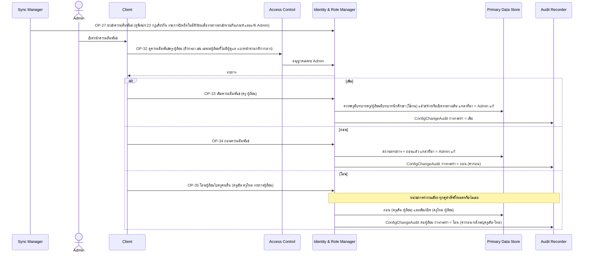
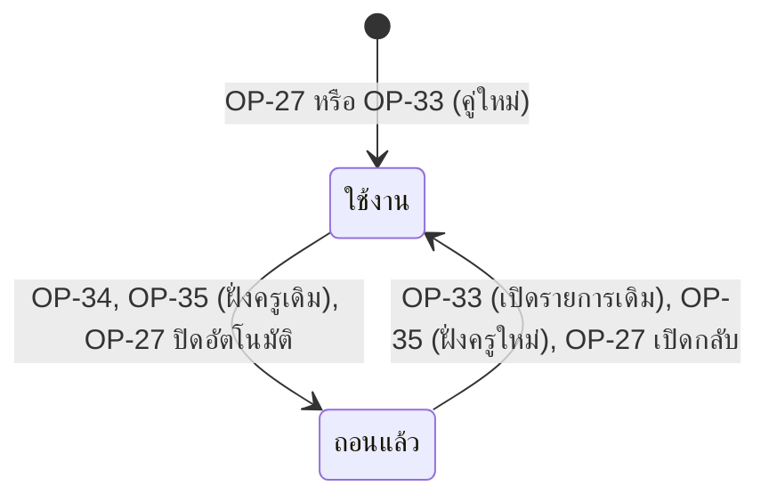

# Detailed Design: จัดการความสัมพันธ์ครู/อาจารย์ที่ปรึกษากับผู้เรียน (ฟีเจอร์ 24)

ที่มา: [[../../feature-list#24. จัดการความสัมพันธ์ครู/อาจารย์ที่ปรึกษากับผู้เรียน|Feature List ข้อ 24]], [[../../user-journey#Journey: Admin จัดการบัญชี บทบาท ความสัมพันธ์ครู-ผู้เรียน และเกณฑ์ผู้ผ่านเกณฑ์|Journey Admin]], [[../../user-journey#Journey: ครู/อาจารย์ที่ปรึกษาติดตามผู้เรียนในความดูแล|Journey ครู]], [[../api-spec#7. กลุ่ม E: บัญชี บทบาท ความสัมพันธ์ครู-ผู้เรียน และเกณฑ์ผู้ผ่านเกณฑ์|API Spec กลุ่ม E]], [[../db-spec#3.3 AdvisorAssignment (ความสัมพันธ์ครู-ผู้เรียนในความดูแล)|DB Spec AdvisorAssignment]], [[../architecture#4.8 Admin จัดการบัญชี บทบาท ความสัมพันธ์ครู-ผู้เรียน และเกณฑ์ผู้ผ่านเกณฑ์|Architecture 4.8]]
FR/NFR: [[../../../01-requirements/01-spec/20261017-01-user-role-advisor-eligibility-management|FR-26, NFR-07]] (ต่อยอด [[../../../01-requirements/01-spec/20261014-01-student-risk-alert|FR-07]], NFR-01)
Test case: ยังไม่มี test case ของฟีเจอร์ 24 ใช้ slug `advisor-student-assignment` เมื่อ test-writer สร้าง

## 1. Sequence Flow

หลังเปลี่ยน ครูเห็นผู้เรียนตามรายการใช้งานปัจจุบันทันที (ดู [[advisor-view]])

## 2. Operation ↔ Entity

| Operation | ผู้เรียก | Entity | กระทำ | ConfigChangeAudit (การกระทำ) |
|-----------|---------|--------|-------|-------------------------------|
| [[../api-spec#OP-27 นำเข้าบัญชี บทบาท และความสัมพันธ์จากระบบเดิม\|OP-27]] | ระบบ | AdvisorAssignment | สร้าง/แก้/ถอนอัตโนมัติ/เปิดกลับ | เพิ่ม/ถอน/เปิดใช้งาน (ที่มา = นำเข้า) |
| [[../api-spec#OP-32 ดูความสัมพันธ์ครู-ผู้เรียน\|OP-32]] | Admin | AdvisorAssignment, User, UserRole | อ่าน | - |
| [[../api-spec#OP-33 เพิ่มความสัมพันธ์ครู-ผู้เรียน\|OP-33]] | Admin | AdvisorAssignment (+ UserRole อ่านตรวจ) | สร้าง/เปิดรายการที่ถอนแล้ว | เพิ่ม |
| [[../api-spec#OP-34 ถอนความสัมพันธ์ครู-ผู้เรียน\|OP-34]] | Admin | AdvisorAssignment | แก้สถานะ → ถอนแล้ว | ถอน |
| [[../api-spec#OP-35 โอนผู้เรียนในความดูแลไปครูคนอื่น\|OP-35]] | Admin | AdvisorAssignment (สองรายการต่อผู้เรียน), UserRole (อ่านตรวจ) | แก้+สร้าง/เปิด | โอน |
| [[../api-spec#OP-36 สั่งให้การนำเข้าทับรายการที่ Admin แก้\|OP-36]] | Admin | AdvisorAssignment (แหล่งที่มา) | แก้เฉพาะแหล่งที่มา | คืนให้การนำเข้าดูแล |
| OP-11, OP-12 (ฟีเจอร์ 7) | ครู | AdvisorAssignment | อ่านเฉพาะ ใช้งาน | - |

## 3. State Transition (AdvisorAssignment.สถานะรายการ)

ผู้เรียนมีผู้ดูแลได้ตั้งแต่ศูนย์ถึงหลายคน (ศูนย์เป็นสถานะที่ถูกต้อง) คู่ (ครู ผู้เรียน) ซ้ำกันไม่ได้ (เปลี่ยนสถานะรายการเดิม)

## 4. Edge Case

| กรณี | วิธีจัดการ | อ้างอิง |
|------|-------------|---------|
| ครูไม่มีบทบาท ครู-อาจารย์ที่ปรึกษา (ใช้งาน) หรือผู้เรียนไม่มีบทบาทนักศึกษา | ERR-INVALID-INPUT | OP-33 |
| เพิ่มคู่ที่ใช้งานอยู่แล้ว | ERR-DUPLICATE | OP-33 |
| ถอนคู่ที่ไม่มีหรือไม่ได้ใช้งานอยู่ | ERR-NOT-FOUND | OP-34 |
| โอนผู้เรียนที่ไม่อยู่ในความดูแลของครูเดิม | ERR-NOT-FOUND (ไม่โอนเลยทั้งหน่วย) | OP-35 |
| ครูใหม่เป็นคนเดียวกับครูเดิม หรือบทบาทไม่ถูกต้อง | ERR-INVALID-INPUT | OP-35 |
| ครูใหม่ดูแลผู้เรียนนั้นอยู่แล้ว | คงรายการเดิม ไม่สร้างซ้ำ | OP-35 |
| โอนครั้งเดียวหลายผู้เรียน ล้มเหลวบางคู่ | ถอยทั้งหมด (หน่วยการทำงานเดียว) | OP-35 |
| รายการโอนว่าง | หมายถึงผู้เรียนทั้งหมดที่ใช้งานอยู่ของครูเดิม | OP-35 |
| ความสัมพันธ์ที่ Admin ถอน แล้วระบบเดิมยังส่งมา | ไม่เพิ่มกลับ (แหล่งที่มา = Admin แก้) เว้นแต่ Admin สั่ง OP-36 | OP-27 ข้อ 3 |
| ถอนบทบาทครูของผู้ใช้ | รายการไม่ถูกลบ แต่ไม่มีผลต่อสิทธิ์ | OP-31 |
| ระดับห้อง/กลุ่ม | ไม่รองรับ ออกแบบรายบุคคล (คำถามเปิดใน REQ-06) ถ้าต้องการต้องเพิ่ม entity กลุ่ม | db-spec หัวข้อ 8 |
| ผู้เรียนไม่มีผู้ดูแล | ไม่มีครูเห็นได้ ค้นหาด้วยตัวกรองใน OP-32 | OP-32 |
| ความสัมพันธ์นำเข้าหายไปจากรอบนำเข้า (แหล่งที่มา = นำเข้า) | ถอนอัตโนมัติถ้าสัดส่วนของชนิดความสัมพันธ์ไม่เกินเกณฑ์ แจ้ง Admin (ถอนแล้ว แหล่งที่มายังเป็นนำเข้า) ถ้าเกินเกณฑ์/ยังไม่ตั้งเกณฑ์ ไม่ถอนและแจ้ง Admin ว่าข้าม ความสัมพันธ์ที่ Admin เพิ่ม/แก้ไม่ถูกแตะ | OP-27 ข้อ 6 |
| ความสัมพันธ์ที่ถอนอัตโนมัติกลับมาในรอบถัดไป | เปิดกลับเป็นใช้งานพร้อม audit ถ้าแหล่งที่มายังเป็นนำเข้า (Admin เปิดกลับเองผ่าน OP-33 ตั้ง แหล่งที่มา = Admin แก้ จึงไม่ถูกปิดซ้ำ) | OP-27 ข้อ 6 |

## 5. ช่องว่างที่พบ

- ไม่มี (ข้อจำกัดเรื่องห้อง/กลุ่มเป็นคำถามเปิดใน REQ-06 ที่บันทึกไว้แล้ว)
