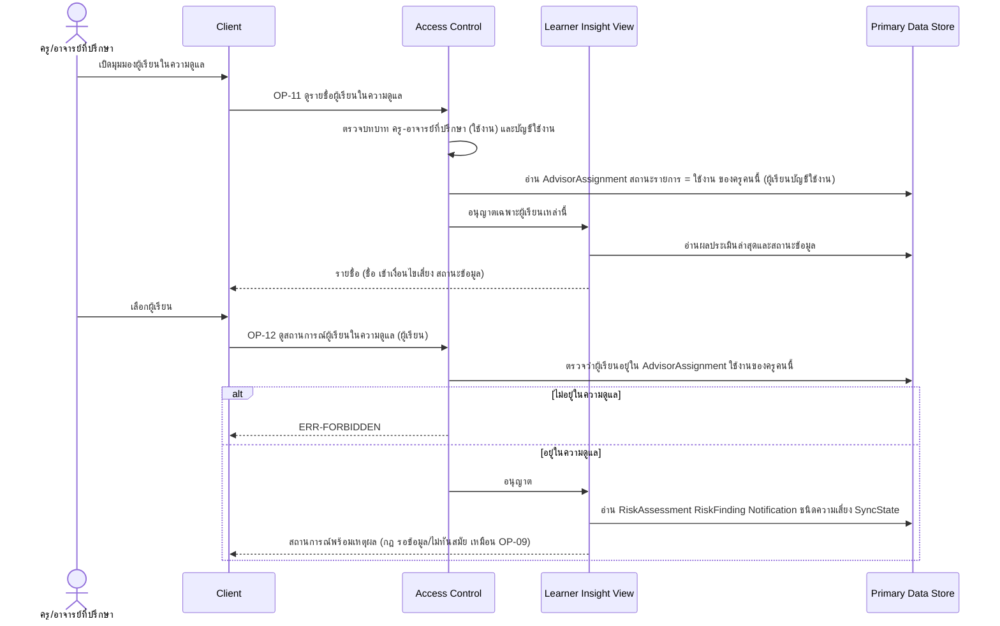

# Detailed Design: มุมมองครู/อาจารย์ที่ปรึกษา (ฟีเจอร์ 7)

ที่มา: [[../../feature-list#7. มุมมองครู/อาจารย์ที่ปรึกษา|Feature List ข้อ 7]], [[../../user-journey#Journey: ครู/อาจารย์ที่ปรึกษาติดตามผู้เรียนในความดูแล|Journey ครู/อาจารย์ที่ปรึกษา]], [[../api-spec|API Spec]] OP-11, OP-12, [[../db-spec#3.3 AdvisorAssignment (ความสัมพันธ์ครู-ผู้เรียนในความดูแล)|DB Spec AdvisorAssignment]], [[../architecture#4.3 ครู/อาจารย์ที่ปรึกษาติดตามผู้เรียนในความดูแล|Architecture 4.3]]
FR/NFR: [[../../../01-requirements/01-spec/20261014-01-student-risk-alert|FR-07, NFR-01, NFR-02]], [[../../../01-requirements/01-spec/20261017-01-user-role-advisor-eligibility-management|FR-26]]
Test case: [[../../../03-testing/01-test-plan/test-cases/advisor-view|advisor-view]]

## 1. Sequence Flow

ดูประวัติย้อนหลังของผู้เรียนที่เลือกคือฟีเจอร์ 8 (OP-10)

## 2. Operation ↔ Entity

| Operation | Entity | กระทำ |
|-----------|--------|-------|
| [[../api-spec#OP-11 ดูรายชื่อผู้เรียนในความดูแล\|OP-11]] | AdvisorAssignment, User, UserRole, RiskAssessment, SyncState | อ่าน |
| [[../api-spec#OP-12 ดูสถานการณ์ผู้เรียนในความดูแล\|OP-12]] | AdvisorAssignment (ตรวจสิทธิ์), RiskAssessment, RiskFinding, Notification, SyncState, Grade/Attendance/AssignmentRecord | อ่าน |

## 3. State Transition

ไม่มีสถานะของฟีเจอร์นี้เอง ขอบเขตการมองเห็นขึ้นกับสถานะรายการของ AdvisorAssignment (ใช้งาน/ถอนแล้ว) ที่เปลี่ยนโดยฟีเจอร์ 24 ผลมีทันที: ผู้เรียนที่ถูกโอนหรือถอนหายจากรายชื่อทันที

## 4. Edge Case

| กรณี | วิธีจัดการ | อ้างอิง |
|------|-------------|---------|
| ขอผู้เรียนนอกความดูแล | ERR-FORBIDDEN | NFR-01 |
| ไม่มีผู้เรียนนี้ในระบบ | ERR-NOT-FOUND | OP-12 |
| ผู้เรียนถูกโอน/ถอนระหว่างครูกำลังดู | คำขอถัดไปไม่ผ่านสิทธิ์ ผลที่แสดงอยู่แล้วฝั่ง Client ไม่ถูกเรียกกลับ | OP-34/OP-35 |
| ครูไม่มีผู้เรียนในความดูแลเลย | OP-11 ส่งรายการว่าง (ศูนย์ผู้เรียนเป็นสถานะที่ถูกต้อง) | FR-26 |
| ผู้เรียนบัญชีปิดใช้งาน | ไม่ปรากฏใน OP-11 | OP-11 |
| สถานะข้อมูล = รอข้อมูล | ไม่ส่งผลประเมินใดๆ (เหมือน OP-09) | FR-23 |
| ผู้เรียนยังไม่มี RiskAssessment (สถานะปกติ/ไม่ทันสมัย) | OP-12 ส่ง ยังไม่มีผลประเมิน = จริง ผลประเมินว่าง ไม่ส่ง error (กฎเดียวกับ OP-09) | OP-12 กฎ |
| ครูถูกถอนบทบาท ครู-อาจารย์ที่ปรึกษา | ไม่มีสิทธิ์ทันที แม้ AdvisorAssignment ยังอยู่ | OP-31, FR-25 |
| ผู้เรียกไม่ใช่ครู-อาจารย์ที่ปรึกษา (เช่น Admin ที่ไม่มีบทบาทครู) | ERR-FORBIDDEN | OP-11 |

## 5. ช่องว่างที่พบ

- ครูได้รับแจ้งเตือนความเสี่ยงของผู้เรียนหรือไม่ ยังเป็นคำถามเปิดใน REQ-01 (ปัจจุบันดูได้ผ่าน OP-11/OP-12 เท่านั้น ไม่มีช่องทางแจ้งเชิงรุก)
