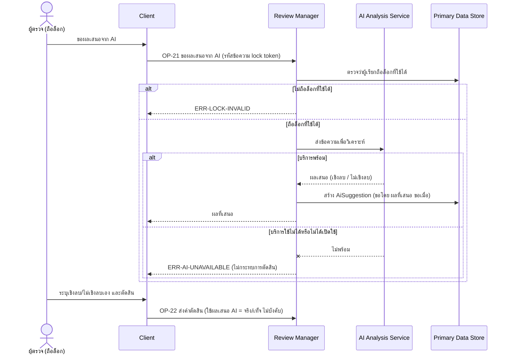

# Detailed Design: AI ช่วยวิเคราะห์เชิงลบ/ไม่เชิงลบ (ฟีเจอร์ 16)

ที่มา: [[../../feature-list#16. AI ช่วยวิเคราะห์เชิงลบ/ไม่เชิงลบ|Feature List ข้อ 16]], [[../../user-journey#Journey: อาจารย์/Admin ตรวจและอนุมัติข้อความ|Journey ผู้ตรวจ]], [[../api-spec|API Spec]] OP-21, OP-22, [[../db-spec#3.18 AiSuggestion (ผลเสนอจาก AI — ไม่บังคับ)|DB Spec AiSuggestion]], [[../architecture#4.5 อาจารย์/Admin ตรวจและตัดสินข้อความ (รวมกรณีไม่ถือล็อกที่ใช้ได้)|Architecture 4.5]]
FR/NFR: [[../../../01-requirements/01-spec/20261014-02-peer-advice-chat|FR-17]] (ระดับต่ำ ไม่บังคับ)
Test case: [[../../../03-testing/01-test-plan/test-cases/ai-negativity-assist|ai-negativity-assist]]

## 1. Sequence Flow

OP-22 ไม่ขึ้นกับ OP-21 ผู้ตรวจระบุการระบุเองได้เสมอ

## 2. Operation ↔ Entity

| Operation | Entity | กระทำ |
|-----------|--------|-------|
| [[../api-spec#OP-21 ขอผลเสนอจาก AI\|OP-21]] | ReviewLock | อ่าน (ตรวจล็อกที่ใช้ได้) |
| OP-21 | AiSuggestion | สร้าง (ไม่เปลี่ยนสถานะข้อความ) |
| [[../api-spec#OP-22 ส่งคำตัดสินข้อความ\|OP-22]] | ReviewDecision.ใช้ผลเสนอ AI | บันทึกว่าผู้ตรวจใช้ผลเสนอหรือไม่ (เฉพาะเมื่อมี AiSuggestion) |

## 3. State Transition

ไม่มี AiSuggestion เป็นเพียงข้อเสนอ ไม่เปลี่ยนสถานะข้อความและไม่แทนการตัดสินของผู้ตรวจ

## 4. Edge Case

| กรณี | วิธีจัดการ | อ้างอิง |
|------|-------------|---------|
| บริการ AI ไม่พร้อม/ไม่ได้เปิดใช้ | ERR-AI-UNAVAILABLE ผู้ตรวจระบุเอง OP-22 ทำงานปกติ | OP-21 |
| ไม่ถือล็อกที่ใช้ได้ | ERR-LOCK-INVALID (ไม่ส่งเนื้อหาออกไปวิเคราะห์) | OP-21 |
| ผู้ตรวจขอซ้ำหลายครั้ง | สร้าง AiSuggestion ได้หลายรายการต่อข้อความ (ChatMessage 1:N AiSuggestion) | db-spec ความสัมพันธ์ |
| AI เสนอไม่เชิงลบ แต่ผู้ตรวจระบุเชิงลบ | ใช้ค่าที่ผู้ตรวจระบุ ใช้ผลเสนอ AI = เท็จ | FR-17 |
| ผล AI เป็นเชิงลบ | ไม่ปฏิเสธอัตโนมัติ | FR-14 |
| ล็อกหมดอายุ/ถูกปลดระหว่างรอ AI ตอบ | ผลเสนอยังบันทึกได้ ไม่กระทบการตัดสิน (ผลกระทบต่ำ) OP-22 ต่อมาจะถูกปฏิเสธถ้าไม่ถือล็อก | api-spec หัวข้อ 11 |
| การส่งเนื้อหาข้อความออกนอกระบบ | ต้องยืนยันนโยบาย (คำถามเปิดใน REQ-02) ไม่ได้กำหนดในเอกสารนี้ | OP-21 |

## 5. ช่องว่างที่พบ

ไม่มี (กรณีล็อกหมดอายุระหว่างรอ AI ระบุเป็นข้อสมมติฐานใน api-spec แล้ว) ข้อสมมติฐานที่คงไว้: ผลที่ AI เสนอบันทึกเมื่อผู้ตรวจขอเท่านั้น ไม่เรียกอัตโนมัติ และการส่งเนื้อหาออกนอกระบบยังต้องยืนยัน (คำถามเปิดใน REQ-02)
