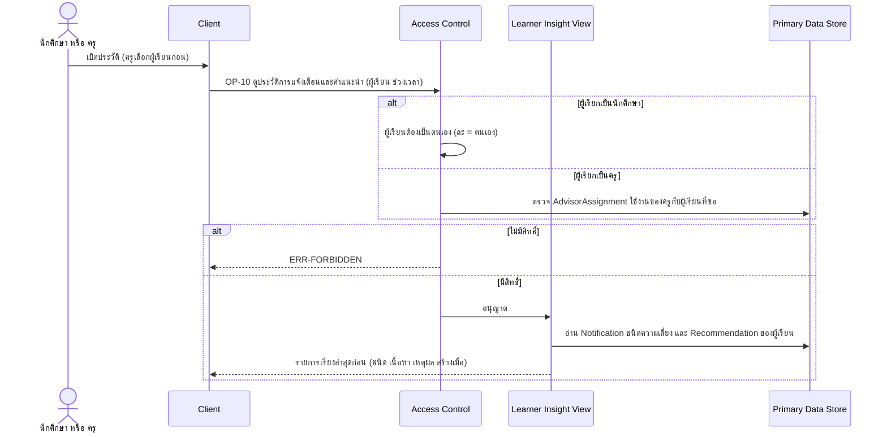

# Detailed Design: ประวัติการแจ้งเตือนและคำแนะนำ (ฟีเจอร์ 8)

ที่มา: [[../../feature-list#8. ประวัติการแจ้งเตือนและคำแนะนำ|Feature List ข้อ 8]], [[../../user-journey#Journey: ผู้เรียนรับแจ้งเตือนความเสี่ยงและคำแนะนำ|Journey ผู้เรียน]], [[../../user-journey#Journey: ครู/อาจารย์ที่ปรึกษาติดตามผู้เรียนในความดูแล|Journey ครู]], [[../api-spec|API Spec]] OP-10, [[../db-spec|DB Spec]], [[../architecture#4.2 ผู้เรียนรับแจ้งเตือน ดูแดชบอร์ด คำแนะนำ และประวัติ|Architecture 4.2]]
FR/NFR: [[../../../01-requirements/01-spec/20261014-01-student-risk-alert|FR-09, NFR-01]]
Test case: [[../../../03-testing/01-test-plan/test-cases/alert-history|alert-history]]

## 1. Sequence Flow

## 2. Operation ↔ Entity

| Operation | Entity | กระทำ |
|-----------|--------|-------|
| [[../api-spec#OP-10 ดูประวัติการแจ้งเตือนและคำแนะนำ\|OP-10]] | Notification (เฉพาะชนิดความเสี่ยง), Recommendation, RiskAssessment/RiskFinding (เหตุผล) | อ่าน |
| OP-10 | AdvisorAssignment | อ่านเพื่อตรวจสิทธิ์ของครู |
| (ผู้สร้างประวัติ) OP-07, OP-08 | RiskAssessment, Notification, Recommendation | สร้างและเก็บถาวรไม่ลบ ไม่แก้ |

## 3. State Transition

ไม่มี ประวัติเพิ่มอย่างเดียวผ่านการประเมินทุกรอบ (FR-09)

## 4. Edge Case

| กรณี | วิธีจัดการ | อ้างอิง |
|------|-------------|---------|
| นักศึกษาขอของผู้อื่น | ERR-FORBIDDEN | NFR-01 |
| ครูขอผู้เรียนนอกความดูแล | ERR-FORBIDDEN | NFR-01 |
| ไม่มีผู้เรียนนี้ | ERR-NOT-FOUND | OP-10 |
| ไม่ระบุช่วงเวลา | ส่งหน้าแรกเรียงล่าสุดก่อน แบ่งหน้าด้วยขนาดหน้า/จุดต่อ (จุดต่อว่างเมื่อหมด) | OP-10, กติกากลางข้อแบ่งหน้า |
| การแจ้งเตือนชนิดอื่น (ซิงก์ล้มเหลว ข้อความถูกปฏิเสธ ฯลฯ) | ไม่รวมใน OP-10 (ใช้ OP-13 ซึ่งแสดงเฉพาะของตน) | OP-10 กฎ |
| ผู้เรียนที่ครูเคยดูแลแล้วถูกถอน | ครูเห็นประวัติไม่ได้อีก (สิทธิ์ตามรายการใช้งานปัจจุบัน) | FR-26 |
| ผลประเมินไม่เสี่ยง ไม่มี Notification | ประวัติแสดงคำแนะนำเท่านั้น | OP-07 |

## 5. ช่องว่างที่พบ

- ระยะเวลาเก็บข้อมูลตาม PDPA ยังไม่กำหนด (คำถามเปิดใน REQ-01) ไม่มี attribute วันหมดอายุของประวัติ ตามที่บันทึกใน [[../db-spec#8. บันทึกการตัดสินใจและประเด็นรอตัดสินใจ|db-spec หัวข้อ 8]]
