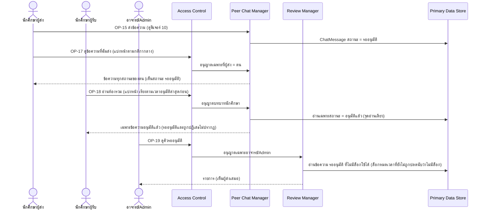
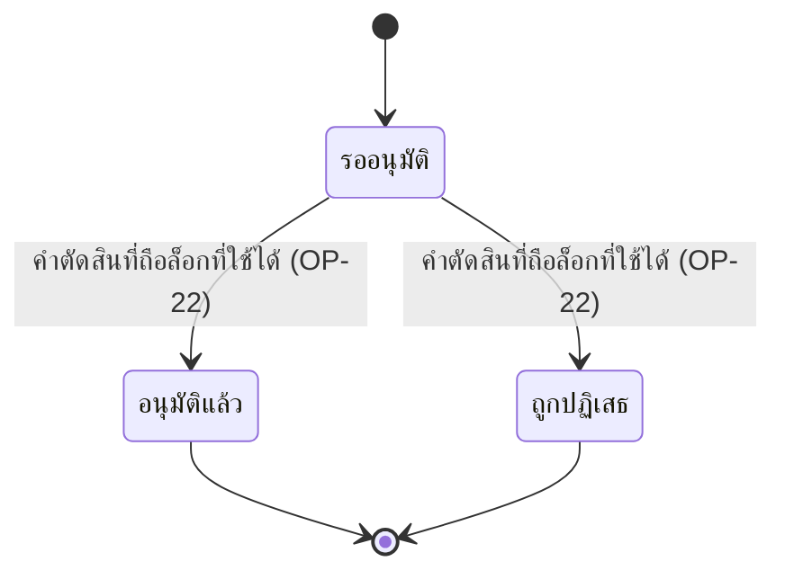

# Detailed Design: คิวรออนุมัติและการซ่อนข้อความจากผู้รับ (ฟีเจอร์ 11)

ที่มา: [[../../feature-list#11. คิวรออนุมัติและการซ่อนข้อความจากผู้รับ|Feature List ข้อ 11]], [[../../user-journey#Journey: นักศึกษาผู้ส่งข้อความแนะนำแนวทางการเรียน|Journey ผู้ส่ง]], [[../../user-journey#Journey: อาจารย์/Admin ตรวจและอนุมัติข้อความ|Journey ผู้ตรวจ]], [[../api-spec|API Spec]] OP-15..OP-19, [[../db-spec#3.15 ChatMessage (ข้อความในห้องรวม)|DB Spec ChatMessage]], [[../architecture#4.7 นักศึกษาผู้รับอ่านห้องรวม|Architecture 4.7]]
FR/NFR: [[../../../01-requirements/01-spec/20261014-02-peer-advice-chat|FR-11, NFR-04]]
Test case: [[../../../03-testing/01-test-plan/test-cases/approval-queue-visibility|approval-queue-visibility]]

## 1. Sequence Flow

## 2. Operation ↔ Entity

| Operation | Entity | กระทำ |
|-----------|--------|-------|
| [[../api-spec#OP-15 ส่งข้อความเข้าห้องรวม\|OP-15]] | ChatMessage | สร้างสถานะ รออนุมัติ |
| [[../api-spec#OP-17 ดูข้อความที่ฉันส่ง\|OP-17]] | ChatMessage, ReviewDecision | อ่านเฉพาะผู้ส่ง = ตน |
| [[../api-spec#OP-18 อ่านห้องรวม\|OP-18]] | ChatMessage | อ่านเฉพาะ อนุมัติแล้ว |
| [[../api-spec#OP-19 ดูคิวรออนุมัติ\|OP-19]] | ChatMessage, ReviewLock | อ่านรออนุมัติที่ไม่มีล็อกใช้ได้ |

## 3. State Transition

อนุมัติแล้ว/ถูกปฏิเสธ เป็นสถานะปลายทาง ย้อนไม่ได้ ผู้รับเห็นได้เฉพาะ อนุมัติแล้ว

| สถานะ | ผู้ส่ง (OP-17) | ผู้รับ (OP-18) | ผู้ตรวจ (OP-19) |
|-------|----------------|-----------------|------------------|
| รออนุมัติ (ไม่มีล็อกใช้ได้) | เห็น | ไม่เห็น | เห็นในคิว |
| รออนุมัติ (มีล็อกใช้ได้) | เห็น | ไม่เห็น | ไม่อยู่ในคิว (ดูผ่าน OP-23) |
| อนุมัติแล้ว | เห็น | เห็น | ไม่อยู่ในคิว |
| ถูกปฏิเสธ | เห็นพร้อมเหตุผล | ไม่เห็น | ไม่อยู่ในคิว |

## 4. Edge Case

| กรณี | วิธีจัดการ | อ้างอิง |
|------|-------------|---------|
| นักศึกษาขอรหัสข้อความที่ไม่อนุมัติของผู้อื่น | ERR-NOT-FOUND เหมือนไม่มี | กติกากลาง, NFR-04 |
| เส้นทางอ่านอื่นนอกจาก OP-18 | ต้องไม่มี การกรองสถานะทำที่จุดเดียวใน Backend | Architecture หัวข้อ 6 ประเด็น 2 |
| ล็อกหมดอายุแต่ตัวปลดอัตโนมัติยังไม่ทำงาน | ถือว่าไม่มีล็อก ข้อความแสดงในคิว | OP-19 กฎ |
| ผู้เรียกไม่ใช่อาจารย์/Admin ขอคิว | ERR-FORBIDDEN | OP-19 |
| ข้อความถูกปลดล็อกด้วยมือ/หมดเวลา | กลับเข้าคิว สถานะคงรออนุมัติ ไม่ปรากฏต่อผู้รับ | FR-21, NFR-04 |
| คำตัดสินถูกปฏิเสธเพราะไม่ถือล็อก | สถานะไม่เปลี่ยน ไม่หลุดเป็นอนุมัติ | FR-24 |

## 5. ช่องว่างที่พบ

ไม่มี (รายการ OP-17, OP-18, OP-19 แบ่งหน้าตามกติกากลางของ api-spec ขนาดหน้าเริ่มต้นกำหนดตอน detailed design ระดับถัดไป)
