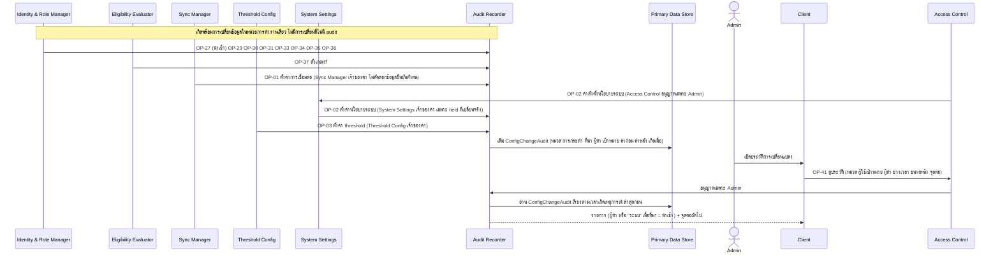

# Detailed Design: ประวัติการเปลี่ยนบัญชี บทบาท ความสัมพันธ์ เกณฑ์ ค่าตั้งการเชื่อมต่อ นโยบายระบบ และ threshold (audit trail) (ฟีเจอร์ 26)

ที่มา: [[../../feature-list#26. ประวัติการเปลี่ยนบัญชี บทบาท ความสัมพันธ์ เกณฑ์ ค่าตั้งการเชื่อมต่อ นโยบายระบบ และ threshold (audit trail)|Feature List ข้อ 26]], [[../../user-journey#Journey: Admin จัดการบัญชี บทบาท ความสัมพันธ์ครู-ผู้เรียน และเกณฑ์ผู้ผ่านเกณฑ์|Journey Admin]], [[../api-spec#OP-41 ดูประวัติการเปลี่ยนบัญชี บทบาท ความสัมพันธ์ เกณฑ์ ค่าตั้งการเชื่อมต่อ นโยบายระบบ และ threshold|API Spec OP-41]], [[../db-spec#3.22 ConfigChangeAudit (ประวัติการเปลี่ยนบัญชี บทบาท ความสัมพันธ์ และเกณฑ์ แบบเพิ่มอย่างเดียว)|DB Spec ConfigChangeAudit]], [[../architecture#4.8 Admin จัดการบัญชี บทบาท ความสัมพันธ์ครู-ผู้เรียน และเกณฑ์ผู้ผ่านเกณฑ์|Architecture 4.8]]
FR/NFR: [[../../../01-requirements/01-spec/20261017-01-user-role-advisor-eligibility-management|NFR-07]] (ขยายครอบคลุม OP-01/OP-02/OP-03 ต่อยอด NFR-01, NFR-05)
Test case: ยังไม่มี test case ของฟีเจอร์ 26 ใช้ slug `config-change-audit` เมื่อ test-writer สร้าง

## 1. Sequence Flow

การบันทึกเกิดจาก operation เปลี่ยนข้อมูลในหน่วยการทำงานเดียวกัน ส่วนการอ่านทำผ่าน OP-41 (เฉพาะ Admin)

เส้นทาง audit เหมือนกันทุกหมวด (เจ้าของค่า → Audit Recorder ในหน่วยการทำงานเดียวกับการเก็บค่า ตาม [[../architecture#4.1 ซิงก์ข้อมูล ประเมินความเสี่ยง และตั้งค่า threshold|Architecture 4.1]]): OP-01 Sync Manager → Audit Recorder, OP-02 Access Control → System Settings → Audit Recorder, OP-03 Threshold Config → Audit Recorder, บัญชี/บทบาท/ความสัมพันธ์ Identity & Role Manager → Audit Recorder, เกณฑ์ผู้ผ่านเกณฑ์ Eligibility Evaluator → Audit Recorder

## 2. Operation ↔ Entity (ที่สร้าง ConfigChangeAudit)

| Operation | หมวด | การกระทำที่บันทึก | ที่มาของการเปลี่ยน | ผู้ทำ |
|-----------|------|---------------------|---------------------|-------|
| [[../api-spec#OP-01 ตั้งค่าการเชื่อมต่อระบบเดิม\|OP-01]] | ค่าตั้งการเชื่อมต่อ | ตั้งค่า (ค่าก่อน-หลังเฉพาะปลายทาง ข้อมูลยืนยันตัวตนบันทึกเพียงว่าเปลี่ยน/ไม่เปลี่ยน ตั้งครั้งแรกค่าก่อนว่าง ไม่มีค่าเปลี่ยนจริง = ไม่บันทึก) | Admin | Admin |
| [[../api-spec#OP-02 ตั้งค่านโยบายระบบ\|OP-02]] | นโยบายระบบ | ตั้งค่า (ค่าก่อน-หลังเฉพาะ field ที่เปลี่ยนจริง ได้แก่ ความถี่รอบซิงก์ ระยะเวลาล็อกหมดอายุ นโยบายแสดงชื่อผู้ส่ง เกณฑ์สัดส่วนรายการนำเข้าที่หาย) | Admin | Admin |
| [[../api-spec#OP-03 ตั้งค่า threshold ความเสี่ยง\|OP-03]] | threshold ความเสี่ยง | เพิ่ม (กฎใหม่) / ตั้งค่า (แก้กฎเดิม) พร้อมกฎที่เกี่ยวข้อง ค่าก่อน-หลัง | Admin | Admin |
| [[../api-spec#OP-27 นำเข้าบัญชี บทบาท และความสัมพันธ์จากระบบเดิม\|OP-27]] | บัญชี / บทบาท / ความสัมพันธ์ครู-ผู้เรียน | เพิ่ม แก้ ปิดใช้งาน ถอน เปิดใช้งาน (เฉพาะรายการที่เปลี่ยนจริง รวมปิดอัตโนมัติ/เปิดกลับ) | นำเข้าจากระบบเดิม | ว่าง (+ รอบซิงก์ที่เกี่ยวข้อง) |
| [[../api-spec#OP-29 เพิ่มบัญชีผู้ใช้\|OP-29]] | บัญชี (และบทบาท) | เพิ่ม | Admin | Admin ผู้เรียก |
| [[../api-spec#OP-30 แก้ไขบัญชีผู้ใช้ (รวมปิด/เปิดใช้งาน)\|OP-30]] | บัญชี | แก้ / ปิดใช้งาน / เปิดใช้งาน (ไม่มีค่าเปลี่ยนจริง = ไม่บันทึก) | Admin | Admin |
| [[../api-spec#OP-31 กำหนดบทบาทของผู้ใช้ (เพิ่ม/ถอน)\|OP-31]] | บทบาท | เพิ่ม / ถอน | Admin | Admin |
| [[../api-spec#OP-33 เพิ่มความสัมพันธ์ครู-ผู้เรียน\|OP-33]] | ความสัมพันธ์ครู-ผู้เรียน | เพิ่ม | Admin | Admin |
| [[../api-spec#OP-34 ถอนความสัมพันธ์ครู-ผู้เรียน\|OP-34]] | ความสัมพันธ์ครู-ผู้เรียน | ถอน | Admin | Admin |
| [[../api-spec#OP-35 โอนผู้เรียนในความดูแลไปครูคนอื่น\|OP-35]] | ความสัมพันธ์ครู-ผู้เรียน | โอน (ต่อผู้เรียน) | Admin | Admin |
| [[../api-spec#OP-36 สั่งให้การนำเข้าทับรายการที่ Admin แก้\|OP-36]] | ตามชนิดรายการ | คืนให้การนำเข้าดูแล | Admin | Admin |
| [[../api-spec#OP-37 ตั้งเกณฑ์ผู้ผ่านเกณฑ์\|OP-37]] | เกณฑ์ผู้ผ่านเกณฑ์ | ตั้งเกณฑ์ (เกณฑ์ที่เกี่ยวข้อง ค่าก่อน-หลังคือเวอร์ชันก่อน-หลัง) | Admin | Admin |
| [[../api-spec#OP-41 ดูประวัติการเปลี่ยนบัญชี บทบาท ความสัมพันธ์ เกณฑ์ ค่าตั้งการเชื่อมต่อ นโยบายระบบ และ threshold\|OP-41]] | (อ่านอย่างเดียว ครอบคลุมทั้ง 7 หมวด) | - | - | Admin เท่านั้น |

หมวดค่าตั้งการเชื่อมต่อ นโยบายระบบ และ threshold ไม่มี "ผู้ใช้เป้าหมาย" (ว่าง) ConfigChangeAudit แยกจาก AuditEvent ของฟีเจอร์ 15 ([[review-audit-trail]]) ผู้อ่านและหัวข้อต่างกัน (ผู้อ่านประวัตินี้เฉพาะ Admin) ผลประเมิน EligibilityResult ที่คำนวณใหม่ไม่ใช่การเปลี่ยนที่ต้อง audit

## 3. State Transition

ไม่มี ConfigChangeAudit เพิ่มอย่างเดียว ห้ามแก้หรือลบ ไม่มี operation แก้/ลบใดเลย

## 4. Edge Case

| กรณี | วิธีจัดการ | อ้างอิง |
|------|-------------|---------|
| การเปลี่ยนข้อมูลสำเร็จแต่บันทึก audit ล้มเหลว | ถอนทั้งหน่วย (ไม่มีการเปลี่ยนที่ไม่มี audit) รวม OP-01/02/03 | NFR-07 |
| นำเข้าไม่มีรายการเปลี่ยน | ไม่บันทึกอะไร (บันทึกเฉพาะรายการที่เปลี่ยนจริง) | OP-27 ข้อ 5 |
| OP-01/OP-02/OP-03 ค่าไม่เปลี่ยนจริง | ไม่บันทึก audit | OP-01, OP-02, OP-03 |
| OP-02 เปลี่ยนหลาย field พร้อมกัน | ค่าก่อน-หลังเฉพาะ field ที่เปลี่ยนจริง | OP-02 |
| ข้อมูลยืนยันตัวตนกับระบบเดิม | ห้ามคัดลอกลงค่าก่อน-หลัง บันทึกเพียงว่า "เปลี่ยน" และ OP-41 ไม่แสดงค่านี้ไม่ว่ากรณีใด | OP-01, OP-41, db-spec 3.22 |
| โอนหลายผู้เรียนใน OP-35 | บันทึกต่อผู้เรียน และถอยพร้อมกันถ้าล้มเหลว | OP-35 |
| ผู้ทำเป็นระบบ | ผู้ทำว่าง แสดงเป็น "ระบบ" ใน OP-41 | OP-41 |
| ผู้เรียกไม่ใช่ Admin (รวมอาจารย์ ครู นักศึกษา) | ERR-FORBIDDEN | OP-41, NFR-01 |
| บัญชีผู้ทำถูกปิดภายหลัง | ประวัติยังอยู่ ไม่ถูกลบ | FR-25 |
| ปิดอัตโนมัติจากการนำเข้า | บันทึกต่อรายการ (ที่มา = นำเข้า รอบซิงก์ที่เกี่ยวข้อง ค่าก่อน-หลัง) | OP-27 ข้อ 6 |
| กรองตามหมวดที่ไม่มีข้อมูล | รายการว่าง จุดต่อถัดไปว่าง | OP-41 |
| รายการยาว | แบ่งหน้าด้วยขนาดหน้า/จุดต่อ ล่าสุดก่อน | กติกากลางข้อแบ่งหน้า |

## 5. ช่องว่างที่พบ

ไม่มี (ขอบเขต OP-01/02/03, การแบ่งหน้า OP-41 และโมดูลเจ้าของนโยบายระบบ ปิดแล้วใน api-spec และ architecture ล่าสุด)
