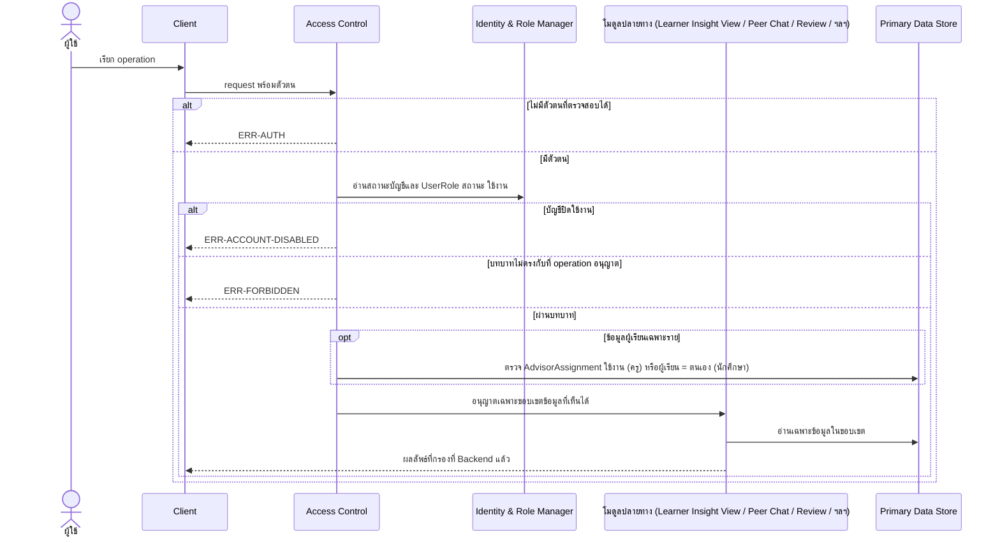

# Detailed Design: ความเป็นส่วนตัวและสิทธิ์การมองเห็นข้อมูลการเรียน (ฟีเจอร์ 9)

ที่มา: [[../../feature-list#9. ความเป็นส่วนตัวและสิทธิ์การมองเห็นข้อมูลการเรียน|Feature List ข้อ 9]], [[../../user-journey#Journey: ผู้เรียนรับแจ้งเตือนความเสี่ยงและคำแนะนำ|Journey ผู้เรียน]], [[../../user-journey#Journey: ครู/อาจารย์ที่ปรึกษาติดตามผู้เรียนในความดูแล|Journey ครู]], [[../api-spec#1. กติกากลางของทุก Operation|API Spec กติกากลาง]], [[../db-spec|DB Spec]], [[../architecture#5. NFR Mapping|Architecture NFR Mapping]]
FR/NFR: [[../../../01-requirements/01-spec/20261014-01-student-risk-alert|NFR-01]] (ต่อยอดโดย [[../../../01-requirements/01-spec/20261017-01-user-role-advisor-eligibility-management|FR-25, FR-26]])
Test case: [[../../../03-testing/01-test-plan/test-cases/data-privacy|data-privacy]]

ฟีเจอร์นี้เป็นข้อกำหนดตัดขวาง (cross-cutting) ไม่มี operation ของตนเอง ใช้ Access Control ตรวจก่อนทุก operation เอกสารนี้สรุปลำดับการตรวจ และบังคับใช้ต่อ operation

## 1. Sequence Flow (ลำดับตรวจสิทธิ์มาตรฐานก่อนทุก operation)

## 2. กฎการมองเห็นต่อ Operation

| Operation | ผู้เรียกได้ | ขอบเขตข้อมูลที่เห็น | Entity ที่ใช้ตัดสินสิทธิ์ |
|-----------|-------------|-----------------------|---------------------------|
| OP-09 | นักศึกษา | ของตนเท่านั้น | User, UserRole |
| OP-10 | นักศึกษา, ครู | นักศึกษา = ตน, ครู = ผู้เรียนใน AdvisorAssignment ใช้งาน | AdvisorAssignment |
| OP-11, OP-12 | ครู | เฉพาะผู้เรียนใน AdvisorAssignment ใช้งาน (บัญชีใช้งาน) | AdvisorAssignment |
| OP-13 | ผู้ใช้ทุกบทบาท | Notification ที่ผู้รับ = ตน | Notification |
| OP-14..OP-18 | นักศึกษา | ข้อความของตน/ห้องรวมที่อนุมัติแล้ว | ChatMessage.สถานะ, ผู้ส่ง |
| OP-19..OP-26 | อาจารย์, Admin | คิวและประวัติการตรวจ (เห็นตัวตนผู้ส่ง) | UserRole |
| OP-01..OP-05, OP-28..OP-43 (ที่ผู้เรียกเป็นมนุษย์) | Admin เท่านั้น | การตั้งค่าการเชื่อมต่อ/นโยบาย/threshold สถานะซิงก์ การจัดการบัญชี บทบาท ความสัมพันธ์ เกณฑ์ และประวัติการเปลี่ยนแปลง (OP-42 ไม่ส่งค่าข้อมูลยืนยันตัวตนกับระบบเดิมกลับเด็ดขาด OP-41 ไม่แสดงค่านั้นไม่ว่ากรณีใด) | UserRole = Admin |

## 3. State Transition

สิทธิ์ขึ้นกับสถานะสองส่วนที่ Admin เปลี่ยนได้ (ดูฟีเจอร์ 23, 24): User.สถานะบัญชี (ใช้งาน/ปิดใช้งาน) และสถานะรายการของ UserRole/AdvisorAssignment (ใช้งาน/ถอนแล้ว) สิทธิ์มีเฉพาะเมื่อบัญชีใช้งานและรายการใช้งาน มีผลทันทีในคำขอถัดไป

## 4. Edge Case

| กรณี | วิธีจัดการ | อ้างอิง |
|------|-------------|---------|
| นักศึกษาขอข้อความที่ไม่อนุมัติ | ERR-NOT-FOUND (ตอบเหมือนไม่มี เพื่อไม่รั่วไหล) | กติกากลาง, NFR-04 |
| ครูขอผู้เรียนนอกความดูแล | ERR-FORBIDDEN | OP-10, OP-12 |
| นโยบายซ่อนชื่อผู้ส่ง | Backend ไม่ส่ง field ผู้ส่งไปยัง Client เลย (ไม่ซ่อนที่ Client) | OP-18 |
| ข้อมูลยืนยันตัวตนกับระบบเดิม | ไม่ส่งกลับใน operation ใดและไม่ถูกคัดลอกลงประวัติ ConfigChangeAudit (บันทึกเพียงว่า "เปลี่ยน") | OP-01, OP-42, OP-41, db-spec 3.22 |
| รายการยาว (ประวัติ ห้องรวม ฯลฯ) | แบ่งหน้าด้วยจุดต่อ การกรองสิทธิ์ทำก่อนแบ่งหน้า ไม่รั่วไหลผ่านจำนวนรวมหรือจุดต่อ (ผลลัพธ์ทุกหน้าผ่านการกรองสิทธิ์ที่ Backend) | กติกากลางข้อแบ่งหน้า |
| Client ถือข้อมูลเกินสิทธิ์ | ไม่ให้เกิด Client ไม่ตัดสินสิทธิ์และไม่ได้รับข้อมูลเกินสิทธิ์ | Architecture หัวข้อ 1 |
| ผู้ที่ถูกปิดบัญชีขณะมี session ค้าง | คำขอถัดไปตอบ ERR-ACCOUNT-DISABLED (การยืนยันตัวตนอยู่นอกขอบเขตตาม REQ-06) | กติกากลาง |
| ผู้ใช้มีหลายบทบาท | ใช้บทบาทที่ operation อนุญาตและรายการใช้งานอยู่ | db-spec 3.2 |

## 5. ช่องว่างที่พบ

- นโยบาย PDPA ที่ต้องยืนยัน และระยะเวลาเก็บข้อมูล ยังไม่มีใน spec (คำถามเปิดใน REQ-01) ไม่ได้กำหนดในเอกสารนี้
