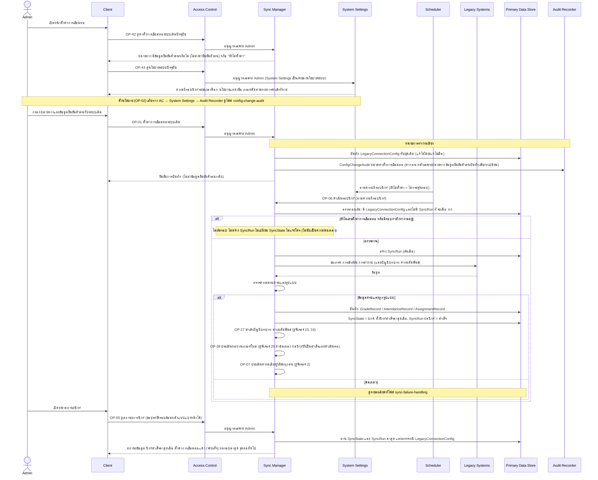
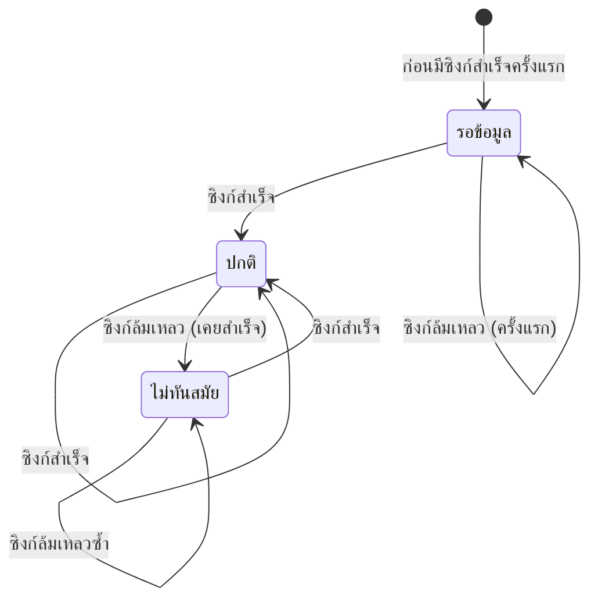

# Detailed Design: เชื่อมต่อและซิงก์ข้อมูลจากระบบเดิม (ฟีเจอร์ 1)

ที่มา: [[../../feature-list#1. เชื่อมต่อและซิงก์ข้อมูลจากระบบเดิม|Feature List ข้อ 1]], [[../../user-journey#Journey: ผู้ดูแลระบบตั้งค่าการเชื่อมต่อและ threshold|Journey ผู้ดูแลระบบ]], [[../api-spec|API Spec]] (กลุ่ม A), [[../db-spec|DB Spec]], [[../architecture#4.1 ซิงก์ข้อมูล ประเมินความเสี่ยง และตั้งค่า threshold|Architecture 4.1]]
FR/NFR: [[../../../01-requirements/01-spec/20261014-01-student-risk-alert|FR-01, NFR-03]], NFR-07 (audit การตั้งค่า)
Test case: [[../../../03-testing/01-test-plan/test-cases/data-sync|data-sync]]

เอกสารนี้ระดับ logical ไม่ระบุ technology (ดู [[../architecture#7. ประเด็นรอตัดสินใจ|Architecture หัวข้อ 7]])

## 1. Sequence Flow

ลำดับก่อนหลังที่ต้องรักษา: บันทึกข้อมูลการเรียนและตั้งเวลาซิงก์สำเร็จล่าสุดก่อน แล้วจึงเรียก OP-27 → OP-39 → OP-07 ตามลำดับนี้ เพราะ OP-39 และ OP-07 ใช้ข้อมูลที่เพิ่งนำเข้า

## 2. Operation ↔ Entity

| Operation | ผู้เรียก | Entity ที่กระทบ | สร้าง/อ่าน/แก้/ลบ |
|-----------|---------|------------------|---------------------|
| [[../api-spec#OP-42 ดูค่าตั้งการเชื่อมต่อระบบเดิมปัจจุบัน\|OP-42]] | Admin | LegacyConnectionConfig | อ่าน (ไม่ส่งค่ายืนยันตัวตน) |
| [[../api-spec#OP-43 ดูนโยบายระบบปัจจุบัน\|OP-43]] | Admin | SystemPolicy (โมดูล System Settings เป็นเจ้าของ) | อ่าน |
| [[../api-spec#OP-01 ตั้งค่าการเชื่อมต่อระบบเดิม\|OP-01]] | Admin | LegacyConnectionConfig, ConfigChangeAudit | แก้ (ทับชุดเดิมที่มีชุดเดียว) และสร้าง audit (ไม่มีค่าเปลี่ยนจริง = ไม่บันทึก audit) |
| [[../api-spec#OP-06 ดำเนินรอบซิงก์ข้อมูล\|OP-06]] | Scheduler | LegacyConnectionConfig (อ่าน), SystemPolicy (Scheduler อ่านความถี่จาก System Settings), SyncRun (สร้าง/แก้ จบเมื่อ ผลซิงก์), SyncState (แก้), GradeRecord/AttendanceRecord/AssignmentRecord (สร้างเฉพาะรอบสำเร็จ) | ดูคอลัมน์ |
| [[../api-spec#OP-05 ดูสถานะการซิงก์\|OP-05]] | Admin | SyncState, SyncRun, LegacyConnectionConfig (ตรวจว่ามี) | อ่าน |
| OP-27, OP-39, OP-07 | ระบบ (ต่อจาก OP-06) | ดูฟีเจอร์ 23-25 และ 2 | - |

## 3. State Transition (SyncState.สถานะข้อมูล)

ค่าเริ่มต้นก่อนรอบแรกเป็น "รอข้อมูล" ตามนิยามใน [[../db-spec#3.8 SyncState (สถานะข้อมูลปัจจุบัน)|SyncState]] (ซิงก์สำเร็จล่าสุดเมื่อ ว่าง) การข้ามรอบเพราะยังไม่ตั้งค่าการเชื่อมต่อหรือรอบซ้อน ไม่เปลี่ยนสถานะใดๆ

## 4. Edge Case

| กรณี | วิธีจัดการ | อ้างอิง |
|------|-------------|---------|
| Admin กรอกค่าเชื่อมต่อว่าง | OP-01 ตอบ ERR-INVALID-INPUT ไม่บันทึก ไม่มี audit | OP-01 |
| ผู้เรียกไม่ใช่ Admin | ERR-FORBIDDEN จาก Access Control | กติกากลาง |
| ตั้งค่าครั้งแรก | ConfigChangeAudit ค่าก่อนว่าง | OP-01 |
| บันทึกซ้ำโดยไม่มีค่าเปลี่ยนจริง | ไม่บันทึก audit | OP-01 |
| ยังไม่เคยตั้ง LegacyConnectionConfig | OP-06 ไม่เริ่มรอบ ไม่สร้าง SyncRun ไม่เปลี่ยน SyncState ไม่แจ้งใคร สถานะคงรอข้อมูล OP-05 แสดงตั้งค่าการเชื่อมต่อแล้ว = เท็จ | OP-06 ข้อ 0 (ก) |
| Scheduler กระตุ้นขณะมี SyncRun ที่ จบเมื่อ ว่าง | ไม่เริ่มรอบใหม่ ไม่สร้างรอบซ้อน ไม่นับเป็นความล้มเหลว (ข้อสมมติฐานชั่วคราว) | OP-06 ข้อ 0 (ข) |
| ยังไม่ได้ตั้งความถี่รอบซิงก์ | Scheduler อ่านจาก System Settings แล้วไม่กระตุ้นรอบซิงก์ จนกว่า Admin ตั้งผ่าน OP-02 | db-spec ข้อสมมติฐาน |
| ข้อมูลที่ได้ไม่ครบหรือผิดรูปแบบ | ปฏิเสธทั้งชุด ถือเป็นรอบล้มเหลว ไม่เขียนทับข้อมูลเดิม (spec ยังเปิดว่าข้ามเฉพาะเรคอร์ดที่ผิดหรือไม่) | OP-06 ข้อ 5 |
| OP-39 ล้มเหลวหลังซิงก์สำเร็จ | ผลซิงก์ยังเป็นสำเร็จ ดำเนินต่อไป OP-07 ผลผ่านเกณฑ์เดิมคงอยู่ | OP-06 ข้อ 2 |
| เปลี่ยนค่าเชื่อมต่อระหว่างรอบซิงก์กำลังทำงาน | ค่าใหม่ใช้ในรอบถัดไป | OP-01 |
| ข้อมูลยืนยันตัวตนกับระบบเดิม | ไม่ปรากฏในผลลัพธ์ของ operation ใดเลย (OP-01, OP-42, OP-41) และไม่ถูกคัดลอกลง audit | OP-01, OP-42, OP-41 |

## 5. ช่องว่างที่พบ

ไม่มี (ช่องว่างรอบก่อนปิดแล้วด้วย OP-06 ข้อ 0, OP-42, OP-43) ส่วนที่รอ technology: การตรวจจับรอบที่ค้างเพราะระบบหยุดกลางทาง ตาม [[../api-spec#11. ประเด็นรอตัดสินใจ|api-spec หัวข้อ 11]]
