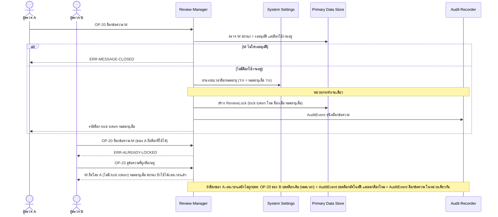
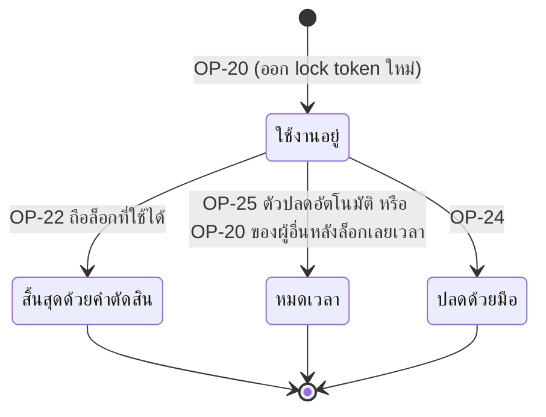

# Detailed Design: กันตรวจซ้ำระหว่างผู้ตรวจ (ฟีเจอร์ 14)

ที่มา: [[../../feature-list#14. กันตรวจซ้ำระหว่างผู้ตรวจ|Feature List ข้อ 14]], [[../../user-journey#Journey: อาจารย์/Admin ตรวจและอนุมัติข้อความ|Journey ผู้ตรวจ]], [[../api-spec|API Spec]] OP-19, OP-20, OP-23, [[../db-spec#3.16 ReviewLock (ล็อกข้อความระหว่างตรวจ พร้อม lock token)|DB Spec ReviewLock]], [[../architecture#4.5 อาจารย์/Admin ตรวจและตัดสินข้อความ (รวมกรณีไม่ถือล็อกที่ใช้ได้)|Architecture 4.5]]
FR/NFR: [[../../../01-requirements/01-spec/20261014-02-peer-advice-chat|FR-18]], [[../../../01-requirements/01-spec/20261016-02-peer-chat-recipients-lock-resubmit|FR-21]], [[../../../01-requirements/01-spec/20261016-03-first-sync-failure-and-expired-lock-decision|FR-24]]
Test case: [[../../../03-testing/01-test-plan/test-cases/duplicate-review-lock|duplicate-review-lock]]

## 1. Sequence Flow

## 2. Operation ↔ Entity

| Operation | Entity | กระทำ |
|-----------|--------|-------|
| [[../api-spec#OP-20 ล็อกข้อความเพื่อตรวจ\|OP-20]] | ChatMessage | อ่าน (ต้องรออนุมัติ) |
| OP-20 | ReviewLock | สร้างล็อกใหม่ / แก้ล็อกเดิมที่เลยเวลาเป็นหมดเวลา |
| OP-20 | AuditEvent | สร้าง ชนิดล็อกข้อความ และ (กรณีปลดล็อกเดิมที่เลยเวลา) ชนิดปลดล็อกอัตโนมัติ สำหรับล็อกเดิม (ผู้กระทำว่าง) ในหน่วยเดียวกัน |
| [[../api-spec#OP-19 ดูคิวรออนุมัติ\|OP-19]] | ChatMessage, ReviewLock | อ่าน ซ่อนข้อความที่ล็อกใช้ได้ |
| [[../api-spec#OP-23 ดูข้อความที่ถูกล็อกอยู่\|OP-23]] | ReviewLock | อ่าน (ไม่เปิดเผย lock token) |

## 3. State Transition (ReviewLock.สถานะล็อก)

ล็อกที่สิ้นสุดแล้วเก็บเป็นประวัติ ไม่ลบ ล็อกใหม่ของข้อความเดิมได้ lock token ใหม่เสมอ ข้อความมีล็อก "ใช้งานอยู่" ได้ไม่เกิน 1

## 4. Edge Case

| กรณี | วิธีจัดการ | อ้างอิง |
|------|-------------|---------|
| ผู้อื่นถือล็อกที่ยังไม่หมดอายุ | ERR-ALREADY-LOCKED | FR-18 |
| ผู้ตรวจ 2 คนล็อกพร้อมกัน | ได้ล็อก "ใช้งานอยู่" ได้เพียงรายการเดียว อีกคน ERR-ALREADY-LOCKED (ต้องรับประกันที่ชั้น technology ดู api-spec หัวข้อ 11) | FR-18 |
| ข้อความไม่อยู่สถานะรออนุมัติ (ตัดสินแล้ว) | ERR-MESSAGE-CLOSED | OP-20 |
| ล็อกเดิมเลยเวลาแต่ยังไม่ถูกปลด | ปลดล็อกเดิม (หมดเวลา) พร้อม AuditEvent ปลดล็อกอัตโนมัติ แล้วออกล็อกใหม่พร้อม AuditEvent ล็อกข้อความ ในหน่วยเดียว (ประวัติล็อกครบ) | OP-20 กฎข้อ 3 |
| ผู้ถือล็อกที่ใช้ได้เรียก OP-20 ซ้ำ | คืนล็อกและ token เดิม ไม่ต่ออายุ (สมมติฐานชั่วคราว) | OP-20 กฎข้อ 5 |
| รหัสข้อความไม่มี | ERR-NOT-FOUND | OP-20 |
| ระยะเวลาล็อกหมดอายุยังไม่กำหนด (Review Manager อ่านจาก System Settings) | หมดอายุเมื่อ ว่าง ล็อกไม่หมดอัตโนมัติ ต้องปลดด้วยมือ | db-spec ข้อสมมติฐาน |
| ผู้ถือล็อกถูกปิดบัญชี | ล็อกไม่ถูกปลดอัตโนมัติ รอหมดเวลาหรือปลดด้วยมือ | OP-30 |
| ผู้ใช้ดู lock token ของผู้อื่น | ไม่ได้ OP-23 ไม่ส่ง token | OP-23 |

## 5. ช่องว่างที่พบ

ไม่มี (ช่องว่างเรื่อง AuditEvent ของล็อกเดิมที่เลยเวลาปิดแล้วใน OP-20 กฎข้อ 3) ข้อสมมติฐานที่คงไว้: ผู้ถือล็อกที่ใช้ได้เรียก OP-20 ซ้ำ คืนล็อกและ token เดิม ไม่ต่ออายุ
