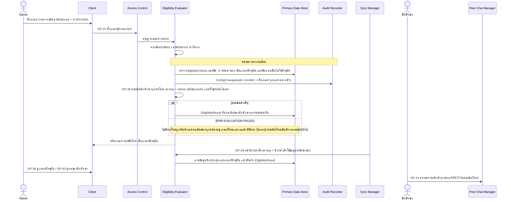
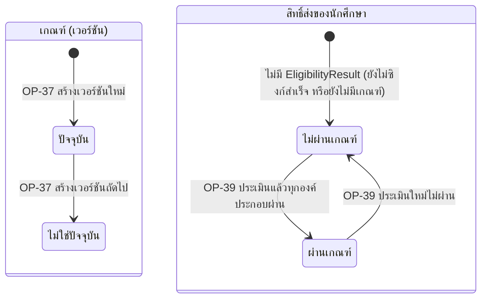

# Detailed Design: นิยามและประเมินเกณฑ์ผู้ผ่านเกณฑ์ (ฟีเจอร์ 25)

ที่มา: [[../../feature-list#25. นิยามและประเมินเกณฑ์ผู้ผ่านเกณฑ์|Feature List ข้อ 25]], [[../../user-journey#Journey: Admin จัดการบัญชี บทบาท ความสัมพันธ์ครู-ผู้เรียน และเกณฑ์ผู้ผ่านเกณฑ์|Journey Admin]], [[../../user-journey#Journey: นักศึกษาผู้ส่งข้อความแนะนำแนวทางการเรียน|Journey ผู้ส่ง]], [[../api-spec#7. กลุ่ม E: บัญชี บทบาท ความสัมพันธ์ครู-ผู้เรียน และเกณฑ์ผู้ผ่านเกณฑ์|API Spec กลุ่ม E]], [[../db-spec#3.20 EligibilityCriteria / EligibilityCriteriaItem (เกณฑ์ "ผู้ผ่านเกณฑ์")|DB Spec EligibilityCriteria]], [[../db-spec#3.21 EligibilityResult (ผลผ่านเกณฑ์ที่เก็บล่วงหน้า)|EligibilityResult]], [[../architecture#4.8 Admin จัดการบัญชี บทบาท ความสัมพันธ์ครู-ผู้เรียน และเกณฑ์ผู้ผ่านเกณฑ์|Architecture 4.8]]
FR/NFR: [[../../../01-requirements/01-spec/20261017-01-user-role-advisor-eligibility-management|FR-27, NFR-07]] (ต่อยอด [[../../../01-requirements/01-spec/20261014-02-peer-advice-chat|FR-16]])
Test case: ยังไม่มี test case ของฟีเจอร์ 25 ใช้ slug `eligibility-criteria` เมื่อ test-writer สร้าง

## 1. Sequence Flow

ลำดับที่ต้องรักษา: บันทึกเกณฑ์ใหม่และ audit ก่อน แล้วจึงเรียก OP-39 (ผลประเมินใช้เกณฑ์ใหม่) ในกรณีหลังซิงก์ ต้องหลัง OP-27 เพราะบัญชีและบทบาทนักศึกษาต้องเป็นปัจจุบันก่อนประเมิน

## 2. Operation ↔ Entity

| Operation | ผู้เรียก | Entity | กระทำ |
|-----------|---------|--------|-------|
| [[../api-spec#OP-37 ตั้งเกณฑ์ผู้ผ่านเกณฑ์\|OP-37]] | Admin | EligibilityCriteria, EligibilityCriteriaItem | สร้างเวอร์ชันใหม่ / แก้ เป็นเกณฑ์ปัจจุบัน ของเวอร์ชันก่อน (ไม่ลบ) |
| OP-37 | Admin | ConfigChangeAudit (หมวด = เกณฑ์ผู้ผ่านเกณฑ์) | สร้าง |
| [[../api-spec#OP-38 ดูเกณฑ์ผู้ผ่านเกณฑ์ปัจจุบัน\|OP-38]] | Admin | EligibilityCriteria, EligibilityCriteriaItem | อ่าน (เลือกดูประวัติเวอร์ชัน) |
| [[../api-spec#OP-39 ประเมินผลผ่านเกณฑ์ของนักศึกษาใหม่\|OP-39]] | ระบบ | EligibilityCriteria (อ่านปัจจุบัน), SyncState, GradeRecord/AttendanceRecord/AssignmentRecord, User, UserRole | อ่าน |
| OP-39 | EligibilityResult | สร้าง/ทับผลเดิม (1 ต่อนักศึกษา) แบบทั้งชุดหรือไม่เลย (ล้มเหลว = ERR-EVALUATION-FAILED ไม่มีผลใหม่) |
| [[../api-spec#OP-40 ดูผลผ่านเกณฑ์ของนักศึกษา\|OP-40]] | Admin | EligibilityResult | อ่าน |
| [[../api-spec#OP-14 ตรวจสถานะสิทธิ์ส่งข้อความ\|OP-14]] | นักศึกษา | EligibilityResult | อ่านเฉพาะของตน |
| OP-15/OP-16 (ฟีเจอร์ 10, 21) | นักศึกษา | EligibilityResult → ChatMessage.เกณฑ์ ณ เวลาส่ง | อ่านแล้วบันทึกเวอร์ชันที่ใช้ |

## 3. State Transition

เกณฑ์มี "ปัจจุบัน" ได้เพียงเวอร์ชันเดียว เวอร์ชันเก่าเก็บถาวร ผลผ่านเกณฑ์เปลี่ยนเฉพาะตอน OP-39 รัน (ซิงก์สำเร็จหรือ Admin เปลี่ยนเกณฑ์)

## 4. Edge Case

| กรณี | วิธีจัดการ | อ้างอิง |
|------|-------------|---------|
| ไม่มีองค์ประกอบ หรือค่าว่าง | ERR-INVALID-INPUT ไม่สร้างเวอร์ชัน | OP-37 |
| ยังไม่มีเกณฑ์ปัจจุบัน หรือยังไม่เคยซิงก์สำเร็จ | OP-39 ไม่สร้างผลใด (ERR-NO-SYNC-DATA เมื่อไม่เคยซิงก์) นักศึกษาถือว่าไม่ผ่านเกณฑ์ | OP-39, db-spec 3.21 |
| รอผลประเมินใหม่หลัง OP-37 | ผลเดิมยังใช้ตัดสินสิทธิ์ส่ง (สมมติฐานชั่วคราว) | OP-37 |
| OP-39 ล้มเหลวกลางทาง (ERR-EVALUATION-FAILED) | ไม่เหลือผลใหม่บางส่วน ผลเดิมของทุกคนคงอยู่ (ไม่มีสถานะผสมเกณฑ์เก่า-ใหม่) ไม่ลองใหม่เองจนกว่าจะมีการกระตุ้นถัดไป (ซิงก์สำเร็จ หรือ Admin ตั้งเกณฑ์อีกครั้ง) | OP-39 |
| OP-39 ล้มเหลวหลัง OP-37 | เกณฑ์ใหม่และ ConfigChangeAudit ยังมีผล ไม่ถอย | OP-37 |
| OP-39 ล้มเหลวหลังซิงก์สำเร็จ | ผลซิงก์ยังเป็นสำเร็จ ดำเนินต่อ OP-07 ผลผ่านเกณฑ์เดิมคงอยู่ | OP-06 ข้อ 2 |
| ซิงก์ล้มเหลว | ไม่เรียก OP-39 ผลเดิมคงอยู่ | OP-06, OP-39 |
| นักศึกษาหลุดเกณฑ์หลังส่งข้อความ | ข้อความที่ส่งแล้วไม่ถูกกระทบ ตรวจต่อได้ กระทบเฉพาะการส่งครั้งถัดไป | FR-27 |
| ข้อมูลไม่พอสำหรับองค์ประกอบใด | ถือว่าไม่ผ่านองค์ประกอบนั้น (ข้อสมมติฐาน) ผลรวมผ่านเมื่อทุกองค์ประกอบผ่าน | db-spec หัวข้อ 8 |
| บัญชีนักศึกษาที่ Admin เพิ่มใหม่ | ไม่ผ่านจนถึงรอบ OP-39 ถัดไป | OP-29 |
| บัญชีปิดใช้งาน/ถอนบทบาทนักศึกษา | ไม่ถูกประเมิน (ประเมินเฉพาะบัญชีใช้งานและบทบาทนักศึกษาใช้งาน) | OP-39 |
| ผู้เรียกไม่ใช่ Admin (OP-37/38/40) | ERR-FORBIDDEN | กติกากลาง |
| ขอผลของนักศึกษาที่ไม่มี | ERR-NOT-FOUND | OP-40 |
| นักศึกษาไม่มีผลประเมิน | OP-40 แสดง "ยังไม่ประเมิน" OP-14 ตอบเท็จ | OP-40, OP-14 |
| การประเมินใหม่ไม่ต้องมี ConfigChangeAudit | ตั้งใจ (NFR-07 ครอบคลุมตัวเกณฑ์) ผลประเมินเก็บ เกณฑ์ที่ใช้/เวลาประเมินแทน | db-spec 3.22 |

## 5. ช่องว่างที่พบ

- องค์ประกอบของเกณฑ์ (ชนิดและวิธีประเมิน เช่น GPA ขั้นต่ำ ผ่านรายวิชา) ยังไม่กำหนดใน REQ-06 api-spec/db-spec เก็บเป็น "ชนิดองค์ประกอบ + ค่าที่กำหนด" แบบข้อความ ทำให้ **วิธีประเมินแต่ละชนิดยังออกแบบไม่ได้** ในระดับ component เอกสารนี้ออกแบบเฉพาะลำดับและสถานะ แนะนำให้ผู้ใช้ตอบคำถามเปิดข้อ 10 ของ REQ-06 ผ่าน `capture-requirement` แล้วรัน `sync-api-db`
- (ปิดแล้ว) กรณีข้อผิดพลาดกลางทางระหว่างประเมิน: OP-39 เป็นแบบทั้งชุดหรือไม่เลย ตอบ ERR-EVALUATION-FAILED ผลเดิมคงอยู่ และ OP-37 ไม่ถอยเกณฑ์ใหม่/audit ไม่ถือเป็นช่องว่างอีก
