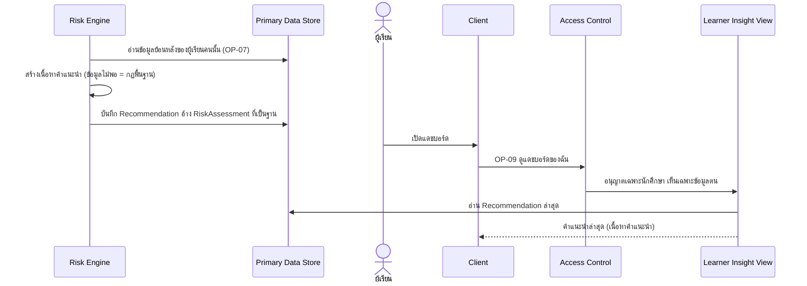

# Detailed Design: คำแนะนำการเรียนเฉพาะบุคคล (ฟีเจอร์ 5)

ที่มา: [[../../feature-list#5. คำแนะนำการเรียนเฉพาะบุคคล|Feature List ข้อ 5]], [[../../user-journey#Journey: ผู้เรียนรับแจ้งเตือนความเสี่ยงและคำแนะนำ|Journey ผู้เรียน]], [[../api-spec|API Spec]] OP-07, OP-09, OP-10, [[../db-spec#3.12 Recommendation (คำแนะนำเฉพาะบุคคล)|DB Spec Recommendation]], [[../architecture#4.2 ผู้เรียนรับแจ้งเตือน ดูแดชบอร์ด คำแนะนำ และประวัติ|Architecture 4.2]]
FR/NFR: [[../../../01-requirements/01-spec/20261014-01-student-risk-alert|FR-05]]
Test case: [[../../../03-testing/01-test-plan/test-cases/personalized-advice|personalized-advice]]

## 1. Sequence Flow

การดูย้อนหลังใช้ OP-10 (ดูฟีเจอร์ 8)

## 2. Operation ↔ Entity

| Operation | Entity | กระทำ |
|-----------|--------|-------|
| [[../api-spec#OP-07 ประเมินความเสี่ยงผู้เรียน\|OP-07]] | Recommendation | สร้างทุกรอบประเมิน (ผูก RiskAssessment ฐาน) |
| [[../api-spec#OP-09 ดูแดชบอร์ดของฉัน\|OP-09]] | Recommendation | อ่านล่าสุด |
| [[../api-spec#OP-10 ดูประวัติการแจ้งเตือนและคำแนะนำ\|OP-10]] | Recommendation | อ่านประวัติ |

## 3. State Transition

ไม่มี (Recommendation เป็นบันทึกต่อรอบ ไม่แก้หลังสร้าง)

## 4. Edge Case

| กรณี | วิธีจัดการ | อ้างอิง |
|------|-------------|---------|
| ผู้เรียนใหม่ ข้อมูลย้อนหลังไม่พอ | สร้างจากกฎพื้นฐาน "สร้างจากกฎพื้นฐาน" = จริง | FR-05, assumption REQ-01 |
| สถานะข้อมูล = รอข้อมูล | ไม่ส่งคำแนะนำใดๆ ให้ผู้เรียน (OP-09 แสดงเฉพาะสถานะ) | FR-23 |
| สถานะข้อมูล = ไม่ทันสมัย | ส่งคำแนะนำล่าสุดพร้อมป้าย | FR-19 |
| ผู้เรียนขอคำแนะนำของผู้อื่น | ไม่มีช่องทาง OP-09 ใช้ตัวตนผู้เรียก OP-10 ตอบ ERR-FORBIDDEN | NFR-01 |
| ผลประเมินไม่เสี่ยง | api-spec สร้าง Recommendation ทุกรอบ ไม่ขึ้นกับเสี่ยงหรือไม่ (ดูข้อ 5) | OP-07 กฎข้อ 4 |

## 5. ช่องว่างที่พบ

- spec/api-spec ไม่ได้กำหนดว่าเนื้อหาคำแนะนำสร้างด้วยวิธีใด (กฎ/แม่แบบ/AI) และเมื่อผู้เรียนไม่เสี่ยงควรมีคำแนะนำหรือไม่ เอกสารนี้ถือตาม OP-07 ว่าสร้างทุกรอบ ไม่ได้ตัดสินใจเพิ่ม
