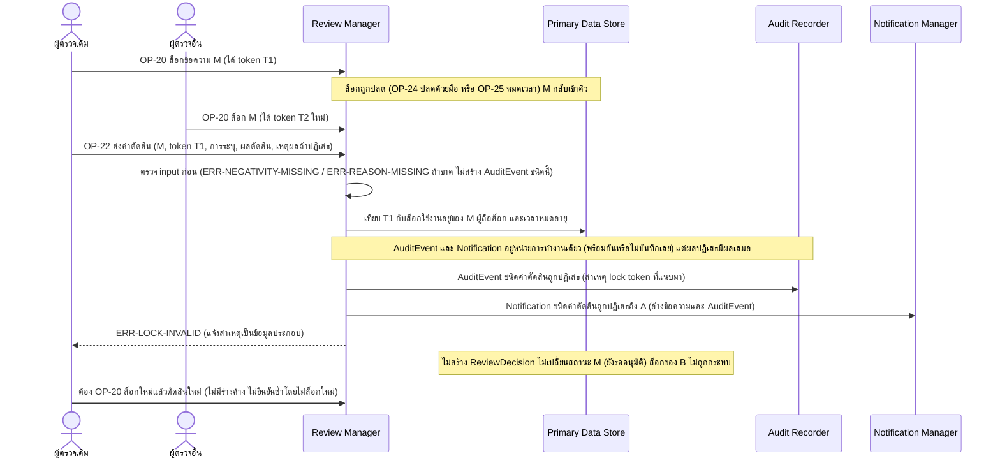

# Detailed Design: ปฏิเสธคำตัดสินเมื่อผู้ตัดสินไม่ได้ถือล็อกที่ยังใช้ได้ (ฟีเจอร์ 22)

ที่มา: [[../../feature-list#22. ปฏิเสธคำตัดสินเมื่อผู้ตัดสินไม่ได้ถือล็อกที่ยังใช้ได้|Feature List ข้อ 22]], [[../../user-journey#Journey: อาจารย์/Admin ตรวจและอนุมัติข้อความ|Journey ผู้ตรวจ]], [[../../user-journey#Journey: อาจารย์/Admin ปลดล็อกข้อความที่ผู้ตรวจค้างด้วยมือ|Journey ปลดล็อกด้วยมือ]], [[../api-spec|API Spec]] OP-20, OP-22, OP-13, OP-26, [[../db-spec|DB Spec]], [[../architecture#4.5 อาจารย์/Admin ตรวจและตัดสินข้อความ (รวมกรณีไม่ถือล็อกที่ใช้ได้)|Architecture 4.5]], [[../architecture#4.6 ปลดล็อกข้อความที่ผู้ตรวจค้าง (อัตโนมัติและด้วยมือ)|Architecture 4.6]]
FR/NFR: [[../../../01-requirements/01-spec/20261016-03-first-sync-failure-and-expired-lock-decision|FR-24]] (สอดคล้อง NFR-04, NFR-05)
Test case: [[../../../03-testing/01-test-plan/test-cases/reject-decision-without-valid-lock|reject-decision-without-valid-lock]]

## 1. Sequence Flow

ตัวอย่างหลัก: ผู้ตรวจ A ถือล็อก → ล็อกถูกปลด/หมดเวลา → ผู้ตรวจ B ล็อกต่อ → A กดตัดสินด้วย token เดิม

## 2. Operation ↔ Entity

| Operation | Entity | กระทำ |
|-----------|--------|-------|
| [[../api-spec#OP-22 ส่งคำตัดสินข้อความ\|OP-22]] (กรณีไม่ถือล็อกที่ใช้ได้) | ReviewLock | อ่านเทียบ (ไม่แก้) |
| OP-22 | AuditEvent | สร้าง ชนิดคำตัดสินถูกปฏิเสธ + สาเหตุที่ไม่ถือล็อกที่ใช้ได้ + lock token ที่แนบมา |
| OP-22 | Notification | สร้าง ชนิดคำตัดสินถูกปฏิเสธ ผู้รับ = ผู้เรียก (ผู้ตรวจ) อ้าง ChatMessage และ AuditEvent |
| OP-22 | ReviewDecision, ChatMessage | **ไม่สร้าง ไม่แก้** |
| [[../api-spec#OP-13 ดูการแจ้งเตือนในระบบของฉัน\|OP-13]] | Notification | ผู้ตรวจเห็นการแจ้งคำตัดสินถูกปฏิเสธ |
| [[../api-spec#OP-26 ดูประวัติการตรวจ\|OP-26]] | AuditEvent | อ่านสาเหตุ |

## 3. State Transition

ไม่มีการเปลี่ยนสถานะของ ChatMessage หรือ ReviewLock จากการตัดสินที่ถูกปฏิเสธ แสดงผลการตัดสินว่าล็อกใช้ได้หรือไม่ด้วย decision table

| สาเหตุ (AuditEvent.สาเหตุที่ไม่ถือล็อกที่ใช้ได้) | เงื่อนไขที่ตรวจพบ | ผล |
|--------------------------------------------------|---------------------|-----|
| ล็อกหมดเวลา | ล็อกของ token นั้นสถานะ หมดเวลา หรือเลย หมดอายุเมื่อ | ปฏิเสธ |
| ปลดด้วยมือ | ล็อกของ token นั้นสถานะ ปลดด้วยมือ | ปฏิเสธ |
| ผู้อื่นล็อกต่อ | ล็อกใช้งานอยู่ของข้อความเป็นของผู้อื่น/token ไม่ตรง | ปฏิเสธ |
| ข้อความถูกตัดสินแล้ว | ข้อความไม่ใช่ รออนุมัติ | ปฏิเสธ |
| ไม่เคยถือล็อก | ไม่มี token หรือไม่เคยมีล็อกของผู้เรียก | ปฏิเสธ |
| ล็อกใช้งานอยู่ ผู้ถือ = ผู้เรียก token ตรง ยังไม่หมดอายุ | - | ตัดสินสำเร็จตาม [[review-and-decision]] |

ทุกสาเหตุปฏิบัติเหมือนกัน (ERR-LOCK-INVALID รหัสเดียว)

## 4. Edge Case

| กรณี | วิธีจัดการ | อ้างอิง |
|------|-------------|---------|
| ผู้ตรวจกดตัดสินด้วย token ของล็อกเดิมที่ถูกปลดแล้ว แต่ตนเป็นคนล็อกใหม่ (ล็อกใหม่ token ใหม่) | token เก่าไม่ตรงล็อกปัจจุบัน → ปฏิเสธ (แยกล็อกเก่า/ใหม่ของคนเดิมได้เพราะ lock token) | Architecture หัวข้อ 6 ประเด็น 1 |
| ล็อกหมดอายุแล้วแต่ตัวปลดอัตโนมัติยังไม่ทำงาน | เทียบเวลาหมดอายุตอนรับคำตัดสินเสมอ ปฏิเสธ | db-spec 3.16 |
| ผู้ตรวจเรียก OP-22 ตรงโดยไม่ผ่านหน้าจอ | ปฏิบัติเหมือนกัน | OP-22 ข้อ 5 |
| input ขาดการระบุ/เหตุผล | error ตัวอื่นก่อนเทียบล็อก ไม่มี AuditEvent ชนิดนี้ ไม่มี Notification | OP-22 |
| คำตัดสินถูกปฏิเสธซ้ำจากผู้ตรวจเดิม | แต่ละครั้งสร้าง AuditEvent และ Notification ใหม่ (api-spec ไม่กำหนดการรวม) | OP-22 |
| ผู้ตรวจอื่นที่ถือล็อกอยู่ | ไม่ได้รับแจ้งและไม่กระทบ (คำถามเปิดใน REQ-05) | api-spec หัวข้อ 11 |
| การสร้าง Notification หรือ AuditEvent ล้มเหลว | AuditEvent และ Notification อยู่หน่วยการทำงานเดียว (บันทึกพร้อมกันหรือไม่บันทึกเลย) แต่ผลปฏิเสธคำตัดสินมีผลเสมอ: ไม่สร้าง ReviewDecision ไม่เปลี่ยนสถานะข้อความ ผู้เรียกยังได้ ERR-LOCK-INVALID | OP-22 ข้อ 5 |
| ผู้ตรวจที่ถูกปิดบัญชี | ERR-ACCOUNT-DISABLED ก่อนถึงการเทียบล็อก ไม่มี AuditEvent ชนิดนี้ | กติกากลาง |

## 5. ช่องว่างที่พบ

ไม่มี (ช่องว่างเรื่องหน่วยการทำงานของกรณีปฏิเสธปิดแล้วใน OP-22 ข้อ 5) กรณีผู้ตรวจไม่ผ่านการตรวจสิทธิ์บทบาทหรือบัญชีถูกปิด ไม่มีการบันทึก AuditEvent ตามกติกากลาง ข้อสมมติฐานที่คงไว้: ผู้ตรวจอื่นที่ล็อกอยู่ไม่ได้รับแจ้ง (คำถามเปิดใน REQ-05)
