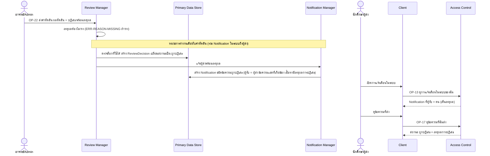

# Detailed Design: ปฏิเสธพร้อมเหตุผลและแจ้งผู้ส่ง (ฟีเจอร์ 13)

ที่มา: [[../../feature-list#13. ปฏิเสธพร้อมเหตุผลและแจ้งผู้ส่ง|Feature List ข้อ 13]], [[../../user-journey#Journey: อาจารย์/Admin ตรวจและอนุมัติข้อความ|Journey ผู้ตรวจ]], [[../../user-journey#Journey: นักศึกษาผู้ส่งข้อความแนะนำแนวทางการเรียน|Journey ผู้ส่ง]], [[../api-spec|API Spec]] OP-22, OP-13, OP-17, [[../db-spec|DB Spec]], [[../architecture#4.5 อาจารย์/Admin ตรวจและตัดสินข้อความ (รวมกรณีไม่ถือล็อกที่ใช้ได้)|Architecture 4.5]]
FR/NFR: [[../../../01-requirements/01-spec/20261014-02-peer-advice-chat|FR-15]]
Test case: [[../../../03-testing/01-test-plan/test-cases/reject-with-reason|reject-with-reason]]

## 1. Sequence Flow

ผู้ส่งไม่เห็นผลการระบุเชิงลบ/ไม่เชิงลบ และไม่เห็นว่าใครเป็นผู้ตรวจ

## 2. Operation ↔ Entity

| Operation | Entity | กระทำ |
|-----------|--------|-------|
| [[../api-spec#OP-22 ส่งคำตัดสินข้อความ\|OP-22]] | ReviewDecision (เหตุผลการปฏิเสธ) | สร้าง |
| OP-22 | ChatMessage | แก้สถานะ → ถูกปฏิเสธ |
| OP-22 | Notification (ชนิดข้อความถูกปฏิเสธ ผู้รับ = ผู้ส่ง) | สร้าง |
| [[../api-spec#OP-13 ดูการแจ้งเตือนในระบบของฉัน\|OP-13]] | Notification | อ่านเฉพาะของตน |
| [[../api-spec#OP-17 ดูข้อความที่ฉันส่ง\|OP-17]] | ChatMessage, ReviewDecision | อ่านเหตุผลเฉพาะสถานะ ถูกปฏิเสธ |

## 3. State Transition

ใช้สถานะข้อความตาม [[review-and-decision#3. State Transition|review-and-decision]] การปฏิเสธเป็นสถานะปลายทาง ผู้ส่งแก้ข้อความเดิมไม่ได้ ต้องสร้างใหม่ตามฟีเจอร์ 21

## 4. Edge Case

| กรณี | วิธีจัดการ | อ้างอิง |
|------|-------------|---------|
| ปฏิเสธโดยเหตุผลว่าง | ERR-REASON-MISSING ไม่บันทึกอะไร | FR-15 |
| ผู้ตัดสินไม่ถือล็อกที่ใช้ได้ | ไม่สร้างคำตัดสิน **และไม่แจ้งผู้ส่ง** (ไม่มีการปฏิเสธเกิดขึ้น) แจ้งเฉพาะผู้ตรวจ | FR-24 |
| อนุมัติข้อความ | ไม่แจ้งผู้ส่ง (นอกขอบเขต REQ-02) ผู้ส่งเห็นสถานะผ่าน OP-17 | OP-22 กฎข้อ 4 |
| ผู้ส่งบัญชีถูกปิดใช้งานหลังถูกปฏิเสธ | Notification ยังอยู่ แต่ผู้ส่งเรียก OP-13/OP-17 ไม่ได้ | กติกากลาง |
| การสร้าง Notification ล้มเหลว | ถอยทั้งหน่วยของคำตัดสิน เพราะ Notification (รายการในระบบ) อยู่ในหน่วยการทำงานเดียวกับคำตัดสิน จึงไม่มีการปฏิเสธที่ผู้ส่งไม่ได้รับแจ้ง | OP-22 ข้อ 4 |
| นักศึกษาคนอื่นขอเหตุผลการปฏิเสธ | ไม่เห็น (OP-17 เฉพาะของตน OP-18 ไม่ส่งเหตุผล) | NFR-04 |

## 5. ช่องว่างที่พบ

ไม่มี (ช่องว่างเรื่องหน่วยการทำงานของ Notification ถึงผู้ส่งปิดแล้วใน OP-22 ข้อ 4)
