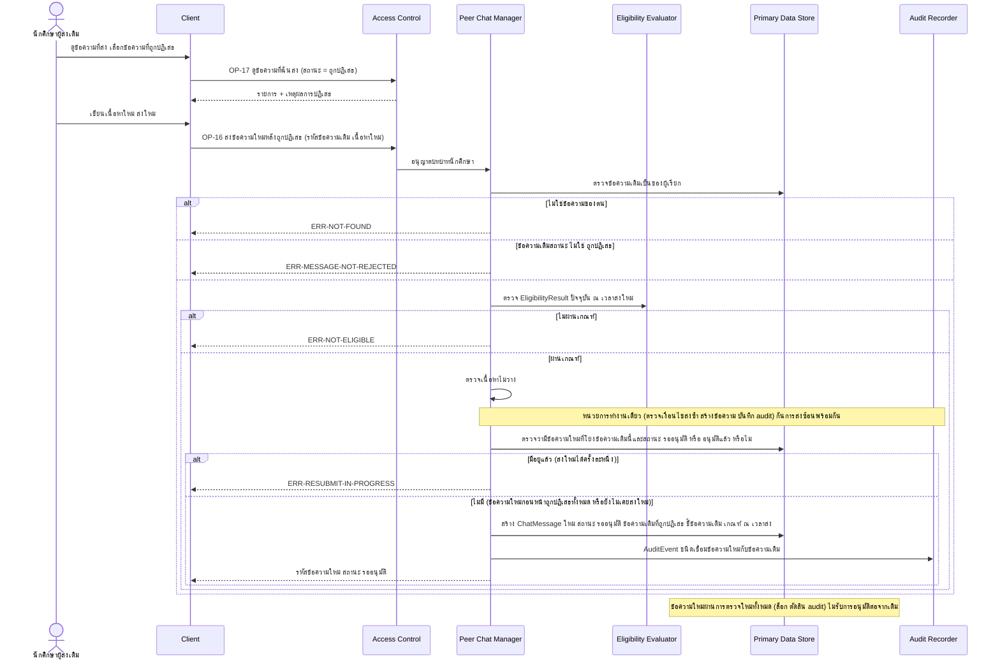
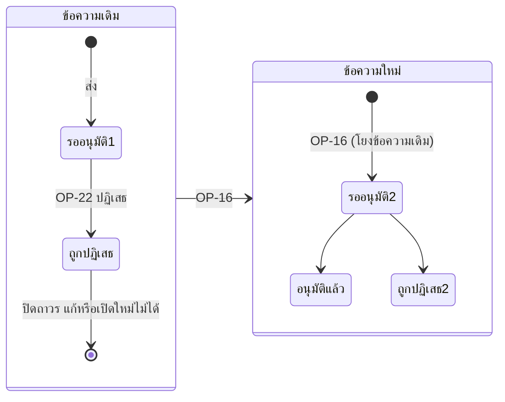

# Detailed Design: ส่งข้อความใหม่หลังถูกปฏิเสธ (ฟีเจอร์ 21)

ที่มา: [[../../feature-list#21. ส่งข้อความใหม่หลังถูกปฏิเสธ|Feature List ข้อ 21]], [[../../user-journey#Journey: นักศึกษาผู้ส่งข้อความแนะนำแนวทางการเรียน|Journey ผู้ส่ง]], [[../api-spec|API Spec]] OP-16 (ERR-RESUBMIT-IN-PROGRESS), OP-17, OP-19, OP-26, [[../db-spec#3.15 ChatMessage (ข้อความในห้องรวม)|DB Spec ChatMessage]], [[../architecture#4.4 นักศึกษาผู้ส่งข้อความ และการส่งใหม่หลังถูกปฏิเสธ|Architecture 4.4]]
FR/NFR: [[../../../01-requirements/01-spec/20261016-02-peer-chat-recipients-lock-resubmit|FR-22]], [[../../../01-requirements/01-spec/20261014-02-peer-advice-chat|NFR-05, FR-16]]
Test case: [[../../../03-testing/01-test-plan/test-cases/resubmit-after-reject|resubmit-after-reject]]

## 1. Sequence Flow

## 2. Operation ↔ Entity

| Operation | Entity | กระทำ |
|-----------|--------|-------|
| [[../api-spec#OP-17 ดูข้อความที่ฉันส่ง\|OP-17]] | ChatMessage, ReviewDecision | อ่านเหตุผลการปฏิเสธ |
| [[../api-spec#OP-16 ส่งข้อความใหม่หลังถูกปฏิเสธ\|OP-16]] | ChatMessage (เดิม) | อ่านเท่านั้น (ไม่แก้ ไม่เปิดใหม่) |
| OP-16 | ChatMessage (ข้อความใหม่เดิมที่โยงข้อความเดิมนี้) | อ่านตรวจกฎส่งใหม่ครั้งละหนึ่ง (รออนุมัติ/อนุมัติแล้ว = ปฏิเสธ) |
| OP-16 | EligibilityResult | อ่านตรวจใหม่ |
| OP-16 | ChatMessage (ใหม่) | สร้าง พร้อม ข้อความเดิมที่ถูกปฏิเสธ และเกณฑ์ ณ เวลาส่ง |
| OP-16 | AuditEvent | สร้าง ชนิดเชื่อมข้อความใหม่กับข้อความเดิม (ข้อความ = ใหม่ ข้อความเดิมที่เกี่ยวข้อง = เดิม) |
| [[../api-spec#OP-19 ดูคิวรออนุมัติ\|OP-19]] | ChatMessage | อ่าน ผู้ตรวจเห็นข้อความเดิมที่เกี่ยวข้อง |
| [[../api-spec#OP-26 ดูประวัติการตรวจ\|OP-26]] | AuditEvent | อ่านความสัมพันธ์เดิม-ใหม่ |

## 3. State Transition

(รออนุมัติ1/รออนุมัติ2 คือสถานะ รออนุมัติ เดียวกัน แยกชื่อเพื่อความถูกต้องของแผนภาพ) กฎส่งใหม่ครั้งละหนึ่ง (ผู้ใช้ตัดสินแล้ว ทาง B): ข้อความเดิมหนึ่งข้อความมีข้อความใหม่ที่ "รออนุมัติหรืออนุมัติแล้ว" ได้ไม่เกิน 1 ข้อความ ถ้าข้อความใหม่ถูกปฏิเสธ จึงส่งใหม่ได้อีก (โยงกับข้อความเดิมเดียวกัน) cardinality ใน db-spec ยังเป็น 1 : N

## 4. Edge Case

| กรณี | วิธีจัดการ | อ้างอิง |
|------|-------------|---------|
| ส่งใหม่จากข้อความของผู้อื่น | ERR-NOT-FOUND | OP-16 |
| ข้อความเดิมยังรออนุมัติ/อนุมัติแล้ว | ERR-MESSAGE-NOT-REJECTED | OP-16 |
| ผู้ส่งหลุดเกณฑ์ก่อนส่งใหม่ | ERR-NOT-ELIGIBLE (ตรวจใหม่ ณ เวลาส่งใหม่) | FR-16, FR-27 |
| เนื้อหาใหม่ว่าง | ERR-INVALID-INPUT | OP-16 |
| ข้อความเดิมถูกแก้/เปิดใหม่ | ไม่มีช่องทาง (ปิดถาวร) | FR-22 |
| สร้างข้อความใหม่สำเร็จแต่ AuditEvent ล้มเหลว | ถอนทั้งหน่วย ไม่สร้างข้อความที่ไม่มีความสัมพันธ์ใน audit | NFR-05 |
| ข้อความใหม่อ้างการอนุมัติของเดิม | ไม่มี ต้องผ่านการตรวจใหม่ทั้งหมด | FR-22 |
| มีข้อความใหม่จากข้อความเดิมนี้ที่ยังรออนุมัติหรืออนุมัติแล้ว | ERR-RESUBMIT-IN-PROGRESS ไม่สร้างข้อความ ไม่บันทึก audit | OP-16, ผู้ใช้ตัดสิน ทาง B |
| ข้อความใหม่ก่อนหน้าถูกปฏิเสธทั้งหมด | ส่งใหม่ได้อีก (โยงข้อความเดิมเดียวกัน) | OP-16 |
| ผู้ส่งส่งใหม่ซ้อนพร้อมกันสองคำขอ | การตรวจเงื่อนไข การสร้าง และ audit อยู่หน่วยเดียว คำขอหนึ่งสำเร็จ อีกคำขอ ERR-RESUBMIT-IN-PROGRESS (วิธีรับประกันรอ technology) | OP-16 |
| ข้อความใหม่ได้รับการตรวจ/ลำดับ OP-19 | ผู้ตรวจเห็นข้อความเดิมที่เกี่ยวข้อง (assumption ใน api-spec หัวข้อ 11) | OP-19 |

## 5. ช่องว่างที่พบ

ไม่มี (ประเด็นจำนวนครั้งส่งใหม่ผู้ใช้ตัดสินแล้ว ทาง B บันทึกที่ [[../api-spec#8. บันทึกการตัดสินใจ|api-spec หัวข้อ 8]] และ [[../db-spec#8. บันทึกการตัดสินใจและประเด็นรอตัดสินใจ|db-spec หัวข้อ 8]])

## 6. บันทึกการตัดสินใจ

| ประเด็น | ตัวเลือก | ทางที่ผู้ใช้เลือก | วันที่ |
|---------|----------|-------------------|--------|
| จำนวนครั้งส่งใหม่จากข้อความเดิมที่ถูกปฏิเสธ (FR-22) | A ไม่จำกัด / B ครั้งละหนึ่ง / C ครั้งเดียวต่อข้อความเดิม | **B ครั้งละหนึ่ง** (ERR-RESUBMIT-IN-PROGRESS) | 2026-10-17 |
