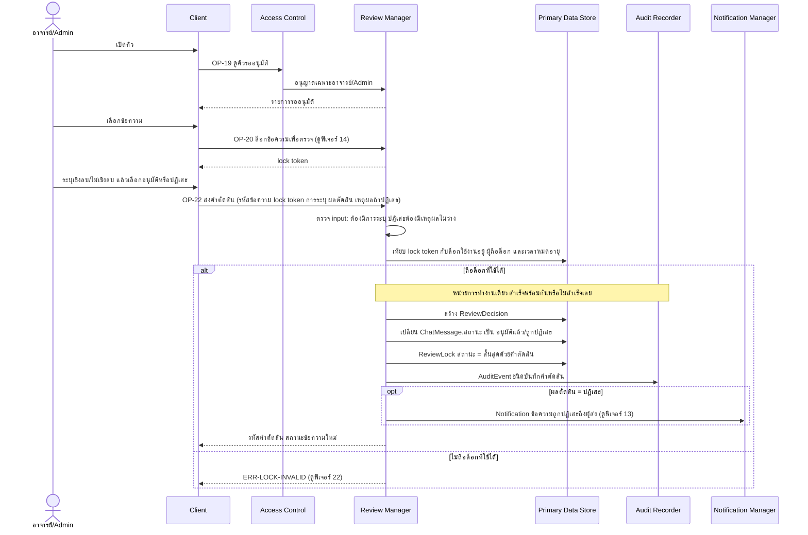
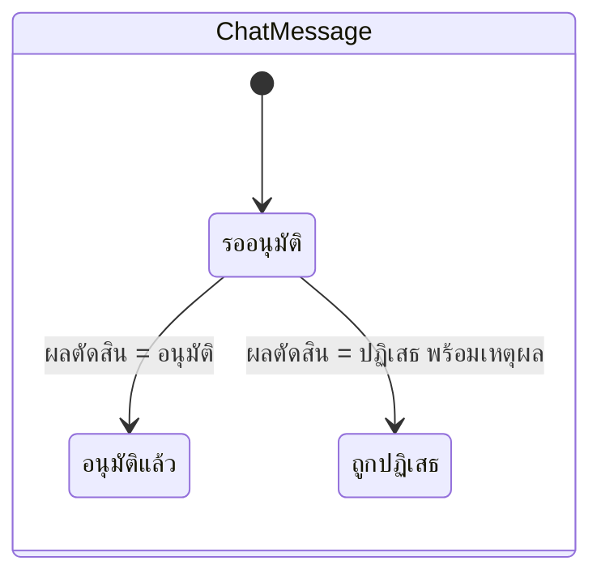

# Detailed Design: ตรวจ ระบุเชิงลบ และอนุมัติ/ปฏิเสธข้อความ (ฟีเจอร์ 12)

ที่มา: [[../../feature-list#12. ตรวจ ระบุเชิงลบ และอนุมัติ/ปฏิเสธข้อความ|Feature List ข้อ 12]], [[../../user-journey#Journey: อาจารย์/Admin ตรวจและอนุมัติข้อความ|Journey ผู้ตรวจ]], [[../api-spec|API Spec]] OP-19, OP-20, OP-22, [[../db-spec#3.17 ReviewDecision (คำตัดสินที่ถูกบันทึกจริง)|DB Spec ReviewDecision]], [[../architecture#4.5 อาจารย์/Admin ตรวจและตัดสินข้อความ (รวมกรณีไม่ถือล็อกที่ใช้ได้)|Architecture 4.5]]
FR/NFR: [[../../../01-requirements/01-spec/20261014-02-peer-advice-chat|FR-12, FR-13, FR-14]]
Test case: [[../../../03-testing/01-test-plan/test-cases/review-and-decision|review-and-decision]]

## 1. Sequence Flow

ลำดับที่ต้องรักษา: ตรวจ input (ERR-NEGATIVITY-MISSING, ERR-REASON-MISSING) ก่อนเทียบล็อก และ ReviewDecision ต้องถูกสร้างก่อนเปลี่ยนสถานะ ChatMessage (ReviewDecision อ้างล็อกที่ใช้ตัดสิน) ทั้งหมดอยู่ในหน่วยการทำงานเดียว

## 2. Operation ↔ Entity

| Operation | Entity | กระทำ |
|-----------|--------|-------|
| [[../api-spec#OP-19 ดูคิวรออนุมัติ\|OP-19]] | ChatMessage, ReviewLock | อ่าน |
| [[../api-spec#OP-22 ส่งคำตัดสินข้อความ\|OP-22]] | ReviewLock | อ่านเทียบ แล้วแก้สถานะล็อก = สิ้นสุดด้วยคำตัดสิน (สิ้นสุดเมื่อ) |
| OP-22 | ReviewDecision | สร้าง (หนึ่งข้อความไม่เกิน 1 รายการ) |
| OP-22 | ChatMessage | แก้สถานะ (รออนุมัติ → อนุมัติแล้ว/ถูกปฏิเสธ) |
| OP-22 | AuditEvent | สร้าง ชนิดบันทึกคำตัดสิน |
| OP-22 (ปฏิเสธ) | Notification | สร้าง ชนิดข้อความถูกปฏิเสธ |

## 3. State Transition

สถานะข้อความและล็อกที่เปลี่ยนจาก OP-22 (ถือล็อกที่ใช้ได้)

การระบุเชิงลบ/ไม่เชิงลบ ไม่เปลี่ยนสถานะเอง เชิงลบไม่ถูกปฏิเสธอัตโนมัติ ผู้ตรวจเลือกผลตัดสินเสมอ (FR-14)

## 4. Edge Case

| กรณี | วิธีจัดการ | อ้างอิง |
|------|-------------|---------|
| ไม่ระบุเชิงลบ/ไม่เชิงลบ | ERR-NEGATIVITY-MISSING ก่อนเทียบล็อก ไม่สร้าง AuditEvent ชนิดคำตัดสินถูกปฏิเสธ | FR-12, OP-22 |
| เลือกปฏิเสธแต่เหตุผลว่าง | ERR-REASON-MISSING ก่อนเทียบล็อก | FR-15, OP-22 |
| ข้อความเชิงลบ | ผู้ตรวจพิจารณาเองจะอนุมัติหรือปฏิเสธก็ได้ ระบบไม่ปฏิเสธอัตโนมัติ | FR-14 |
| ข้อความถูกตัดสินแล้ว แล้วมีอีกคนกดตัดสิน | ไม่ถือล็อกที่ใช้ได้ → ดูฟีเจอร์ 22 | FR-24 |
| ผู้ตรวจเป็นอาจารย์หรือ Admin | สิทธิ์เท่ากัน ใช้คิวเดียวกัน | FR-13 |
| บันทึกส่วนใดส่วนหนึ่งล้มเหลว (เช่น AuditEvent) | ถอยทั้งหน่วย ข้อความคงรออนุมัติ ไม่เกิดคำตัดสินที่ไม่มี audit | NFR-04, NFR-05 |
| ผู้ตรวจเรียก OP-22 โดยตรงโดยไม่ผ่านหน้าจอ | ปฏิบัติเหมือนกัน ตรวจที่ Backend เสมอ | OP-22 กฎข้อ 5 |
| ผู้ส่งหลุดเกณฑ์หลังส่ง | ตรวจต่อได้ปกติ ไม่ตรวจเกณฑ์ซ้ำ | FR-27 |

## 5. ช่องว่างที่พบ

ไม่มี (OP-22 ระบุหน่วยการทำงานครบทั้งกรณีสำเร็จ กรณีปฏิเสธ (Notification ถึงผู้ส่งอยู่ในหน่วยเดียวกับคำตัดสิน) และกรณีไม่ถือล็อก)
