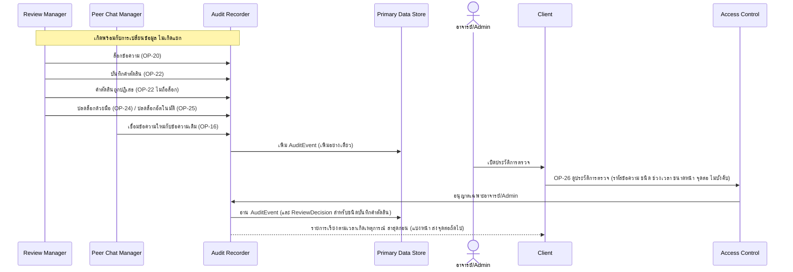

# Detailed Design: ประวัติการตรวจข้อความ (audit trail) (ฟีเจอร์ 15)

ที่มา: [[../../feature-list#15. ประวัติการตรวจข้อความ (audit trail)|Feature List ข้อ 15]], [[../../user-journey#Journey: อาจารย์/Admin ตรวจและอนุมัติข้อความ|Journey ผู้ตรวจ]], [[../api-spec|API Spec]] OP-26, [[../db-spec#3.19 AuditEvent (ประวัติการตรวจ แบบเพิ่มอย่างเดียว)|DB Spec AuditEvent]], [[../architecture#4.5 อาจารย์/Admin ตรวจและตัดสินข้อความ (รวมกรณีไม่ถือล็อกที่ใช้ได้)|Architecture 4.5]]
FR/NFR: [[../../../01-requirements/01-spec/20261014-02-peer-advice-chat|NFR-05]] (ต่อยอด FR-22, FR-24)
Test case: [[../../../03-testing/01-test-plan/test-cases/review-audit-trail|review-audit-trail]]

## 1. Sequence Flow

บันทึก AuditEvent เกิดจาก operation อื่นในหน่วยการทำงานเดียวกับการเปลี่ยนข้อมูล ส่วนการอ่านทำผ่าน OP-26

## 2. Operation ↔ Entity

| Operation | ชนิด AuditEvent ที่สร้าง | Entity อื่นที่เกี่ยว |
|-----------|--------------------------|----------------------|
| [[../api-spec#OP-20 ล็อกข้อความเพื่อตรวจ\|OP-20]] | ล็อกข้อความ (และปลดล็อกอัตโนมัติสำหรับล็อกเดิมที่เลยเวลาแต่ยังไม่ถูกปลด ผู้กระทำว่าง) | ReviewLock |
| [[../api-spec#OP-22 ส่งคำตัดสินข้อความ\|OP-22]] (สำเร็จ) | บันทึกคำตัดสิน | ReviewDecision |
| OP-22 (ไม่ถือล็อก) | คำตัดสินถูกปฏิเสธ (พร้อมสาเหตุ และ lock token ที่แนบ) | - |
| [[../api-spec#OP-24 ปลดล็อกข้อความด้วยมือ\|OP-24]] | ปลดล็อกด้วยมือ | ReviewLock |
| [[../api-spec#OP-25 ปลดล็อกข้อความที่หมดเวลา\|OP-25]] | ปลดล็อกอัตโนมัติ (ผู้กระทำว่าง) | ReviewLock |
| [[../api-spec#OP-16 ส่งข้อความใหม่หลังถูกปฏิเสธ\|OP-16]] | เชื่อมข้อความใหม่กับข้อความเดิม | ChatMessage |
| [[../api-spec#OP-26 ดูประวัติการตรวจ\|OP-26]] | (อ่านอย่างเดียว) | AuditEvent, ReviewDecision |

## 3. State Transition

ไม่มี AuditEvent เพิ่มอย่างเดียว ห้ามแก้หรือลบ ไม่มี operation แก้/ลบใดเลย (OP-26 อ่านอย่างเดียว)

## 4. Edge Case

| กรณี | วิธีจัดการ | อ้างอิง |
|------|-------------|---------|
| การตัดสินสำเร็จแต่บันทึก audit ล้มเหลว | ถอนทั้งหน่วย ผลตัดสินไม่เกิดโดยไม่มี audit | NFR-05, db-spec 3.19 |
| คำตัดสินที่ถูกปฏิเสธเพราะไม่ถือล็อก | มีเฉพาะ AuditEvent ไม่มี ReviewDecision | FR-24 |
| ERR-NEGATIVITY-MISSING / ERR-REASON-MISSING | ไม่สร้าง AuditEvent ชนิดคำตัดสินถูกปฏิเสธ (เกิดก่อนเทียบล็อก) | OP-22 |
| ปลดล็อกอัตโนมัติ | ผู้กระทำว่าง แสดงเป็น "ระบบ" | OP-25, OP-26 |
| ผู้ที่ไม่ใช่อาจารย์/Admin ขอดู | ERR-FORBIDDEN (นักศึกษาและครูอ่านไม่ได้) | OP-26 |
| ไม่ระบุตัวกรอง | ส่งหน้าแรกเรียงตามเวลาเกิดเหตุการณ์ล่าสุดก่อน ใช้จุดต่อต่อหน้าถัดไป (จุดต่อว่างเมื่อหมด) | OP-26, กติกากลางข้อแบ่งหน้า |
| ผู้ตรวจที่ตัดสินถูกปิดบัญชีภายหลัง | ประวัติยังอยู่ ไม่ถูกลบ | FR-25 |

## 5. ช่องว่างที่พบ

ไม่มีช่องว่างใน api-spec/db-spec ที่ต้องแก้ (การแบ่งหน้าปิดแล้ว) ข้อสังเกต: AuditEvent ไม่มีชนิดสำหรับ "ขอผลเสนอ AI" (ผลเสนอเก็บใน AiSuggestion แยก) ตามที่ db-spec ออกแบบ ไม่ใช่ความต้องการที่มี FR/NFR กำกับ
