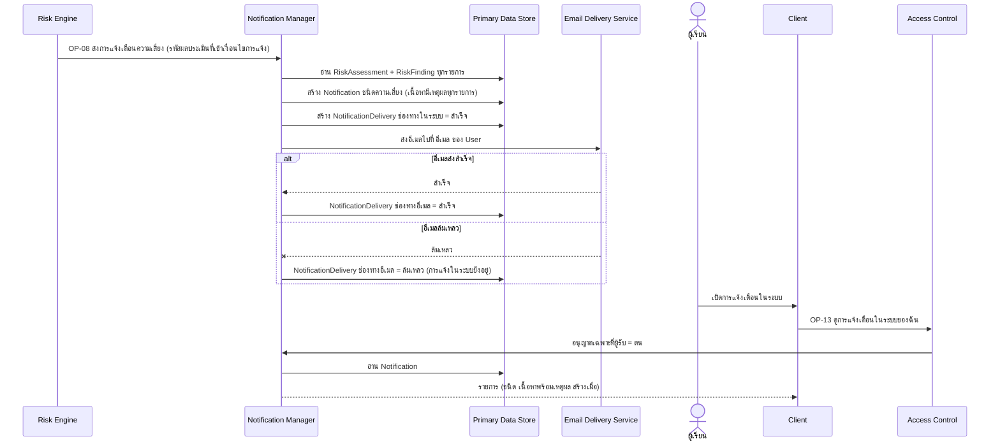
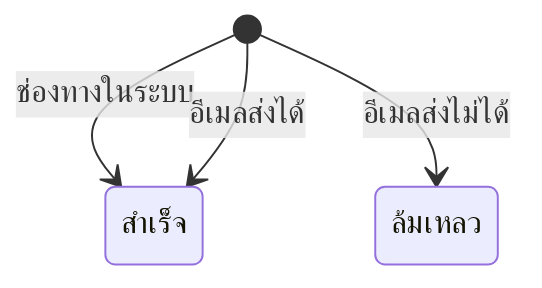

# Detailed Design: แจ้งเตือนความเสี่ยงพร้อมเหตุผล (ฟีเจอร์ 4)

ที่มา: [[../../feature-list#4. แจ้งเตือนความเสี่ยงพร้อมเหตุผล|Feature List ข้อ 4]], [[../../user-journey#Journey: ผู้เรียนรับแจ้งเตือนความเสี่ยงและคำแนะนำ|Journey ผู้เรียน]], [[../api-spec|API Spec]] OP-08, OP-13, [[../db-spec|DB Spec]], [[../architecture#4.2 ผู้เรียนรับแจ้งเตือน ดูแดชบอร์ด คำแนะนำ และประวัติ|Architecture 4.2]]
FR/NFR: [[../../../01-requirements/01-spec/20261014-01-student-risk-alert|FR-04, NFR-02]]
Test case: [[../../../03-testing/01-test-plan/test-cases/risk-alert|risk-alert]]

## 1. Sequence Flow

ลำดับที่ต้องรักษา: Notification ถูกสร้างก่อน NotificationDelivery ต่อช่องทาง และการส่งอีเมลล้มเหลวต้องไม่ย้อนทำให้การแจ้งในระบบหาย

## 2. Operation ↔ Entity

| Operation | Entity | กระทำ |
|-----------|--------|-------|
| [[../api-spec#OP-08 ส่งการแจ้งเตือนความเสี่ยงแก่ผู้เรียน\|OP-08]] | RiskAssessment, RiskFinding | อ่าน (เหตุผลของการแจ้ง) |
| OP-08 | User | อ่าน (อีเมล) |
| OP-08 | Notification (ชนิดความเสี่ยง ผูก RiskAssessment) | สร้าง |
| OP-08 | NotificationDelivery | สร้างต่อช่องทาง (ในระบบ อีเมล) |
| [[../api-spec#OP-13 ดูการแจ้งเตือนในระบบของฉัน\|OP-13]] | Notification | อ่านเฉพาะผู้รับ = ผู้เรียก |

## 3. State Transition (NotificationDelivery.สถานะการส่ง)

Notification เองไม่มีสถานะ (ไม่มี attribute อ่านแล้ว/ยังไม่อ่านใน db-spec)

## 4. Edge Case

| กรณี | วิธีจัดการ | อ้างอิง |
|------|-------------|---------|
| ผลประเมินไม่เข้าเงื่อนไขเสี่ยง | OP-08 ตอบ ERR-INVALID-INPUT ไม่สร้างการแจ้งเตือน | OP-08 |
| ชุดกฎที่เข้าเหมือนรอบก่อน | OP-07 ไม่เรียก OP-08 (ไม่แจ้งซ้ำ) แต่ผลประเมินยังบันทึก | api-spec หัวข้อ 8 |
| อีเมลส่งล้มเหลว | การแจ้งในระบบคงอยู่ NotificationDelivery อีเมล = ล้มเหลว ไม่ลองส่งซ้ำ (ข้อสมมติฐานชั่วคราว ดูข้อ 5) | OP-08 |
| ครูที่ปรึกษา | ไม่ได้รับแจ้งเตือน (คำถามเปิดใน REQ-01) ดูผ่าน OP-11/OP-12 | OP-08 |
| ผู้เรียนบัญชีถูกปิดใช้งานหลังสร้างการแจ้ง | บัญชีปิดทำ OP-13 ไม่ได้ (ERR-ACCOUNT-DISABLED) ข้อมูลยังอยู่ | กติกากลาง |
| เนื้อหาไม่มีเหตุผล | ไม่ให้เกิด: เนื้อหาต้องมีเหตุผลจาก RiskFinding ทุกรายการ | NFR-02 |

## 5. ช่องว่างที่พบ

ไม่มีช่องว่างที่ต้องแก้ ข้อสมมติฐานชั่วคราวที่คงไว้ (ยังไม่ตัดสินแทนผู้ใช้): spec ไม่กำหนดนโยบายลองส่งอีเมลความเสี่ยงซ้ำ จึงไม่ลองซ้ำ บันทึก NotificationDelivery สถานะล้มเหลวไว้เท่านั้น (ผู้เรียนอาจไม่ทราบทางอีเมลถ้าส่งไม่สำเร็จ แต่ยังเห็นการแจ้งในระบบ) และยังไม่มีสถานะ "อ่านแล้ว" ของ Notification ถ้าต้องการลองซ้ำต้องกำหนดความต้องการเพิ่ม (กระทบโครงสร้าง) ตาม [[../api-spec#11. ประเด็นรอตัดสินใจ|api-spec หัวข้อ 11]]
