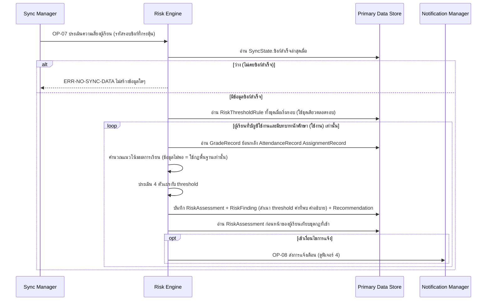

# Detailed Design: วิเคราะห์แนวโน้มและประเมินความเสี่ยง (ฟีเจอร์ 2)

ที่มา: [[../../feature-list#2. วิเคราะห์แนวโน้มและประเมินความเสี่ยง|Feature List ข้อ 2]], [[../../user-journey#Journey: ผู้เรียนรับแจ้งเตือนความเสี่ยงและคำแนะนำ|Journey ผู้เรียน]], [[../api-spec|API Spec]] OP-07, [[../db-spec|DB Spec]], [[../architecture#4.1 ซิงก์ข้อมูล ประเมินความเสี่ยง และตั้งค่า threshold|Architecture 4.1]]
FR/NFR: [[../../../01-requirements/01-spec/20261014-01-student-risk-alert|FR-02, FR-03, NFR-02]], [[../../../01-requirements/01-spec/20261016-03-first-sync-failure-and-expired-lock-decision|FR-23]]
Test case: [[../../../03-testing/01-test-plan/test-cases/risk-assessment|risk-assessment]]

## 1. Sequence Flow

ลำดับที่ต้องรักษา: บันทึก RiskAssessment และ RiskFinding ก่อน แล้วจึงเรียก OP-08 เพราะ Notification อ้างผลประเมิน การเปรียบเทียบเงื่อนไขการแจ้งทำก่อนเรียก OP-08 และใช้ผลประเมินล่าสุด **ก่อนหน้า** (ไม่นับรอบนี้)

## 2. Operation ↔ Entity

| Operation | Entity | กระทำ |
|-----------|--------|-------|
| [[../api-spec#OP-07 ประเมินความเสี่ยงผู้เรียน\|OP-07]] | SyncState | อ่าน |
| OP-07 | GradeRecord, AttendanceRecord, AssignmentRecord | อ่าน |
| OP-07 | RiskThresholdRule | อ่านทั้งชุดเมื่อเริ่มรอบ ใช้ชุดเดียวตลอดรอบ |
| OP-07 | User, UserRole | อ่านเพื่อกำหนดขอบเขตผู้เรียน (บัญชีใช้งาน และบทบาทนักศึกษา ใช้งาน) |
| OP-07 | RiskAssessment | สร้างทุกรอบทุกผู้เรียน (ไม่แก้ ไม่ลบ) |
| OP-07 | RiskFinding | สร้างต่อกฎที่เข้า |
| OP-07 | Recommendation | สร้าง (ผู้เรียนใหม่ = สร้างจากกฎพื้นฐาน) |
| OP-07 → OP-08 | Notification, NotificationDelivery | สร้างเมื่อเข้าเงื่อนไขการแจ้ง |

## 3. State Transition

RiskAssessment เป็นบันทึกต่อรอบ ไม่มีสถานะเปลี่ยน มีเพียงค่า "เข้าเงื่อนไขเสี่ยง" ของผู้เรียนที่เปลี่ยนไปตามรอบ ซึ่งใช้ตัดสินเงื่อนไขการแจ้งเตือน (ผลก่อนหน้า → ผลรอบนี้) ตามตารางตัดสินด้านล่าง

| ผลก่อนหน้า | ผลรอบนี้ | แจ้งเตือน |
|------------|----------|-----------|
| ไม่มี | เสี่ยง | แจ้ง |
| ไม่เสี่ยง | เสี่ยง | แจ้ง |
| เสี่ยง | เสี่ยง ชุดกฎที่เข้าต่างกัน (เพิ่ม ลด สลับ) | แจ้ง |
| เสี่ยง | เสี่ยง ชุดกฎที่เข้าเหมือนเดิม | ไม่แจ้งซ้ำ |
| ใดๆ | ไม่เสี่ยง | ไม่แจ้ง |

(ตามบันทึกการตัดสินใจทาง B ที่ [[../api-spec#8. บันทึกการตัดสินใจ|api-spec หัวข้อ 8]] เปรียบเทียบที่ตัวกฎที่เข้า ไม่เปรียบเทียบค่าที่ตรวจพบ)

## 4. Edge Case

| กรณี | วิธีจัดการ | อ้างอิง |
|------|-------------|---------|
| ยังไม่เคยซิงก์สำเร็จ | ERR-NO-SYNC-DATA ไม่สร้าง RiskAssessment ใดๆ ผู้เรียนเห็นป้ายรอข้อมูล | FR-23 |
| ผู้เรียนใหม่ข้อมูลย้อนหลังไม่พอ | แนวโน้ม = ข้อมูลไม่พอ ใช้กฎพื้นฐานเท่านั้น = จริง คำแนะนำจากกฎพื้นฐาน | FR-02, FR-05 |
| ซิงก์ล้มเหลวแต่เคยสำเร็จ | ประเมินซ้ำด้วยข้อมูลสำเร็จล่าสุด "ใช้ข้อมูลซิงก์ ณ" เป็นเวลาซิงก์สำเร็จล่าสุด (ต่างจากรอบที่กระตุ้น) | Architecture หัวข้อ 6 ประเด็น 3 |
| Admin แก้ threshold ภายหลัง | ผลประเมินเก่าไม่เปลี่ยน เพราะ RiskFinding เก็บสำเนา threshold ที่ใช้จริง | NFR-02, FR-08 |
| ผลประเมินเข้าเงื่อนไขเสี่ยงแต่ไม่มี RiskFinding | ไม่ให้เกิด: เข้าเงื่อนไขเสี่ยง = จริงเมื่อมี RiskFinding อย่างน้อย 1 รายการเท่านั้น | db-spec 3.11 |
| ค่าที่ตรวจพบเปลี่ยนเล็กน้อยแต่กฎที่เข้าเหมือนเดิม | ไม่แจ้งซ้ำ แต่ผลประเมินยังบันทึกเสมอ (ประวัติ FR-09) | api-spec หัวข้อ 8 |
| ผู้เรียนบัญชีปิดใช้งาน หรือถูกถอนบทบาทนักศึกษา | ไม่ถูกประเมิน ไม่ได้รับแจ้งเตือนความเสี่ยง ผลประเมินเดิมไม่ถูกลบ (ตรงกับ OP-39) | OP-07 ขอบเขตผู้เรียน |
| Admin แก้ threshold ระหว่างรอบประเมิน | รอบที่เริ่มแล้วใช้ชุดเดิมตลอดรอบ ค่าใหม่มีผลรอบถัดไป | OP-03, OP-07 ข้อ 3 |

## 5. ช่องว่างที่พบ

ไม่มี (ขอบเขตผู้เรียนของ OP-07 ปิดแล้วให้ตรงกับ OP-39)
