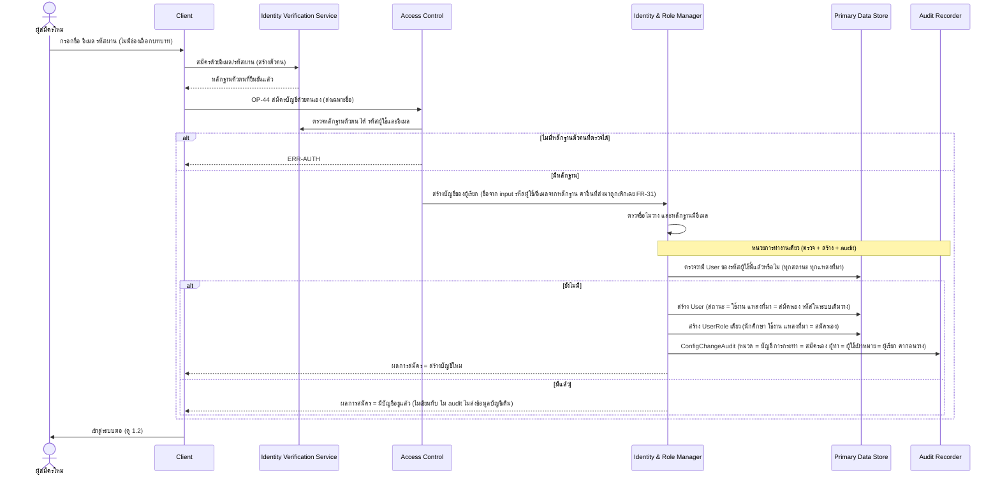
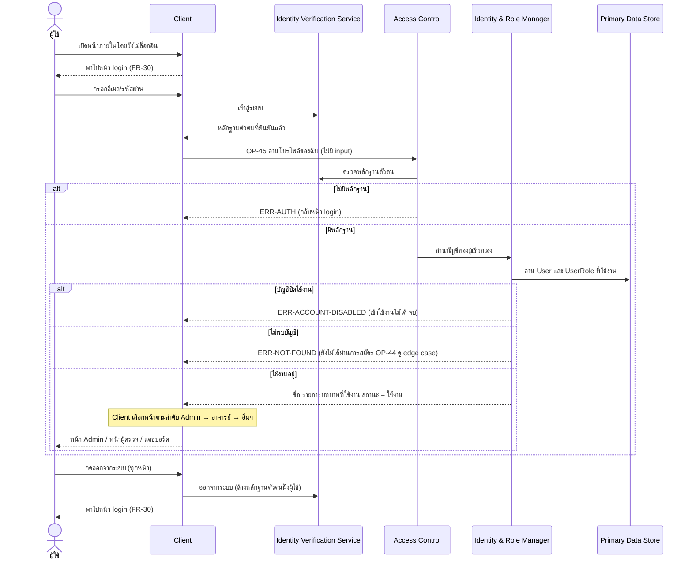
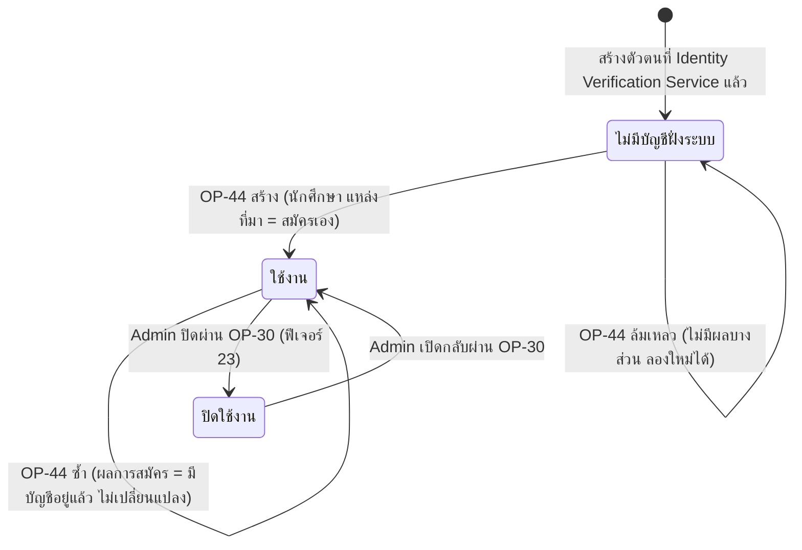

# Detailed Design: สมัครบัญชี เข้าสู่ระบบ ออกจากระบบ และบันทึกผู้สร้างรายการ (ฟีเจอร์ 27)

ที่มา: [[../../feature-list#27. สมัครบัญชี เข้าสู่ระบบ ออกจากระบบ และบันทึกผู้สร้างรายการ|Feature List ข้อ 27]], [[../../user-journey#Journey: ผู้ใช้ใหม่สมัครบัญชีด้วยตนเอง|Journey สมัครเอง]], [[../../user-journey#Journey: ผู้ใช้ทุกบทบาทเข้าสู่ระบบ ใช้งาน และออกจากระบบ|Journey เข้าสู่ระบบ]], [[../api-spec#OP-44 สมัครบัญชีด้วยตนเอง|API Spec OP-44]], [[../api-spec#OP-45 อ่านโปรไฟล์ของฉัน|OP-45]], [[../db-spec#3.1 User (บัญชีผู้ใช้)|DB Spec User]], [[../db-spec#3.2 UserRole (บทบาทของผู้ใช้)|UserRole]], [[../architecture#4.9 ผู้ใช้ใหม่สมัครบัญชีด้วยตนเอง|Architecture 4.9]], [[../architecture#4.10 ผู้ใช้ทุกบทบาทเข้าสู่ระบบ ถูกพาไปหน้าตามบทบาท และออกจากระบบ|4.10]]
FR/NFR: [[../../../01-requirements/01-spec/20261027-01-self-registration-and-login|FR-28, FR-29, FR-30, FR-31]], [[../../../01-requirements/01-spec/20261017-01-user-role-advisor-eligibility-management|NFR-07]]
Test case: ยังไม่มี test case ของฟีเจอร์ 27 ใช้ slug `self-registration-and-login` เมื่อ test-writer สร้าง
ฟีเจอร์ที่เกี่ยวข้อง: [[user-account-role-management|ฟีเจอร์ 23]], [[config-change-audit|ฟีเจอร์ 26]], [[eligibility-criteria|ฟีเจอร์ 25]]

ขอบเขต: การสมัคร/เข้าสู่ระบบ/ออกจากระบบที่ Identity Verification Service อยู่นอกสัญญา api-spec มีเพียง OP-44 (สร้างบัญชีฝั่งระบบ) และ OP-45 (อ่านโปรไฟล์ตน) ส่วนการเลือกหน้าตามบทบาท การพากลับหน้า login และปุ่มออกจากระบบเป็นพฤติกรรมฝั่ง Client

## 1. Sequence Flow

### 1.1 สมัครบัญชีด้วยตนเอง

### 1.2 เข้าสู่ระบบ เลือกหน้าตามบทบาท และออกจากระบบ

หลังเข้าสู่ระบบ ทุก operation ที่สร้างรายการ (OP-44, OP-15, OP-16, OP-20..OP-22, OP-24, OP-29..OP-31, OP-33..OP-37, OP-01..OP-03) ตั้งฟิลด์ผู้กระทำ/ผู้สร้างเป็นผู้เรียกจากหลักฐานตัวตนที่ยืนยันแล้วเสมอ ไม่รับจาก input (FR-31 ตามกติกากลางใน [[../api-spec]])

## 2. Operation ↔ Entity

| Operation | ผู้เรียก | Entity ที่กระทบ | กระทำ | ConfigChangeAudit (การกระทำ) |
|-----------|---------|------------------|-------|-------------------------------|
| [[../api-spec#OP-44 สมัครบัญชีด้วยตนเอง\|OP-44]] | ผู้เรียกที่ยืนยันตัวตนแล้ว (ยังไม่ต้องมีบัญชี) | User, UserRole, ConfigChangeAudit | อ่านตรวจว่ามีบัญชี แล้วสร้าง User + UserRole (นักศึกษา) + audit ในหน่วยเดียว หรือไม่ทำอะไรถ้ามีแล้ว | สมัครเอง (เฉพาะกรณีสร้างใหม่) |
| [[../api-spec#OP-45 อ่านโปรไฟล์ของฉัน\|OP-45]] | ผู้ใช้ทุกบทบาท (ของตน) | User, UserRole | อ่านอย่างเดียว | - |

ลำดับก่อนหลังใน OP-44: ตรวจการมีอยู่ของ User ก่อน จึงสร้าง User, UserRole และ audit ภายในหน่วยการทำงานเดียวกัน ผลสำเร็จทั้งหมดหรือไม่สำเร็จเลย

## 3. State Transition

ฟีเจอร์นี้เปลี่ยนสถานะบัญชีเฉพาะเส้นทางไป "ใช้งาน" ครั้งแรก การปิด/เปิดอยู่ที่ [[user-account-role-management|ฟีเจอร์ 23]] ส่วนสถานะเข้าสู่ระบบ/ออกจากระบบเป็นสถานะของหลักฐานตัวตนฝั่ง Identity Verification Service ไม่ใช่ข้อมูลใน db-spec

## 4. Edge Case

| กรณี | วิธีจัดการ | อ้างอิง |
|------|-------------|---------|
| สมัครซ้ำ/เรียกสร้างซ้ำเมื่อมีบัญชีของรหัสผู้ใช้นั้นอยู่แล้ว (นำเข้า/Admin สร้าง/สมัครไปแล้ว ไม่ว่าสถานะ) | ตอบผลการสมัคร = มีบัญชีอยู่แล้ว (ไม่ใช่ error) ไม่เขียนทับชื่อ อีเมล บทบาท สถานะ แหล่งที่มา ไม่บันทึก ConfigChangeAudit ไม่ส่งข้อมูลบัญชีเดิมกลับ | OP-44 ข้อ 1, AC-3 |
| ส่งบทบาท/สถานะ/แหล่งที่มา/รหัสผู้ใช้มาด้วย (เช่น พยายามส่ง admin) | เพิกเฉย ไม่เกิด error ได้บทบาทนักศึกษาเท่านั้น | OP-44, AC-2 |
| ชื่อ-นามสกุลว่าง | ERR-INVALID-INPUT ไม่สร้างสิ่งใด ไม่ audit | OP-44 |
| หลักฐานตัวตนไม่มีอีเมล | ERR-INVALID-INPUT (อีเมลเป็น attribute จำเป็นของ User และไม่รับอีเมลจาก input) ไม่สร้างสิ่งใด | OP-44 |
| ไม่มีหลักฐานตัวตนที่ตรวจได้ | ERR-AUTH Client พากลับหน้า login | OP-44, OP-45, FR-30 |
| บัญชีปิดใช้งานพยายามเข้าสู่ระบบ | OP-45 ตอบ ERR-ACCOUNT-DISABLED เข้าใช้งานไม่ได้ และทุก operation อื่นตอบเหมือนกันตามกติกากลาง (OP-44 ไม่ตอบ error นี้ เพราะไม่เปิดเผยข้อมูลบัญชี ตอบ มีบัญชีอยู่แล้ว) | OP-45, AC-6 |
| สร้างตัวตนที่ Identity Verification Service สำเร็จ แต่ OP-44 ไม่สำเร็จ (ล้มเหลวกลางทาง ขาดการเชื่อมต่อ ฯลฯ) | หน่วยการทำงานเดียวทำให้ไม่มีบัญชี/บทบาท/audit ค้างครึ่งเดียว Client ลอง OP-44 ซ้ำได้ (เช่น ตอนล็อกอินครั้งถัดไป เมื่อ OP-45 ตอบ ERR-NOT-FOUND ให้ Client เรียก OP-44 ด้วยชื่อที่ผู้ใช้กรอก) เรียกซ้ำปลอดภัย ผลคือสร้างใหม่ หรือ มีบัญชีอยู่แล้ว โดยไม่มีบัญชี/audit ซ้ำซ้อน | OP-44 ข้อ 1, 4 |
| คำสั่งสมัครซ้อนกันของรหัสผู้ใช้เดียวกัน | ตรวจ+สร้างในหน่วยเดียว สร้างใหม่ได้ไม่เกิน 1 ครั้ง ที่เหลือได้ มีบัญชีอยู่แล้ว | OP-44 ข้อ 4 |
| ผู้ใช้มีหลายบทบาท | Client เลือกหน้าตามลำดับ Admin → อาจารย์ → อื่นๆ (นักศึกษา/ครูที่ปรึกษาไปแดชบอร์ด) เป็นเพียงการเลือกหน้า สิทธิ์จริงของทุก operation ตัดสินที่ Access Control ตามบทบาทในระบบ | OP-45, AC-5, NFR-01 |
| ผู้ใช้ไม่มีบทบาทใช้งานเลย | OP-45 ตอบรายการบทบาทว่าง Client ไม่มีหน้าปลายทางตามบทบาท (ไปหน้าอื่นๆ) และ operation ที่ต้องมีบทบาทตอบ ERR-FORBIDDEN | OP-45 |
| ผู้ไม่ล็อกอินเข้าหน้า Admin/ผู้ตรวจ/แดชบอร์ดโดยตรง | Client พาไปหน้า login และ request ที่ไม่มีหลักฐานตัวตนถูกปฏิเสธด้วย ERR-AUTH | FR-30, AC-8 |
| ออกจากระบบ | ทุกหน้ามีปุ่มออกจากระบบ ล้างหลักฐานตัวตนที่ Identity Verification Service แล้วพาไปหน้า login การเข้าหน้าภายในหลังจากนั้นถูกพากลับ login ไม่มี operation ฝั่ง Backend | FR-30, AC-7 |
| สมัครเองแล้วส่งข้อความทันที | ไม่ผ่านเกณฑ์จนกว่า OP-39 ประเมินรอบถัดไป (ไม่มี EligibilityResult) และไม่มีผู้ดูแล (AdvisorAssignment) จนกว่า Admin กำหนด | OP-44 ข้อ 5, FR-27 |
| อีเมลเดียวกับผู้เรียนที่นำเข้าแล้ว | แยกเป็นคนละบัญชี (ประเด็นเปิด ยังไม่ผูก) ผู้สมัครอาจไม่เห็นข้อมูลการเรียนที่นำเข้า OP-44 ไม่ตรวจอีเมลซ้ำ | OP-44 ข้อ 6, api-spec หัวข้อ 11 |
| ผู้ใช้ขอรายการ/ข้อมูลผู้อื่นผ่าน OP-45 | ทำไม่ได้ ไม่มี input ระบุผู้ใช้ ส่งเฉพาะชื่อ บทบาท สถานะของตน ไม่ส่งอีเมล รหัสในระบบเดิม แหล่งที่มา | OP-45, FR-31, NFR-01 |

## 5. ช่องว่างที่พบ

ไม่มีช่องว่างใน api-spec/db-spec ที่ต้องรัน `sync-api-db` เพิ่ม OP-44, OP-45, ค่า "สมัครเอง" ใน db-spec และกติกา FR-31 ครอบคลุมครบ ข้อสังเกตที่เป็นประเด็นเปิดของ api-spec (ไม่ใช่ช่องว่าง) และจะกระทบเอกสารนี้ถ้ามีคำตัดสิน: (1) ผลการสมัครกรณีมีบัญชีอยู่แล้วเป็น "ผลการสมัคร" ไม่ใช่ error (ข้อสมมติฐานชั่วคราว) (2) การผูกบัญชีที่สมัครเองกับผู้เรียนที่นำเข้าซึ่งอีเมลตรงกัน ซึ่งอาจต้องปรับกฎตรวจอีเมลซ้ำของ OP-29/OP-30 ด้วย
ข้อสังเกตเชิงออกแบบ: การลอง OP-44 ซ้ำเมื่อ OP-45 ตอบ ERR-NOT-FOUND เป็นพฤติกรรม Client ที่ออกแบบขึ้นจากความ idempotent ของ OP-44 ไม่ใช่ operation ใหม่
