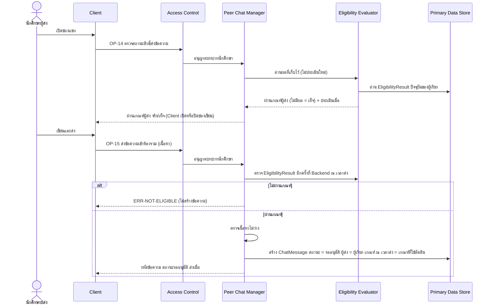
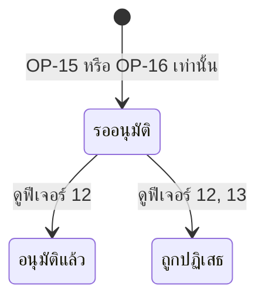

# Detailed Design: ส่งข้อความแนะนำแนวทางการเรียน (ฟีเจอร์ 10)

ที่มา: [[../../feature-list#10. ส่งข้อความแนะนำแนวทางการเรียน|Feature List ข้อ 10]], [[../../user-journey#Journey: นักศึกษาผู้ส่งข้อความแนะนำแนวทางการเรียน|Journey ผู้ส่ง]], [[../api-spec|API Spec]] OP-14, OP-15, [[../db-spec#3.15 ChatMessage (ข้อความในห้องรวม)|DB Spec ChatMessage]], [[../architecture#4.4 นักศึกษาผู้ส่งข้อความ และการส่งใหม่หลังถูกปฏิเสธ|Architecture 4.4]]
FR/NFR: [[../../../01-requirements/01-spec/20261014-02-peer-advice-chat|FR-10, FR-16]], [[../../../01-requirements/01-spec/20261017-01-user-role-advisor-eligibility-management|FR-27]]
Test case: [[../../../03-testing/01-test-plan/test-cases/send-advice-message|send-advice-message]]

## 1. Sequence Flow

ผลตรวจจาก OP-14 ใช้ตัดสินหน้าจอเท่านั้น OP-15 ตรวจซ้ำที่ Backend เสมอ ไม่เชื่อ Client

## 2. Operation ↔ Entity

| Operation | Entity | กระทำ |
|-----------|--------|-------|
| [[../api-spec#OP-14 ตรวจสถานะสิทธิ์ส่งข้อความ\|OP-14]] | EligibilityResult | อ่าน |
| [[../api-spec#OP-15 ส่งข้อความเข้าห้องรวม\|OP-15]] | EligibilityResult | อ่าน (ตัดสินสิทธิ์ ณ เวลาส่ง) |
| OP-15 | EligibilityCriteria | อ้างอิงเวอร์ชันเกณฑ์ที่ใช้ (ผ่าน EligibilityResult.เกณฑ์ที่ใช้) |
| OP-15 | ChatMessage | สร้าง (สถานะแรก = รออนุมัติ เสมอ) |

## 3. State Transition (ChatMessage.สถานะ ณ การสร้าง)

ไม่มีเส้นทางสร้างข้อความด้วยสถานะอื่น (ไม่รับสถานะจาก input) เนื้อหาแก้ไม่ได้หลังส่ง

## 4. Edge Case

| กรณี | วิธีจัดการ | อ้างอิง |
|------|-------------|---------|
| ไม่มี EligibilityResult (ยังไม่เคยซิงก์สำเร็จ หรือยังไม่มีเกณฑ์) | ถือว่าไม่ผ่านเกณฑ์ OP-14 ตอบเท็จ OP-15 ตอบ ERR-NOT-ELIGIBLE | db-spec 3.21 |
| Client ส่ง OP-15 ทั้งที่ OP-14 ตอบเท็จ | Backend ตรวจซ้ำ ปฏิเสธ ERR-NOT-ELIGIBLE | OP-14 กฎ |
| เนื้อหาว่าง | ERR-INVALID-INPUT ไม่สร้างข้อความ | OP-15 |
| ผู้ส่งหลุดเกณฑ์หลังส่ง | ข้อความที่ส่งแล้วยังตรวจต่อตามปกติ กระทบเฉพาะการส่งครั้งถัดไป | FR-27, db-spec 3.15 |
| ระหว่าง Admin เปลี่ยนเกณฑ์ ผลประเมินใหม่ยังไม่เสร็จ | ผลเดิมยังใช้ตัดสินสิทธิ์ (สมมติฐานชั่วคราว) | OP-37 |
| ผู้ส่งระบุผู้รับ | ไม่มีช่องทาง ข้อความเข้าห้องรวมเดียว | FR-20 |
| ผู้ส่งตั้งสถานะ/ผู้ส่งเอง | ไม่รับจาก input (ผู้ส่ง = ผู้เรียก สถานะ = รออนุมัติ) | OP-15 กฎ |
| ผู้เรียกไม่ใช่นักศึกษา | ERR-FORBIDDEN | OP-14 |

## 5. ช่องว่างที่พบ

- ไม่มี (ผลผ่านเกณฑ์ขึ้นกับองค์ประกอบเกณฑ์ที่ยังไม่กำหนดใน REQ-06 ซึ่งเก็บเป็นค่าตั้ง ดูฟีเจอร์ 25)
