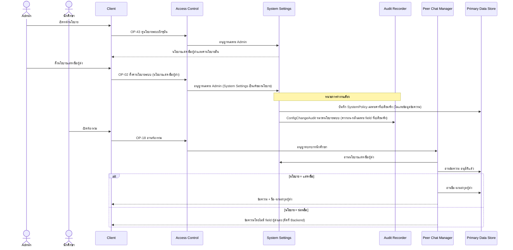
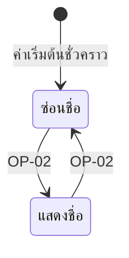

# Detailed Design: การแสดงตัวตนผู้ส่งข้อความ (ฟีเจอร์ 17)

ที่มา: [[../../feature-list#17. การแสดงตัวตนผู้ส่งข้อความ|Feature List ข้อ 17]], [[../../user-journey#Journey: นักศึกษาผู้รับอ่านข้อความแนะนำ|Journey ผู้รับ]], [[../api-spec|API Spec]] OP-02, OP-18, [[../db-spec#3.5 SystemPolicy (นโยบายระบบที่ตั้งค่าได้)|DB Spec SystemPolicy]], [[../architecture#4.7 นักศึกษาผู้รับอ่านห้องรวม|Architecture 4.7]]
FR/NFR: [[../../../01-requirements/01-spec/20261014-02-peer-advice-chat|NFR-06]]
Test case: [[../../../03-testing/01-test-plan/test-cases/sender-identity-display|sender-identity-display]]

## 1. Sequence Flow

ตัวตนผู้ส่งเก็บใน ChatMessage.ผู้ส่ง เสมอ นโยบายแสดงผลเฉพาะตอนอ่าน ผู้ตรวจเห็นตัวตนผู้ส่งเสมอผ่าน OP-19

## 2. Operation ↔ Entity

| Operation | Entity | กระทำ |
|-----------|--------|-------|
| [[../api-spec#OP-43 ดูนโยบายระบบปัจจุบัน\|OP-43]] | SystemPolicy | อ่าน (Admin) |
| [[../api-spec#OP-02 ตั้งค่านโยบายระบบ\|OP-02]] | SystemPolicy.นโยบายแสดงชื่อผู้ส่ง | แก้ (แก้ไขโดย แก้ไขเมื่อ) |
| OP-02 | ConfigChangeAudit (หมวดนโยบายระบบ) | สร้างโดย System Settings ผ่าน Audit Recorder ในหน่วยเดียวกัน ไม่บันทึกถ้าไม่มีค่าเปลี่ยนจริง |
| OP-18 | SystemPolicy | Peer Chat Manager อ่านนโยบายจาก System Settings |
| [[../api-spec#OP-18 อ่านห้องรวม\|OP-18]] | SystemPolicy | อ่าน |
| OP-18 | ChatMessage, User (ชื่อ-นามสกุล) | อ่าน เฉพาะแสดงชื่อ จึงอ่านชื่อ |

## 3. State Transition

การเปลี่ยนนโยบายมีผลกับการอ่านห้องรวมครั้งถัดไปทันที โดยไม่แก้ข้อมูลข้อความ

## 4. Edge Case

| กรณี | วิธีจัดการ | อ้างอิง |
|------|-------------|---------|
| ค่านโยบายนอกชุด (แสดงชื่อ/ซ่อนชื่อ) | ERR-INVALID-INPUT | OP-02 |
| นโยบายซ่อนชื่อ | ห้ามส่ง field ผู้ส่งไป Client (ไม่ใช่ส่งแล้วให้ซ่อน) | OP-18, Architecture หัวข้อ 6 ประเด็น 4 |
| ผู้ส่งอ่านห้องรวม | เห็นข้อความของตนในห้องรวมเมื่ออนุมัติ ตามนโยบายเดียวกัน (assumption REQ-04) | OP-18 |
| ผู้ตรวจ/ผู้ส่งดูข้อความของตน | เห็นตัวตนเสมอ ไม่ขึ้นกับนโยบาย (ผู้ส่งเห็นของตนเอง ผู้ตรวจเห็นผู้ส่งเพื่อ audit) | OP-17, OP-19 |
| ยังไม่เคยตั้งนโยบาย | ใช้ "ซ่อนชื่อ" เป็นค่าเริ่มต้นชั่วคราว | db-spec ข้อสมมติฐาน |
| เปลี่ยนนโยบายแล้วข้อความเก่า | แสดงตามนโยบายใหม่ทั้งหมด ไม่มีข้อมูลถูกแก้ | OP-02 |
| ผู้กำหนดนโยบาย | spec ไม่ได้ระบุ ใช้ Admin ชั่วคราว | api-spec หัวข้อ 11 |

## 5. ช่องว่างที่พบ

ไม่มีช่องว่างใน api-spec/db-spec (OP-43 และ audit ของ OP-02 ปิดแล้ว) ข้อสมมติฐานที่คงไว้: นโยบายแสดงชื่อยังไม่กำหนดใน spec (NFR-06 เป็นคำถามเปิด) ใช้ค่าเริ่มต้น "ซ่อนชื่อ" ตาม db-spec และใช้ Admin เป็นผู้กำหนดชั่วคราว
