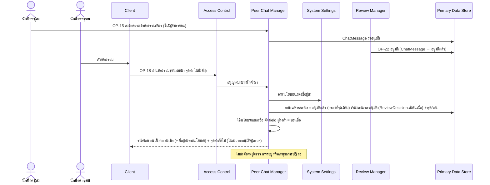

# Detailed Design: ห้องรวมแสดงข้อความที่อนุมัติแล้ว (ฟีเจอร์ 19)

ที่มา: [[../../feature-list#19. ห้องรวมแสดงข้อความที่อนุมัติแล้ว|Feature List ข้อ 19]], [[../../user-journey#Journey: นักศึกษาผู้รับอ่านข้อความแนะนำ|Journey ผู้รับ]], [[../../user-journey#Journey: นักศึกษาผู้ส่งข้อความแนะนำแนวทางการเรียน|Journey ผู้ส่ง]], [[../api-spec|API Spec]] OP-15, OP-18, [[../db-spec#3.15 ChatMessage (ข้อความในห้องรวม)|DB Spec ChatMessage]], [[../architecture#4.7 นักศึกษาผู้รับอ่านห้องรวม|Architecture 4.7]]
FR/NFR: [[../../../01-requirements/01-spec/20261016-02-peer-chat-recipients-lock-resubmit|FR-20]], [[../../../01-requirements/01-spec/20261014-02-peer-advice-chat|NFR-04]]
Test case: [[../../../03-testing/01-test-plan/test-cases/shared-room-visibility|shared-room-visibility]]

## 1. Sequence Flow

## 2. Operation ↔ Entity

| Operation | Entity | กระทำ |
|-----------|--------|-------|
| [[../api-spec#OP-15 ส่งข้อความเข้าห้องรวม\|OP-15]] | ChatMessage | สร้าง (ไม่มี attribute ผู้รับ) |
| [[../api-spec#OP-18 อ่านห้องรวม\|OP-18]] | ChatMessage | อ่านเฉพาะ อนุมัติแล้ว |
| OP-18 | ReviewDecision (ตัดสินเมื่อ) | อ่านเพื่อเรียงลำดับเท่านั้น ไม่ส่งออกแก่ Client |
| OP-18 | SystemPolicy, User | Peer Chat Manager อ่านนโยบายแสดงชื่อจาก System Settings แล้วอ่านชื่อผู้ส่งเมื่อ = แสดงชื่อ |

## 3. State Transition

ข้อความปรากฏในห้องรวมเมื่อสถานะ = อนุมัติแล้ว เท่านั้น (ดู [[approval-queue-visibility#3. State Transition|approval-queue-visibility ข้อ 3]]) การย้ายจาก รออนุมัติ ไป อนุมัติแล้ว ทำผ่าน OP-22 ที่ถือล็อกที่ใช้ได้เท่านั้น

## 4. Edge Case

| กรณี | วิธีจัดการ | อ้างอิง |
|------|-------------|---------|
| ข้อความรออนุมัติ/ถูกปฏิเสธ | ไม่ปรากฏทางใด (ไม่มีเส้นทางอ่านอื่น) | NFR-04 |
| ผู้เรียกไม่ใช่นักศึกษา | ERR-FORBIDDEN | OP-18 |
| ไม่ระบุขนาดหน้า/จุดต่อ | ส่งหน้าแรกตามขนาดหน้าเริ่มต้น (ค่าเริ่มต้น/สูงสุดกำหนดตอน detailed design ระดับถัดไป) เรียงตามเวลาอนุมัติล่าสุดก่อน ใช้จุดต่อไม่ใช้หมายเลขหน้า ข้อความใหม่ที่อนุมัติระหว่างอ่านไม่ทำให้รายการซ้ำ/ตก | กติกากลางข้อแบ่งหน้า, OP-18 |
| จุดต่อสุดท้าย | จุดต่อถัดไปว่างเมื่อหมดรายการ | กติกากลาง |
| ผู้ส่งอ่านห้องรวมเอง | รวมผู้ส่ง (assumption REQ-04 ยังไม่ยืนยัน) | OP-18 |
| ห้องรวมไม่มีข้อความ | รายการว่าง | - |
| ผู้ส่งหลุดเกณฑ์หลังข้อความอนุมัติ | ข้อความยังอยู่ในห้องรวม | FR-27 |
| ข้อความที่อนุมัติแล้วต้องการถอนภายหลัง | ไม่มี operation ถอน/แก้ (สถานะปลายทาง) | db-spec 3.15 |

## 5. ช่องว่างที่พบ

ไม่มี (การแบ่งหน้าและลำดับเรียงปิดแล้วใน OP-18 และกติกากลาง) ข้อสมมติฐานที่คงไว้: ผู้ส่งอ่านห้องรวมแล้วเห็นข้อความของตนด้วย (assumption REQ-04 ยังไม่ยืนยัน)
