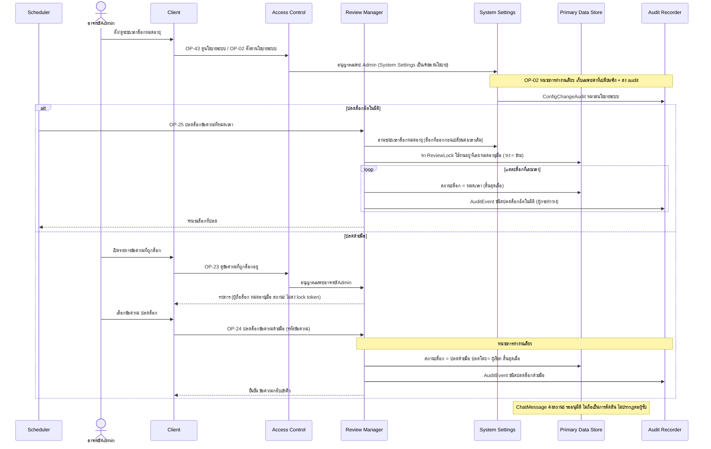
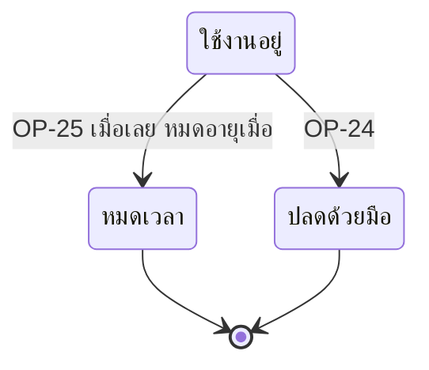

# Detailed Design: ปลดล็อกข้อความที่ผู้ตรวจค้าง (ฟีเจอร์ 20)

ที่มา: [[../../feature-list#20. ปลดล็อกข้อความที่ผู้ตรวจค้าง|Feature List ข้อ 20]], [[../../user-journey#Journey: อาจารย์/Admin ปลดล็อกข้อความที่ผู้ตรวจค้างด้วยมือ|Journey ปลดล็อกด้วยมือ]], [[../api-spec|API Spec]] OP-02, OP-23, OP-24, OP-25, [[../db-spec#3.16 ReviewLock (ล็อกข้อความระหว่างตรวจ พร้อม lock token)|DB Spec ReviewLock]], [[../architecture#4.6 ปลดล็อกข้อความที่ผู้ตรวจค้าง (อัตโนมัติและด้วยมือ)|Architecture 4.6]]
FR/NFR: [[../../../01-requirements/01-spec/20261016-02-peer-chat-recipients-lock-resubmit|FR-21]], [[../../../01-requirements/01-spec/20261014-02-peer-advice-chat|NFR-05]]
Test case: [[../../../03-testing/01-test-plan/test-cases/stuck-review-unlock|stuck-review-unlock]]

## 1. Sequence Flow

ผู้ตรวจเดิมไม่ถูกแจ้งทันที จะทราบเมื่อกดตัดสินแล้วถูกปฏิเสธ (ดู [[reject-decision-without-valid-lock]])

## 2. Operation ↔ Entity

| Operation | Entity | กระทำ |
|-----------|--------|-------|
| [[../api-spec#OP-25 ปลดล็อกข้อความที่หมดเวลา\|OP-25]] | ReviewLock | แก้สถานะ → หมดเวลา |
| OP-25 | AuditEvent | สร้าง ชนิดปลดล็อกอัตโนมัติ |
| [[../api-spec#OP-24 ปลดล็อกข้อความด้วยมือ\|OP-24]] | ReviewLock | แก้สถานะ → ปลดด้วยมือ (ปลดโดย) |
| OP-24 | AuditEvent | สร้าง ชนิดปลดล็อกด้วยมือ |
| [[../api-spec#OP-23 ดูข้อความที่ถูกล็อกอยู่\|OP-23]] | ReviewLock | อ่าน |
| [[../api-spec#OP-43 ดูนโยบายระบบปัจจุบัน\|OP-43]] | SystemPolicy.ระยะเวลาล็อกหมดอายุ | อ่านผ่าน System Settings (Admin ดูค่าเดิมก่อนแก้) |
| [[../api-spec#OP-02 ตั้งค่านโยบายระบบ\|OP-02]] | SystemPolicy.ระยะเวลาล็อกหมดอายุ, ConfigChangeAudit (หมวดนโยบายระบบ) | System Settings แก้ (มีผลกับล็อกที่ออกหลังจากนี้) และส่ง audit ผ่าน Audit Recorder ในหน่วยเดียวกันถ้าค่าเปลี่ยนจริง |
| OP-20, OP-25 | SystemPolicy.ระยะเวลาล็อกหมดอายุ | Review Manager อ่านจาก System Settings (ตอนล็อกเพื่อคำนวณหมดอายุเมื่อ) |
| ทั้ง 2 เส้นทาง | ChatMessage | ไม่แก้ (คงรออนุมัติ) |

## 3. State Transition

ใช้ diagram ReviewLock เดียวกับ [[duplicate-review-lock#3. State Transition (ReviewLock.สถานะล็อก)|duplicate-review-lock ข้อ 3]] เส้นทางของฟีเจอร์นี้คือ ใช้งานอยู่ → หมดเวลา และ ใช้งานอยู่ → ปลดด้วยมือ

## 4. Edge Case

| กรณี | วิธีจัดการ | อ้างอิง |
|------|-------------|---------|
| ข้อความไม่มีล็อกใช้งานอยู่ตอน OP-24 | ERR-NO-ACTIVE-LOCK | OP-24 |
| ไม่พบข้อความ | ERR-NOT-FOUND | OP-24 |
| ปลดด้วยมือล็อกที่ผู้ตรวจอื่นถืออยู่ | ทำได้ (อาจารย์/Admin สิทธิ์เท่ากัน) | OP-24 |
| ระยะเวลาล็อกหมดอายุยังไม่ตั้ง | หมดอายุเมื่อ ว่าง ไม่ถูกปลดอัตโนมัติ ต้องปลดด้วยมือ | OP-25 |
| เปลี่ยนระยะเวลาล็อกภายหลัง | ล็อกที่ออกแล้วคงเวลาหมดอายุเดิม บันทึก ConfigChangeAudit (ค่าก่อน-หลัง) | OP-02 |
| ผู้ตรวจอื่นเรียก OP-20 ขณะล็อกเดิมเลยเวลาแต่ยังไม่ถูกปลด | ปลดล็อกเดิม (หมดเวลา) พร้อม AuditEvent ปลดล็อกอัตโนมัติ (ผู้กระทำว่าง) แล้วออกล็อกใหม่พร้อม AuditEvent ล็อกข้อความ ในหน่วยเดียว | OP-20 ข้อ 3 |
| AI ยังประมวลผลอยู่ขณะล็อกหมดอายุ/ถูกปลด | ผลเสนอยังบันทึกได้ ไม่กระทบการตัดสิน (ผลกระทบต่ำ) | api-spec หัวข้อ 11 |
| ล็อกเลยเวลาแต่ OP-25 ยังไม่ทำงาน | ถือว่าไม่ใช่ล็อกที่ใช้ได้ (แสดงในคิว OP-19 และรับล็อกใหม่ได้ ตัดสินด้วย token เดิมไม่ได้) | db-spec 3.16 |
| OP-25 กับ OP-24 พร้อมกันบนล็อกเดียว | ล็อกสิ้นสุดได้ครั้งเดียว อีกฝ่ายพบว่าไม่มีล็อกใช้งานอยู่ (ต้องรับประกันที่ชั้น technology) | FR-18 |
| ผู้ถือล็อกถูกปิดบัญชี | ไม่ปลดอัตโนมัติ ต้องหมดเวลาหรือปลดด้วยมือ | OP-30 |
| ผู้ตรวจเดิมตัดสินหลังถูกปลด | ถูกปฏิเสธ ข้อความอยู่ในคิว (ฟีเจอร์ 22) | FR-24 |
| ผู้ตรวจอื่นล็อกอยู่ ไม่ได้รับแจ้งเมื่อผู้ตรวจเดิมถูกปฏิเสธ | ไม่แจ้ง (คำถามเปิดใน REQ-05) | api-spec หัวข้อ 11 |

## 5. ช่องว่างที่พบ

ไม่มี (OP-24 เป็นของอาจารย์/Admin ซึ่งรวมผู้ตรวจ ผู้ตรวจเดิมปล่อยล็อกเองได้ในทางปฏิบัติ) รายการ OP-23 แบ่งหน้าตามกติกากลาง ข้อสมมติฐานที่คงไว้: ผู้ตรวจอื่นที่ล็อกอยู่ไม่ได้รับแจ้งเมื่อผู้ตรวจเดิมถูกปฏิเสธ (คำถามเปิดใน REQ-05)
