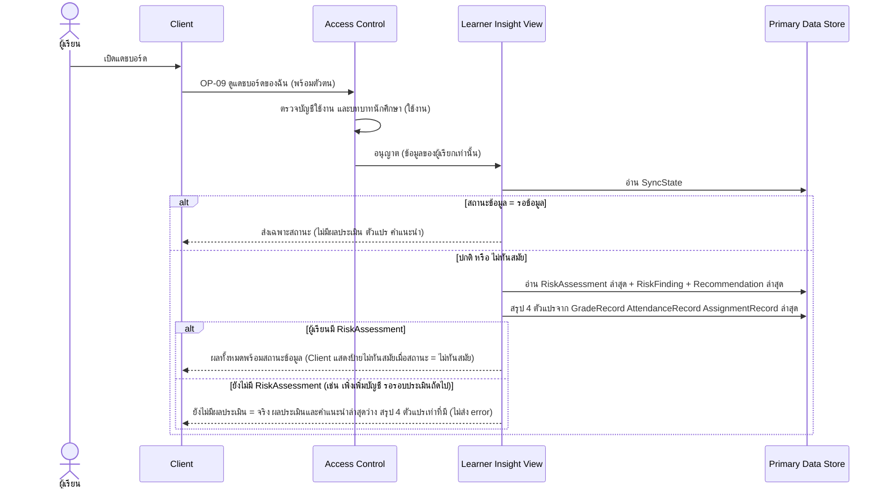

# Detailed Design: แดชบอร์ดสถานการณ์การเรียนของผู้เรียน (ฟีเจอร์ 6)

ที่มา: [[../../feature-list#6. แดชบอร์ดสถานการณ์การเรียนของผู้เรียน|Feature List ข้อ 6]], [[../../user-journey#Journey: ผู้เรียนรับแจ้งเตือนความเสี่ยงและคำแนะนำ|Journey ผู้เรียน]], [[../api-spec|API Spec]] OP-09, [[../db-spec|DB Spec]], [[../architecture#4.2 ผู้เรียนรับแจ้งเตือน ดูแดชบอร์ด คำแนะนำ และประวัติ|Architecture 4.2]]
FR/NFR: [[../../../01-requirements/01-spec/20261014-01-student-risk-alert|FR-06, NFR-01, NFR-02]], [[../../../01-requirements/01-spec/20261016-01-sync-failure-handling|FR-19]], [[../../../01-requirements/01-spec/20261016-03-first-sync-failure-and-expired-lock-decision|FR-23]]
Test case: [[../../../03-testing/01-test-plan/test-cases/student-dashboard|student-dashboard]]

## 1. Sequence Flow

## 2. Operation ↔ Entity

| Operation | Entity | กระทำ |
|-----------|--------|-------|
| [[../api-spec#OP-09 ดูแดชบอร์ดของฉัน\|OP-09]] | SyncState | อ่าน |
| OP-09 | RiskAssessment, RiskFinding | อ่านล่าสุดของผู้เรียก |
| OP-09 | Recommendation | อ่านล่าสุด |
| OP-09 | GradeRecord, AttendanceRecord, AssignmentRecord | อ่านสรุป 4 ตัวแปร |
| OP-09 | User, UserRole | อ่านผ่าน Access Control |

## 3. State Transition

ใช้สถานะข้อมูลของ SyncState (ดู [[data-sync#3. State Transition (SyncState.สถานะข้อมูล)|data-sync ข้อ 3]]) เป็นตัวกำหนดสิ่งที่แดชบอร์ดแสดง

| สถานะข้อมูล | สิ่งที่ OP-09 ส่งกลับ | ป้ายที่ Client แสดง |
|-------------|------------------------|---------------------|
| ปกติ | ทุกอย่าง | ไม่มี |
| ไม่ทันสมัย | ข้อมูลล่าสุดทั้งหมด | ป้ายไม่ทันสมัย (หายเมื่อซิงก์สำเร็จ) |
| รอข้อมูล | เฉพาะสถานะ | ป้ายรอข้อมูล (หายเมื่อซิงก์สำเร็จครั้งแรก) |

## 4. Edge Case

| กรณี | วิธีจัดการ | อ้างอิง |
|------|-------------|---------|
| ผู้เรียกไม่ใช่นักศึกษา | ERR-FORBIDDEN | OP-09 |
| บัญชีปิดใช้งาน | ERR-ACCOUNT-DISABLED | กติกากลาง |
| สถานะปกติ/ไม่ทันสมัย แต่ผู้เรียนยังไม่มี RiskAssessment | ส่ง ยังไม่มีผลประเมิน = จริง (คำนวณ) ผลประเมินและคำแนะนำล่าสุดว่าง สรุป 4 ตัวแปรจากข้อมูลซิงก์ล่าสุดเท่าที่มี ไม่ส่ง error Client แสดงสถานะ "ยังไม่มีผลประเมิน" | OP-09 กฎ |
| ผู้เรียนพยายามขอข้อมูลผู้อื่น | ไม่มีช่องทาง ระบบใช้ตัวตนผู้เรียกเท่านั้น | NFR-01 |
| ผลประเมินเสี่ยง | แสดงรายการเงื่อนไขที่เข้าพร้อมคำอธิบายเหตุผล | NFR-02 |

## 5. ช่องว่างที่พบ

ไม่มี (กรณียังไม่มีผลประเมินปิดแล้วใน OP-09)
