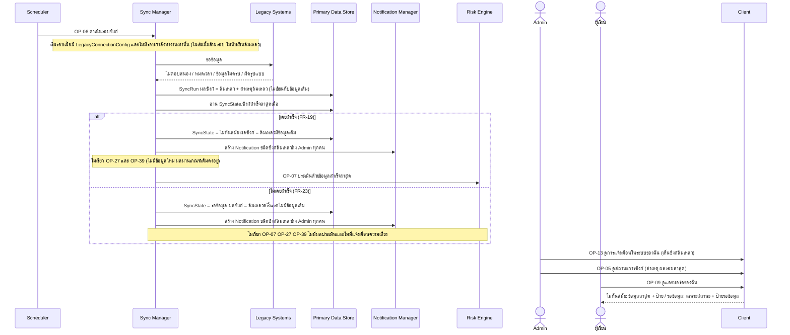
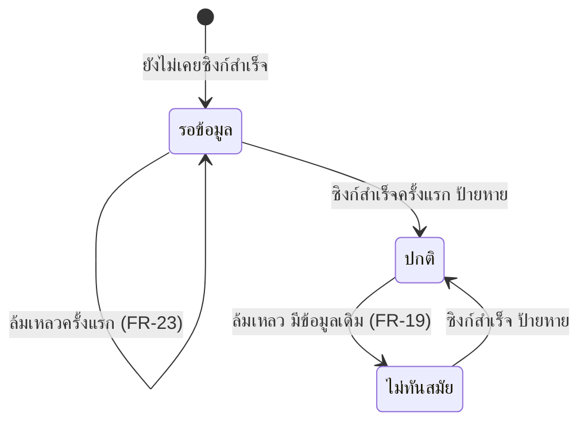

# Detailed Design: จัดการซิงก์ล้มเหลว ป้ายข้อมูลไม่ทันสมัย และป้ายรอข้อมูล (ฟีเจอร์ 18)

ที่มา: [[../../feature-list#18. จัดการซิงก์ล้มเหลว ป้ายข้อมูลไม่ทันสมัย และป้ายรอข้อมูล|Feature List ข้อ 18]], [[../../user-journey#Journey: ผู้ดูแลระบบตั้งค่าการเชื่อมต่อและ threshold|Journey ผู้ดูแลระบบ]], [[../../user-journey#Journey: ผู้เรียนรับแจ้งเตือนความเสี่ยงและคำแนะนำ|Journey ผู้เรียน]], [[../api-spec|API Spec]] OP-05, OP-06, OP-07, OP-09, OP-13, [[../db-spec#3.8 SyncState (สถานะข้อมูลปัจจุบัน)|DB Spec SyncState]], [[../architecture#4.1 ซิงก์ข้อมูล ประเมินความเสี่ยง และตั้งค่า threshold|Architecture 4.1]]
FR/NFR: [[../../../01-requirements/01-spec/20261016-01-sync-failure-handling|FR-19]], [[../../../01-requirements/01-spec/20261016-03-first-sync-failure-and-expired-lock-decision|FR-23]]
Test case: [[../../../03-testing/01-test-plan/test-cases/sync-failure-handling|sync-failure-handling]]

## 1. Sequence Flow

## 2. Operation ↔ Entity

| Operation | Entity | กระทำ |
|-----------|--------|-------|
| [[../api-spec#OP-06 ดำเนินรอบซิงก์ข้อมูล\|OP-06]] (ล้มเหลว) | SyncRun | สร้าง/แก้ ผลซิงก์ สาเหตุล้มเหลว |
| OP-06 | SyncState | แก้ สถานะข้อมูล (ซิงก์สำเร็จล่าสุดเมื่อ ไม่เปลี่ยน) |
| OP-06 | Notification (ซิงก์ล้มเหลว อ้าง SyncRun) | สร้างถึง Admin ทุกคน |
| OP-06 | GradeRecord/AttendanceRecord/AssignmentRecord | ไม่แตะ (ข้อมูลเดิมคงอยู่) |
| [[../api-spec#OP-07 ประเมินความเสี่ยงผู้เรียน\|OP-07]] | RiskAssessment ฯลฯ | เรียกเฉพาะกรณีเคยสำเร็จ |
| [[../api-spec#OP-05 ดูสถานะการซิงก์\|OP-05]], [[../api-spec#OP-09 ดูแดชบอร์ดของฉัน\|OP-09]], [[../api-spec#OP-13 ดูการแจ้งเตือนในระบบของฉัน\|OP-13]] | SyncState, SyncRun, Notification | อ่าน |

## 3. State Transition

ใช้ diagram เดียวกับ [[data-sync#3. State Transition (SyncState.สถานะข้อมูล)|data-sync ข้อ 3]] เน้นสองเส้นทางของฟีเจอร์นี้

## 4. Edge Case

| กรณี | วิธีจัดการ | อ้างอิง |
|------|-------------|---------|
| ข้อมูลไม่ครบ/ผิดรูปแบบ | ปฏิเสธทั้งชุด ปฏิบัติเป็นล้มเหลว (ยังเปิดว่าข้ามเฉพาะเรคอร์ดที่ผิดหรือไม่) | OP-06 ข้อ 5 |
| ล้มเหลวหลายรอบติด | สถานะคงไม่ทันสมัย/รอข้อมูล ทุกรอบที่ล้มเหลวสร้างการแจ้ง Admin ใหม่ ไม่มีกลไกจำกัดการแจ้งซ้ำ (ข้อสมมติฐานชั่วคราว ดูข้อ 5) | OP-06, api-spec หัวข้อ 11 |
| ยังไม่เคยตั้งค่าการเชื่อมต่อ | ไม่ถือเป็นซิงก์ล้มเหลว: OP-06 ไม่เริ่มรอบ ไม่สร้าง SyncRun ไม่แจ้ง Admin สถานะคงรอข้อมูล OP-05 แสดงตั้งค่าการเชื่อมต่อแล้ว = เท็จ | OP-06 ข้อ 0 (ก) |
| รอบก่อนหน้ายังทำงานอยู่ (SyncRun จบเมื่อ ว่าง) | ข้ามรอบใหม่ ไม่นับเป็นความล้มเหลว ไม่แจ้ง | OP-06 ข้อ 0 (ข) |
| ซิงก์สำเร็จแต่ OP-39 ล้มเหลว | ผลซิงก์ยังสำเร็จ ไม่ใช่กรณีของฟีเจอร์นี้ ดำเนินต่อไป OP-07 | OP-06 ข้อ 2 |
| ล้มเหลวครั้งแรก | ไม่สร้างผลประเมิน/แจ้งเตือนความเสี่ยง ผู้เรียนเห็นเฉพาะป้ายรอข้อมูล | FR-23 |
| ล้มเหลวหลังเคยสำเร็จ | ผลประเมินรอบนี้ ใช้ข้อมูลเดิม "ใช้ข้อมูลซิงก์ ณ" = เวลาสำเร็จล่าสุด | Architecture หัวข้อ 6 ประเด็น 3 |
| ซิงก์สำเร็จหลังล้มเหลว | สถานะเป็นปกติ ป้ายหายเอง ประมวลผล OP-27 → OP-39 → OP-07 ตามปกติ | OP-06 ข้อ 2 |
| ผู้เรียกดูแดชบอร์ดขณะรอข้อมูล | ไม่ส่งผลประเมิน ตัวแปร หรือคำแนะนำ | OP-09 |
| ไม่มี Admin ใช้งานอยู่ | ไม่ให้เกิด เพราะกันปิด Admin คนสุดท้าย | OP-30, OP-31 |
| อีเมลแจ้ง Admin | ไม่มี ช่องทางในระบบเท่านั้น | db-spec ข้อสมมติฐาน |

## 5. ช่องว่างที่พบ

ไม่มีช่องว่างใน api-spec/db-spec ที่ต้องแก้ ข้อสมมติฐานชั่วคราวที่คงไว้ (ยังไม่ตัดสินแทนผู้ใช้): spec ไม่กำหนดนโยบายแจ้ง Admin ซ้ำเมื่อซิงก์ล้มเหลวต่อเนื่อง จึงแจ้งทุกรอบที่ล้มเหลว (Admin อาจได้รับการแจ้งซ้ำ) ถ้าผู้ใช้ต้องการจำกัด ต้องกำหนดความต้องการเพิ่มผ่าน `capture-requirement` (อาจกระทบโครงสร้าง เช่น ต้องเก็บสถานะการแจ้งล่าสุด) ตาม [[../api-spec#11. ประเด็นรอตัดสินใจ|api-spec หัวข้อ 11]] และ [[../db-spec#8. บันทึกการตัดสินใจและประเด็นรอตัดสินใจ|db-spec หัวข้อ 8]]
