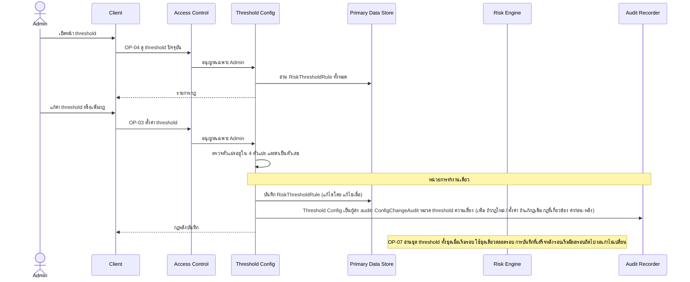

# Detailed Design: ตั้งค่า threshold ความเสี่ยง (ฟีเจอร์ 3)

ที่มา: [[../../feature-list#3. ตั้งค่า threshold ความเสี่ยง|Feature List ข้อ 3]], [[../../user-journey#Journey: ผู้ดูแลระบบตั้งค่าการเชื่อมต่อและ threshold|Journey ผู้ดูแลระบบ]], [[../api-spec|API Spec]] OP-03, OP-04, [[../db-spec#3.6 RiskThresholdRule (กฎ threshold ความเสี่ยง)|DB Spec RiskThresholdRule]], [[../architecture#4.1 ซิงก์ข้อมูล ประเมินความเสี่ยง และตั้งค่า threshold|Architecture 4.1]]
FR/NFR: [[../../../01-requirements/01-spec/20261014-01-student-risk-alert|FR-08, FR-03]]
Test case: [[../../../03-testing/01-test-plan/test-cases/threshold-config|threshold-config]]

## 1. Sequence Flow

## 2. Operation ↔ Entity

| Operation | Entity | กระทำ |
|-----------|--------|-------|
| [[../api-spec#OP-04 ดู threshold ปัจจุบัน\|OP-04]] | RiskThresholdRule | อ่าน |
| [[../api-spec#OP-03 ตั้งค่า threshold ความเสี่ยง\|OP-03]] | RiskThresholdRule | สร้าง (กฎใหม่) หรือแก้ (ค่า threshold) |
| OP-03 | ConfigChangeAudit (หมวด threshold ความเสี่ยง กฎที่เกี่ยวข้อง) | สร้างในหน่วยเดียวกัน (ค่าไม่เปลี่ยนจริง = ไม่บันทึก) |
| [[../api-spec#OP-41 ดูประวัติการเปลี่ยนบัญชี บทบาท ความสัมพันธ์ เกณฑ์ ค่าตั้งการเชื่อมต่อ นโยบายระบบ และ threshold\|OP-41]] | ConfigChangeAudit | อ่านประวัติการแก้ threshold (Admin) |
| OP-07 (ฟีเจอร์ 2) | RiskThresholdRule | อ่านในรอบประเมินถัดไป |
| OP-07 | RiskFinding | เก็บสำเนา threshold จึงไม่เปลี่ยนตามการแก้ภายหลัง |

## 3. State Transition

ไม่มีสถานะที่เปลี่ยนชัดเจน (กฎมีเฉพาะค่าปัจจุบัน ไม่มีเวอร์ชัน/สถานะ) ผลการเปลี่ยนค่ามีผลตามขอบเวลาเดียวคือ "รอบประเมินถัดไป"

## 4. Edge Case

| กรณี | วิธีจัดการ | อ้างอิง |
|------|-------------|---------|
| ตัวแปรที่ประเมินนอก 4 ตัวแปร | ERR-INVALID-INPUT | OP-03 |
| ค่า threshold ไม่ใช่ตัวเลข | ERR-INVALID-INPUT | OP-03 |
| รหัสกฎที่แก้ไม่มีอยู่ | ERR-NOT-FOUND | OP-03 |
| แก้ threshold ระหว่างรอบประเมินกำลังทำงาน | รอบที่เริ่มแล้วใช้ชุดเดิมทั้งชุดตลอดรอบ (อ่านทั้งชุดตอนเริ่มรอบ) การบันทึกที่เสร็จหลังรอบเริ่มมีผลรอบถัดไป | OP-03, OP-07 ข้อ 3 |
| ค่าไม่เปลี่ยนจริง (ตั้งค่าเท่าเดิม) | ไม่บันทึก ConfigChangeAudit | OP-03 |
| บันทึกกฎสำเร็จแต่บันทึก audit ล้มเหลว | ถอยทั้งหน่วย ไม่มีการแก้ threshold ที่ไม่มี audit | NFR-07 |
| ผลประเมินเดิมของผู้เรียน | ไม่เปลี่ยน (RiskFinding เก็บสำเนา) ย้อนอธิบายได้ว่าเข้าเงื่อนไขใดด้วยค่าตอนนั้น | NFR-02, AC-2 ของ REQ-01 |
| ผู้เรียกไม่ใช่ Admin | ERR-FORBIDDEN | กติกากลาง |
| ต้องการดูค่า threshold ก่อนหน้า | ดูผ่าน OP-41 (หมวด threshold ความเสี่ยง ค่าก่อน-หลัง) ซึ่ง NFR-07 ขยายครอบคลุมแล้ว | OP-41, db-spec 3.22 |

## 5. ช่องว่างที่พบ

ไม่มี (จุดตัด "รอบถัดไป" และ audit ปิดแล้วใน OP-03 รอบนี้)
