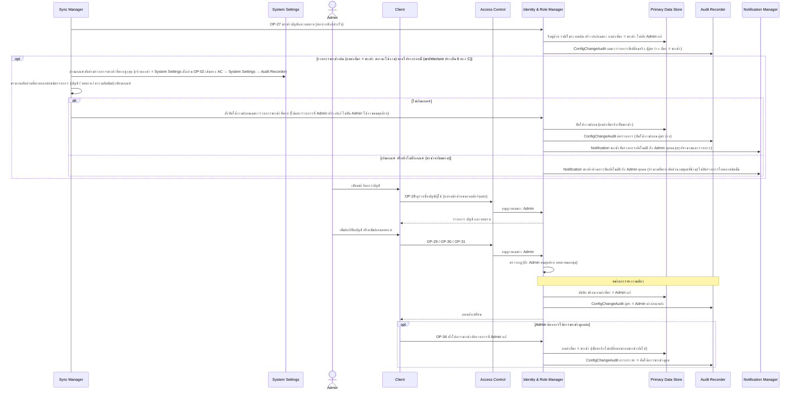
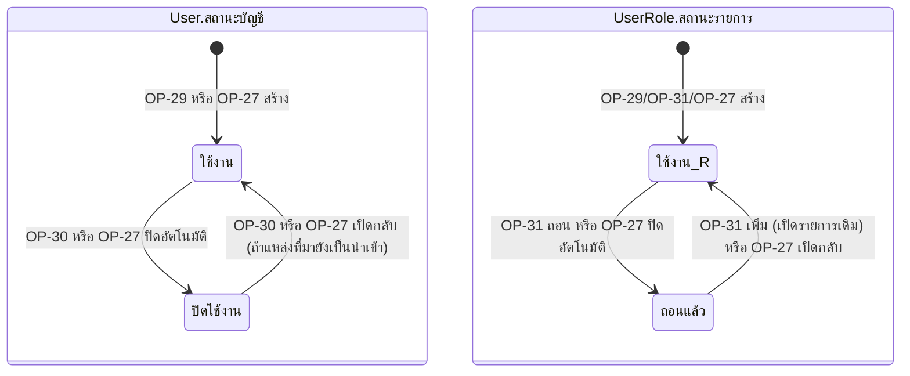

# Detailed Design: จัดการบัญชีผู้ใช้และบทบาท (ฟีเจอร์ 23)

ที่มา: [[../../feature-list#23. จัดการบัญชีผู้ใช้และบทบาท|Feature List ข้อ 23]], [[../../user-journey#Journey: Admin จัดการบัญชี บทบาท ความสัมพันธ์ครู-ผู้เรียน และเกณฑ์ผู้ผ่านเกณฑ์|Journey Admin]], [[../api-spec#7. กลุ่ม E: บัญชี บทบาท ความสัมพันธ์ครู-ผู้เรียน และเกณฑ์ผู้ผ่านเกณฑ์|API Spec กลุ่ม E]], [[../db-spec#3.1 User (บัญชีผู้ใช้)|DB Spec User]], [[../db-spec#3.2 UserRole (บทบาทของผู้ใช้)|UserRole]], [[../architecture#4.8 Admin จัดการบัญชี บทบาท ความสัมพันธ์ครู-ผู้เรียน และเกณฑ์ผู้ผ่านเกณฑ์|Architecture 4.8]]
FR/NFR: [[../../../01-requirements/01-spec/20261017-01-user-role-advisor-eligibility-management|FR-25, NFR-07]]
Test case: ยังไม่มี test case ของฟีเจอร์ 23 ใช้ slug `user-account-role-management` เมื่อ test-writer สร้าง

## 1. Sequence Flow

## 2. Operation ↔ Entity

| Operation | ผู้เรียก | Entity ที่กระทบ | กระทำ | ConfigChangeAudit (การกระทำ) |
|-----------|---------|------------------|-------|-------------------------------|
| [[../api-spec#OP-27 นำเข้าบัญชี บทบาท และความสัมพันธ์จากระบบเดิม\|OP-27]] | ระบบ | User, UserRole, AdvisorAssignment, SystemPolicy (Sync Manager อ่านเกณฑ์สัดส่วนจาก System Settings), Notification | สร้าง/แก้/ปิด/เปิดกลับ | เพิ่ม/แก้/ปิดใช้งาน/ถอน/เปิดใช้งาน (ที่มา = นำเข้า) |
| [[../api-spec#OP-28 ดูรายชื่อบัญชีผู้ใช้\|OP-28]] | Admin | User, UserRole | อ่าน | - |
| [[../api-spec#OP-29 เพิ่มบัญชีผู้ใช้\|OP-29]] | Admin | User, UserRole | สร้าง (แหล่งที่มา = Admin แก้) | เพิ่ม |
| [[../api-spec#OP-30 แก้ไขบัญชีผู้ใช้ (รวมปิด/เปิดใช้งาน)\|OP-30]] | Admin | User | แก้ (แหล่งที่มา = Admin แก้) | แก้/ปิดใช้งาน/เปิดใช้งาน |
| [[../api-spec#OP-31 กำหนดบทบาทของผู้ใช้ (เพิ่ม/ถอน)\|OP-31]] | Admin | UserRole | สร้าง/เปิดกลับ/ถอน (ไม่ลบ) | เพิ่ม/ถอน |
| [[../api-spec#OP-36 สั่งให้การนำเข้าทับรายการที่ Admin แก้\|OP-36]] | Admin | User, UserRole (แหล่งที่มา) | แก้เฉพาะแหล่งที่มา | คืนให้การนำเข้าดูแล |

## 3. State Transition

(ใช้งาน_R คือสถานะ ใช้งาน ของ UserRole แยกชื่อเพื่อความถูกต้องของแผนภาพ) แหล่งที่มา (นำเข้า / Admin แก้) เป็นอีกมิติหนึ่ง: การเปลี่ยนโดย Admin ตั้ง = Admin แก้ (การนำเข้าไม่ทับ) OP-36 ตั้งกลับเป็น = นำเข้า ปิดอัตโนมัติคงแหล่งที่มาเป็น นำเข้า

## 4. Edge Case

| กรณี | วิธีจัดการ | อ้างอิง |
|------|-------------|---------|
| ปิดบัญชี/ถอนบทบาท Admin คนสุดท้ายที่ใช้งานอยู่ | ERR-LAST-ADMIN (OP-27 ข้ามรายการและระบุในสรุป) | OP-30, OP-31, OP-27 |
| อีเมลหรือรหัสในระบบเดิมซ้ำ | ERR-DUPLICATE | OP-29, OP-30 |
| ขาด field จำเป็น/บทบาทนอก 4 บทบาท | ERR-INVALID-INPUT | OP-29, OP-31 |
| เพิ่มบทบาทที่ใช้งานอยู่แล้ว / ถอนที่ไม่มี | ERR-INVALID-INPUT | OP-31 |
| แก้โดยไม่มีค่าเปลี่ยนจริง | ไม่บันทึก audit | OP-30 |
| ปิดบัญชีที่ผู้ตรวจถือล็อกอยู่ | ล็อกไม่ถูกปลดอัตโนมัติ หมดเวลาหรือปลดด้วยมือ | OP-30 |
| ถอนบทบาทครู/นักศึกษา | AdvisorAssignment ไม่ถูกลบ แต่ไม่มีผลต่อสิทธิ์ตราบที่ไม่มีบทบาทนั้น | OP-31 |
| นำเข้าพบรายการที่ Admin แก้ไว้ | ไม่ทับ ไม่เปิดกลับ (นับเป็นข้ามเพราะ Admin แก้เอง) | OP-27 ข้อ 3 |
| รายการนำเข้าหายเกินเกณฑ์/ยังไม่ตั้งเกณฑ์ | ไม่ปิดรายการชนิดนั้น แจ้ง Admin พร้อมเหตุผล Admin ตัดสินเอง | OP-27 ข้อ 6 |
| รายการที่ปิดอัตโนมัติกลับมาในรอบถัดไป | เปิดกลับ พร้อม audit (ถ้าแหล่งที่มายังเป็น นำเข้า) | OP-27 ข้อ 6 |
| Admin เปิดกลับเอง | แหล่งที่มา = Admin แก้ จึงไม่ถูกปิดอัตโนมัติซ้ำ | OP-27 ข้อ 6 |
| OP-36 กับบัญชีที่ไม่มี รหัสในระบบเดิม | ERR-NO-IMPORT-SOURCE | OP-36 |
| บัญชีนักศึกษาที่เพิ่มใหม่ | ไม่ผ่านเกณฑ์จนถึงรอบประเมินถัดไป (OP-39) | OP-29 |
| ข้อมูลความสัมพันธ์ในการนำเข้าผิด (ครู/ผู้เรียนไม่มีบทบาท) | ข้ามรายการ นับเป็นข้ามเพราะข้อมูลไม่ถูกต้อง | OP-27 ข้อ 4 |
| ผู้เรียกไม่ใช่ Admin | ERR-FORBIDDEN | กติกากลาง |
| การยืนยันตัวตน/สมัครเอง | นอกขอบเขต (REQ-06) ระบบนี้ถือว่าได้ตัวตนจาก Access Control แล้ว | กติกากลาง |

## 5. ช่องว่างที่พบ

ไม่มีช่องว่างใน api-spec/db-spec ที่ต้องแก้ ข้อสังเกตที่เป็นการตั้งใจ ไม่ใช่ช่องว่าง: ไม่มี operation ลบถาวรบัญชี (ปิดแทนเพื่อรักษาประวัติ) และ "เกณฑ์สัดส่วนรายการนำเข้าที่หายสูงสุด" ผ่าน OP-02 ยังไม่มีค่าเริ่มต้น (ว่าง = ไม่ปิดอัตโนมัติ และแจ้ง Admin ว่าข้าม) ตามการตัดสินใจทาง C Admin ดูค่าปัจจุบันผ่าน OP-43 ก่อนแก้ (การตั้งเกณฑ์นี้ถูก audit หมวดนโยบายระบบ)
