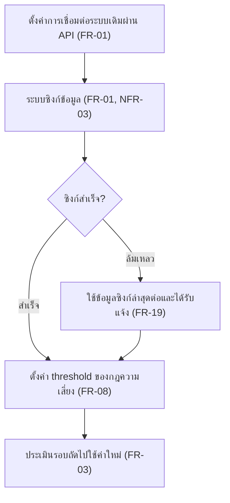
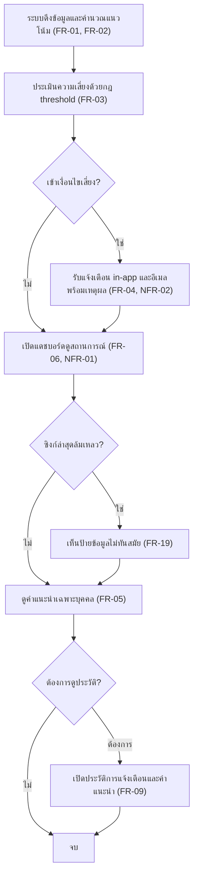
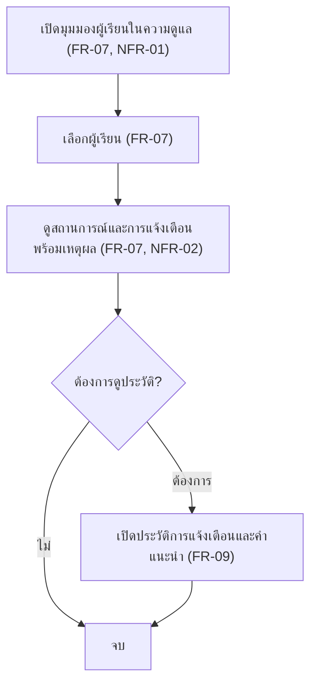
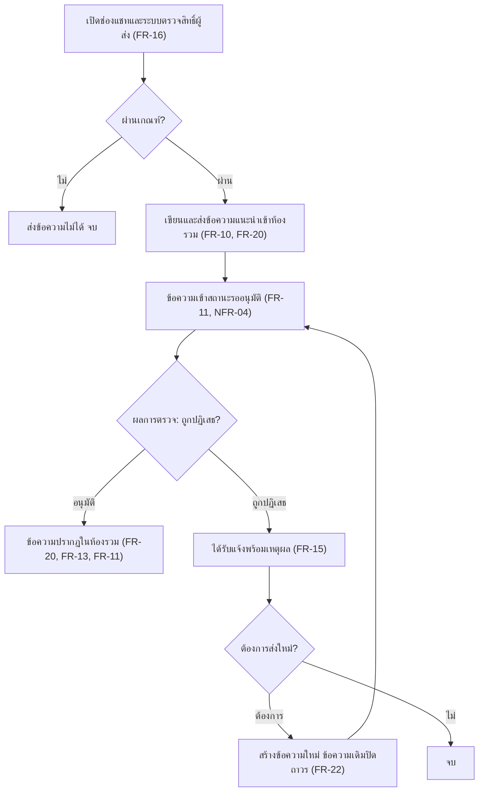
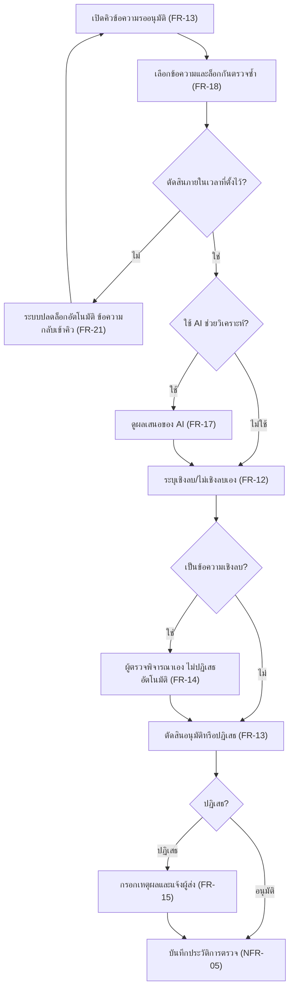
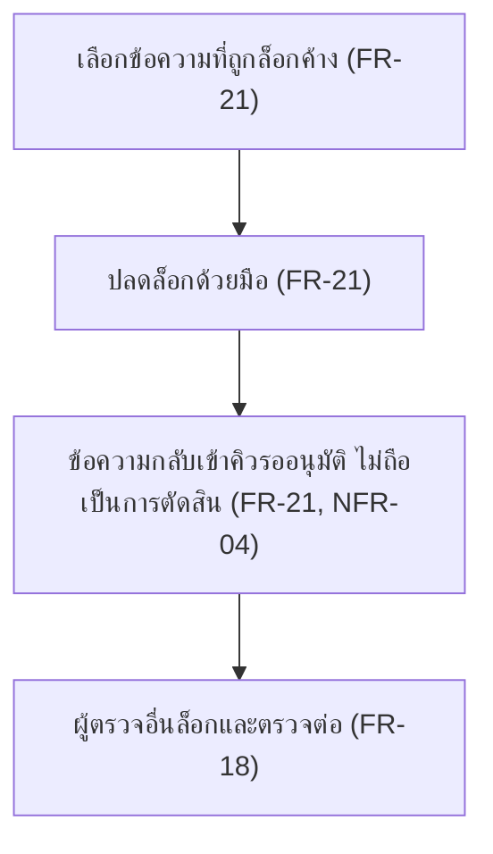
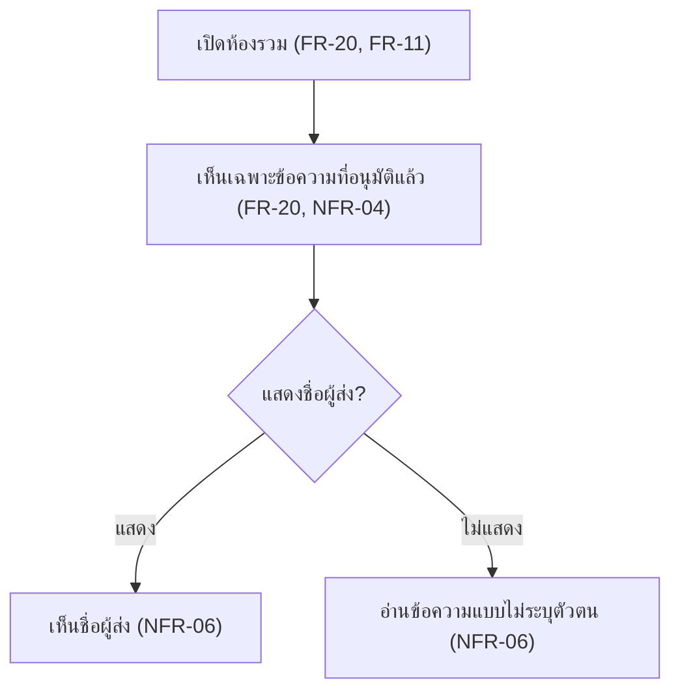

# User Journey

แมปฟีเจอร์ใน [[feature-list]] เป็น flow การใช้งานตามบทบาท (รหัสอ้างอิง spec: [[../01-requirements/01-spec/20261014-01-student-risk-alert|REQ-01]], [[../01-requirements/01-spec/20261014-02-peer-advice-chat|REQ-02]], [[../01-requirements/01-spec/20261016-01-sync-failure-handling|REQ-03]], [[../01-requirements/01-spec/20261016-02-peer-chat-recipients-lock-resubmit|REQ-04]])

## Journey: ผู้ดูแลระบบตั้งค่าการเชื่อมต่อและ threshold
บทบาท: ผู้ดูแลระบบ

1. ตั้งค่าการเชื่อมต่อระบบเดิม (LMS/ทะเบียน) ผ่าน API — [[20261014-01-student-risk-alert|FR-01]]
2. ระบบซิงก์ข้อมูล (ความถี่ยังไม่กำหนด) — [[20261014-01-student-risk-alert|FR-01]], [[20261014-01-student-risk-alert|NFR-03]]
3. ตัดสินว่าซิงก์สำเร็จหรือไม่ ถ้าสำเร็จข้ามไปขั้นที่ 5 ถ้าล้มเหลวไปขั้นที่ 4
4. ซิงก์ล้มเหลว ระบบใช้ข้อมูลซิงก์ล่าสุดที่สำเร็จต่อ และแจ้งผู้ดูแลระบบ — [[20261016-01-sync-failure-handling|FR-19]]
5. ตั้งค่า threshold ของกฎความเสี่ยง — [[20261014-01-student-risk-alert|FR-08]]
6. การประเมินรอบถัดไปใช้ค่าใหม่ — [[20261014-01-student-risk-alert|FR-03]]

## Journey: ผู้เรียนรับแจ้งเตือนความเสี่ยงและคำแนะนำ
บทบาท: ผู้เรียน

1. ระบบดึงข้อมูลและคำนวณแนวโน้มผลการเรียน — [[20261014-01-student-risk-alert|FR-01]], [[20261014-01-student-risk-alert|FR-02]]
2. ประเมินความเสี่ยงด้วยกฎ threshold — [[20261014-01-student-risk-alert|FR-03]]
3. ตัดสินว่าเข้าเงื่อนไขเสี่ยงหรือไม่ ถ้าใช่ไปขั้นที่ 4 ถ้าไม่ข้ามไปขั้นที่ 5
4. รับแจ้งเตือนทาง in-app และอีเมลพร้อมเหตุผล — [[20261014-01-student-risk-alert|FR-04]], [[20261014-01-student-risk-alert|NFR-02]]
5. เปิดแดชบอร์ดดูสถานการณ์ (เห็นเฉพาะข้อมูลตน) — [[20261014-01-student-risk-alert|FR-06]], [[20261014-01-student-risk-alert|NFR-01]]
6. ตัดสินว่าซิงก์ล่าสุดล้มเหลวหรือไม่ ถ้าใช่ไปขั้นที่ 7 ถ้าไม่ข้ามไปขั้นที่ 8
7. เห็นป้ายว่าข้อมูลไม่ทันสมัย (ป้ายหายเมื่อซิงก์สำเร็จ) — [[20261016-01-sync-failure-handling|FR-19]]
8. ดูคำแนะนำเฉพาะบุคคล — [[20261014-01-student-risk-alert|FR-05]]
9. ตัดสินว่าต้องการดูประวัติหรือไม่ — ถ้าต้องการไปขั้นที่ 10
10. เปิดประวัติการแจ้งเตือนและคำแนะนำ — [[20261014-01-student-risk-alert|FR-09]]
11. จบ

## Journey: ครู/อาจารย์ที่ปรึกษาติดตามผู้เรียนในความดูแล
บทบาท: ครู/อาจารย์ที่ปรึกษา

1. เปิดมุมมองผู้เรียนในความดูแล (เห็นเฉพาะผู้เรียนในความดูแล) — [[20261014-01-student-risk-alert|FR-07]], [[20261014-01-student-risk-alert|NFR-01]]
2. เลือกผู้เรียน — [[20261014-01-student-risk-alert|FR-07]]
3. ดูสถานการณ์และการแจ้งเตือนพร้อมเหตุผล — [[20261014-01-student-risk-alert|FR-07]], [[20261014-01-student-risk-alert|NFR-02]]
4. ตัดสินว่าต้องการดูประวัติหรือไม่ — ถ้าต้องการไปขั้นที่ 5
5. เปิดประวัติการแจ้งเตือนและคำแนะนำ — [[20261014-01-student-risk-alert|FR-09]]
6. จบ

## Journey: นักศึกษาผู้ส่งข้อความแนะนำแนวทางการเรียน
บทบาท: นักศึกษาผู้ส่ง

1. เปิดช่องแชท ระบบตรวจสิทธิ์ผู้ส่ง — [[20261014-02-peer-advice-chat|FR-16]]
2. ตัดสินว่าผ่านเกณฑ์หรือไม่ ถ้าไม่ผ่านส่งข้อความไม่ได้และจบ
3. เขียนและส่งข้อความแนะนำเข้าห้องรวม (ไม่เลือกผู้รับรายคน) — [[20261014-02-peer-advice-chat|FR-10]], [[20261016-02-peer-chat-recipients-lock-resubmit|FR-20]]
4. ข้อความเข้าสถานะรออนุมัติ ผู้รับยังไม่เห็น — [[20261014-02-peer-advice-chat|FR-11]], [[20261014-02-peer-advice-chat|NFR-04]]
5. ผู้ตรวจตัดสิน ถ้าถูกปฏิเสธไปขั้นที่ 7 ถ้าอนุมัติไปขั้นที่ 6
6. ข้อความอนุมัติและปรากฏในห้องรวม (จบ) — [[20261016-02-peer-chat-recipients-lock-resubmit|FR-20]], [[20261014-02-peer-advice-chat|FR-13]], [[20261014-02-peer-advice-chat|FR-11]]
7. ได้รับแจ้งพร้อมเหตุผลการปฏิเสธ — [[20261014-02-peer-advice-chat|FR-15]]
8. ตัดสินว่าต้องการส่งใหม่หรือไม่ ถ้าไม่ต้องการจบ
9. สร้างข้อความใหม่ (ข้อความเดิมปิดถาวร แก้ไม่ได้) แล้วกลับไปขั้นที่ 4 เพื่อผ่านการตรวจใหม่ทั้งหมด — [[20261016-02-peer-chat-recipients-lock-resubmit|FR-22]]

## Journey: อาจารย์/Admin ตรวจและอนุมัติข้อความ
บทบาท: อาจารย์, Admin (สิทธิ์เท่ากัน)

1. เปิดคิวข้อความรออนุมัติ — [[20261014-02-peer-advice-chat|FR-13]]
2. เลือกข้อความและระบบล็อกกันตรวจซ้ำ — [[20261014-02-peer-advice-chat|FR-18]]
3. ตัดสินว่าผู้ตรวจตัดสินภายในเวลาที่ตั้งไว้หรือไม่ ถ้าใช่ไปขั้นที่ 5 ถ้าไม่ไปขั้นที่ 4
4. ระบบปลดล็อกอัตโนมัติเมื่อหมดเวลา (ไม่ถือเป็นการตัดสิน) ข้อความกลับเข้าคิว แล้วกลับไปขั้นที่ 1 — [[20261016-02-peer-chat-recipients-lock-resubmit|FR-21]]
5. ตัดสินว่าใช้ AI ช่วยวิเคราะห์หรือไม่ ถ้าใช้ไปขั้นที่ 6 ถ้าไม่ข้ามไปขั้นที่ 7
6. ดูผลเสนอของ AI (ผู้ตรวจยืนยันขั้นสุดท้าย) — [[20261014-02-peer-advice-chat|FR-17]]
7. ระบุเชิงลบ/ไม่เชิงลบ — [[20261014-02-peer-advice-chat|FR-12]]
8. ถ้าเป็นข้อความเชิงลบ ผู้ตรวจพิจารณาเอง ไม่ปฏิเสธอัตโนมัติ (ข้ามถ้าไม่เชิงลบ) — [[20261014-02-peer-advice-chat|FR-14]]
9. ตัดสินอนุมัติหรือปฏิเสธ — [[20261014-02-peer-advice-chat|FR-13]]
10. ถ้าปฏิเสธ กรอกเหตุผลและแจ้งผู้ส่ง (ข้ามถ้าอนุมัติ) — [[20261014-02-peer-advice-chat|FR-15]]
11. ระบบบันทึกประวัติการตรวจ (ใคร ผลตัดสิน เชิงลบ/ไม่เชิงลบ เหตุผล) — [[20261014-02-peer-advice-chat|NFR-05]]

## Journey: Admin ปลดล็อกข้อความที่ผู้ตรวจค้างด้วยมือ
บทบาท: Admin

1. เลือกข้อความที่ผู้ตรวจล็อกไว้แต่ไม่ตัดสิน — [[20261016-02-peer-chat-recipients-lock-resubmit|FR-21]]
2. ปลดล็อกด้วยมือ — [[20261016-02-peer-chat-recipients-lock-resubmit|FR-21]]
3. ข้อความกลับเข้าคิวรออนุมัติ ไม่ถือเป็นการตัดสินและไม่หลุดไปถึงผู้รับ — [[20261016-02-peer-chat-recipients-lock-resubmit|FR-21]], [[20261014-02-peer-advice-chat|NFR-04]]
4. ผู้ตรวจอื่นล็อกและตรวจต่อได้ — [[20261014-02-peer-advice-chat|FR-18]]

## Journey: นักศึกษาผู้รับอ่านข้อความแนะนำ
บทบาท: นักศึกษาผู้รับ

1. เปิดห้องรวม (นักศึกษาทุกคนในระบบเข้าถึงได้) — [[20261016-02-peer-chat-recipients-lock-resubmit|FR-20]], [[20261014-02-peer-advice-chat|FR-11]]
2. เห็นเฉพาะข้อความที่อนุมัติแล้ว ไม่เห็นข้อความรออนุมัติหรือถูกปฏิเสธ — [[20261016-02-peer-chat-recipients-lock-resubmit|FR-20]], [[20261014-02-peer-advice-chat|NFR-04]]
3. การแสดงชื่อผู้ส่งตามนโยบายที่จะกำหนด (ยังเป็นคำถามเปิด) — [[20261014-02-peer-advice-chat|NFR-06]]
