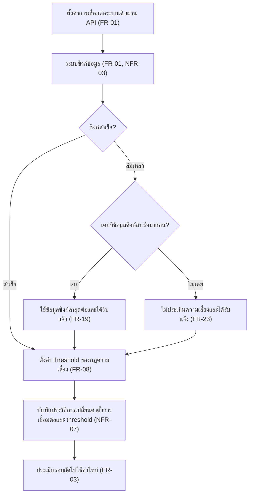
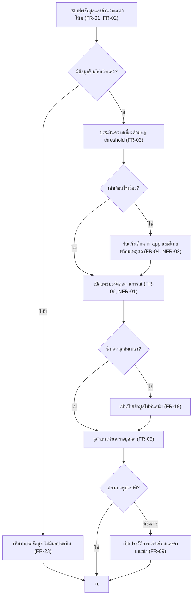
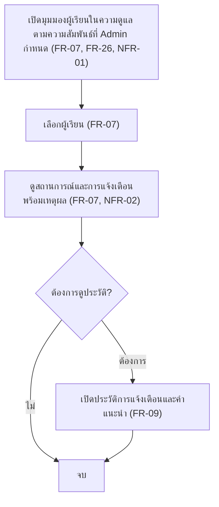
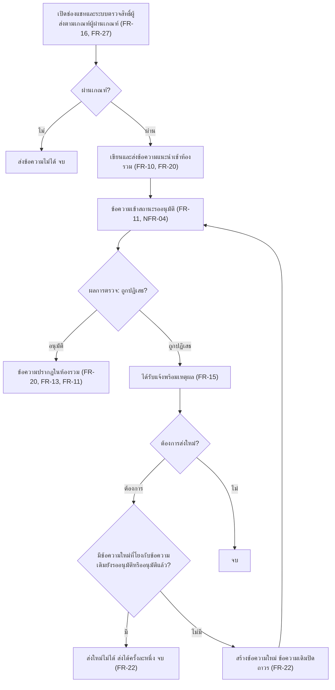
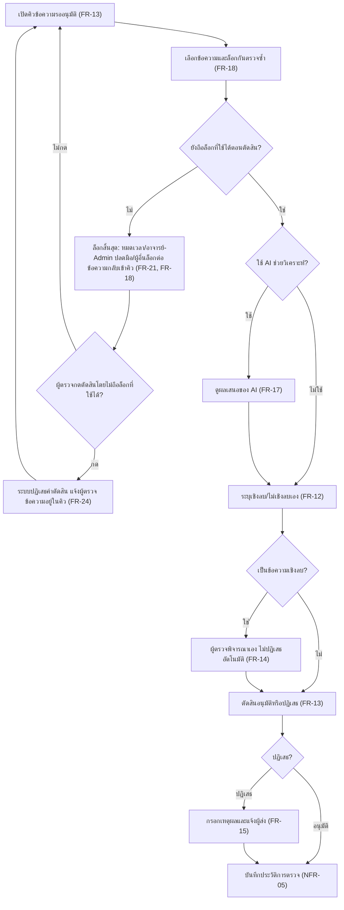
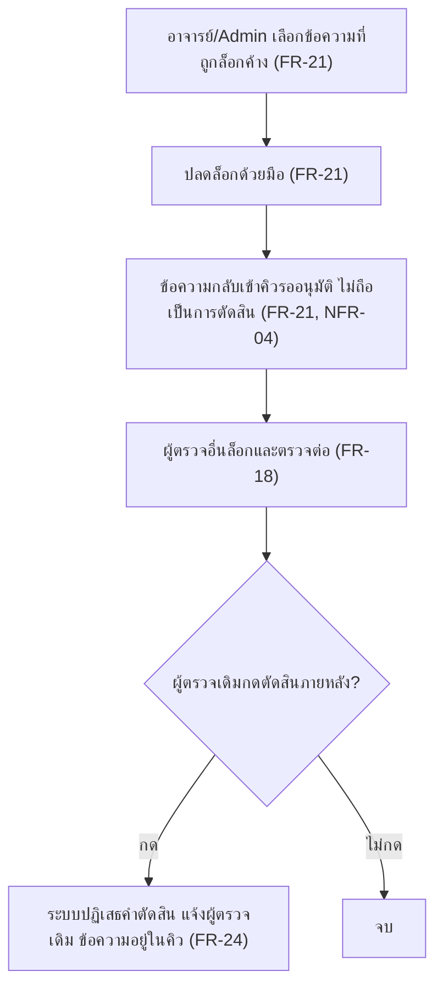
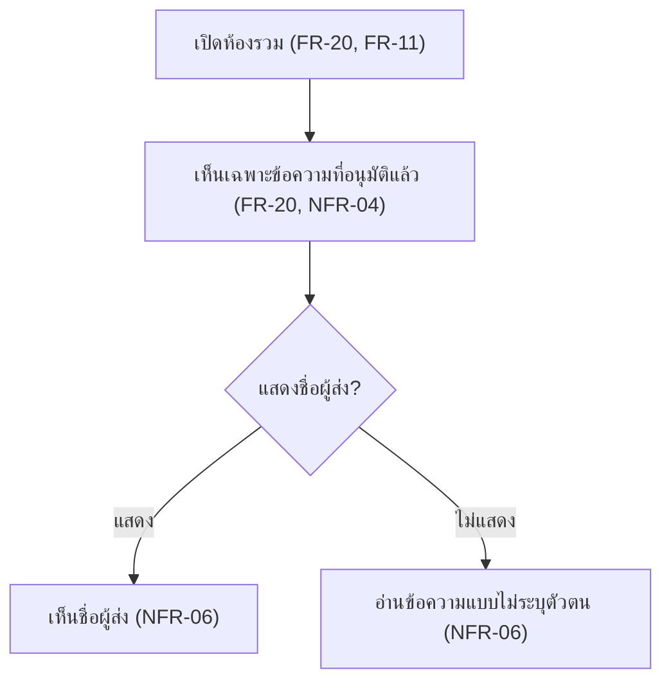
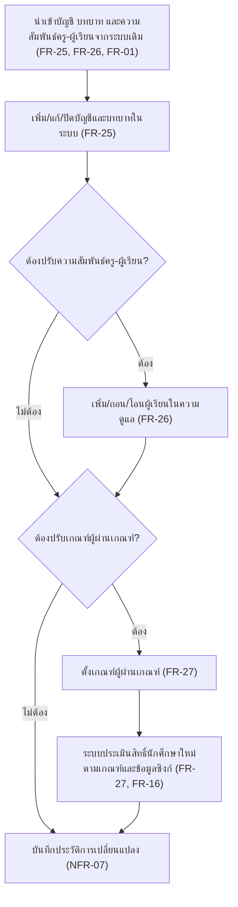
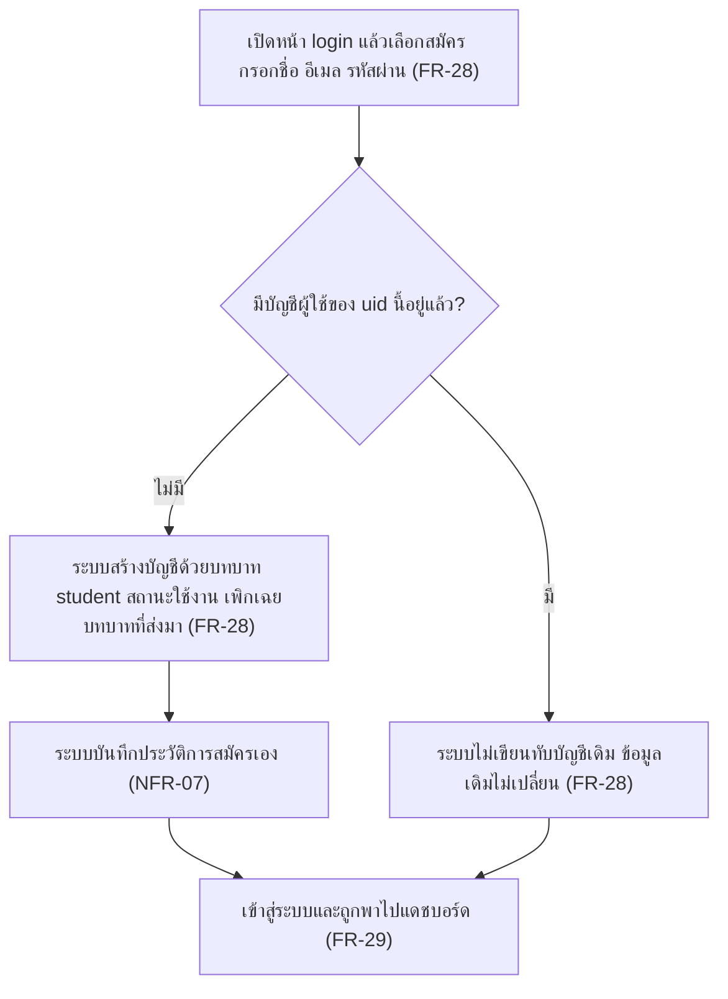
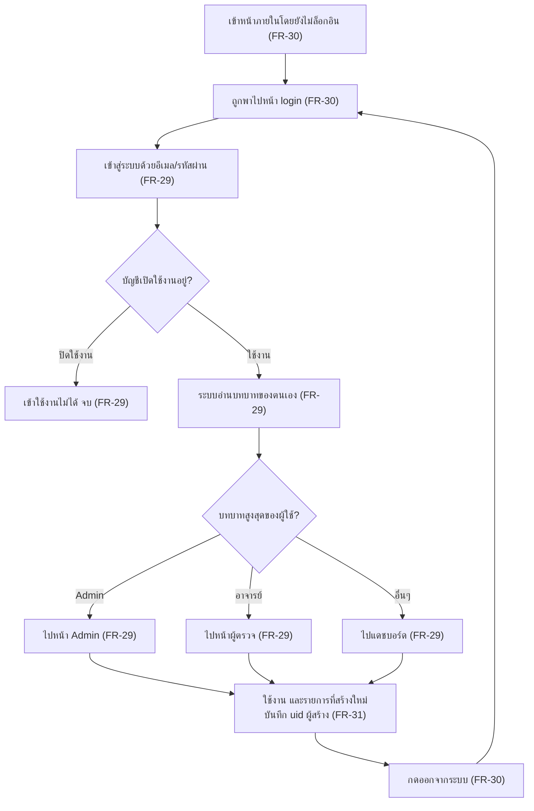

# User Journey

แมปฟีเจอร์ใน [[feature-list]] เป็น flow การใช้งานตามบทบาท (รหัสอ้างอิง spec: [[../01-requirements/01-spec/20261014-01-student-risk-alert|REQ-01]], [[../01-requirements/01-spec/20261014-02-peer-advice-chat|REQ-02]], [[../01-requirements/01-spec/20261016-01-sync-failure-handling|REQ-03]], [[../01-requirements/01-spec/20261016-02-peer-chat-recipients-lock-resubmit|REQ-04]], [[../01-requirements/01-spec/20261016-03-first-sync-failure-and-expired-lock-decision|REQ-05]], [[../01-requirements/01-spec/20261017-01-user-role-advisor-eligibility-management|REQ-06]], [[../01-requirements/01-spec/20261027-01-self-registration-and-login|REQ-07]])

## Journey: ผู้ดูแลระบบตั้งค่าการเชื่อมต่อและ threshold
บทบาท: ผู้ดูแลระบบ

1. ตั้งค่าการเชื่อมต่อระบบเดิม (LMS/ทะเบียน) ผ่าน API — [[20261014-01-student-risk-alert|FR-01]]
2. ระบบซิงก์ข้อมูล (ความถี่ยังไม่กำหนด) — [[20261014-01-student-risk-alert|FR-01]], [[20261014-01-student-risk-alert|NFR-03]]
3. ตัดสินว่าซิงก์สำเร็จหรือไม่ ถ้าสำเร็จข้ามไปขั้นที่ 7 ถ้าล้มเหลวไปขั้นที่ 4
4. ตัดสินว่าเคยมีข้อมูลซิงก์สำเร็จมาก่อนหรือไม่ ถ้าเคยไปขั้นที่ 5 ถ้าไม่เคยไปขั้นที่ 6
5. ซิงก์ล้มเหลว ระบบใช้ข้อมูลซิงก์ล่าสุดที่สำเร็จต่อ และแจ้งผู้ดูแลระบบ แล้วไปขั้นที่ 7 — [[20261016-01-sync-failure-handling|FR-19]]
6. ซิงก์ครั้งแรกล้มเหลวโดยไม่มีข้อมูลเดิม ระบบไม่ประเมินความเสี่ยงและแจ้งผู้ดูแลระบบ — [[20261016-03-first-sync-failure-and-expired-lock-decision|FR-23]]
7. ตั้งค่า threshold ของกฎความเสี่ยง — [[20261014-01-student-risk-alert|FR-08]]
8. ระบบบันทึกประวัติการเปลี่ยนค่าตั้งการเชื่อมต่อและ threshold (ผู้ทำ เวลา ค่าก่อน-หลัง) — [[20261017-01-user-role-advisor-eligibility-management|NFR-07]]
9. การประเมินรอบถัดไปใช้ค่าใหม่ — [[20261014-01-student-risk-alert|FR-03]]

## Journey: ผู้เรียนรับแจ้งเตือนความเสี่ยงและคำแนะนำ
บทบาท: ผู้เรียน

1. ระบบดึงข้อมูลและคำนวณแนวโน้มผลการเรียน — [[20261014-01-student-risk-alert|FR-01]], [[20261014-01-student-risk-alert|FR-02]]
2. ตัดสินว่ามีข้อมูลซิงก์สำเร็จแล้วหรือไม่ ถ้ามีไปขั้นที่ 4 ถ้าไม่มีไปขั้นที่ 3
3. เห็นป้ายรอข้อมูล ไม่มีผลประเมินใดๆ (ป้ายหายและกลับสู่การทำงานปกติเมื่อซิงก์สำเร็จครั้งแรก) แล้วจบ — [[20261016-03-first-sync-failure-and-expired-lock-decision|FR-23]]
4. ประเมินความเสี่ยงด้วยกฎ threshold — [[20261014-01-student-risk-alert|FR-03]]
5. ตัดสินว่าเข้าเงื่อนไขเสี่ยงหรือไม่ ถ้าใช่ไปขั้นที่ 6 ถ้าไม่ข้ามไปขั้นที่ 7
6. รับแจ้งเตือนทาง in-app และอีเมลพร้อมเหตุผล — [[20261014-01-student-risk-alert|FR-04]], [[20261014-01-student-risk-alert|NFR-02]]
7. เปิดแดชบอร์ดดูสถานการณ์ (เห็นเฉพาะข้อมูลตน) — [[20261014-01-student-risk-alert|FR-06]], [[20261014-01-student-risk-alert|NFR-01]]
8. ตัดสินว่าซิงก์ล่าสุดล้มเหลวหรือไม่ ถ้าใช่ไปขั้นที่ 9 ถ้าไม่ข้ามไปขั้นที่ 10
9. เห็นป้ายว่าข้อมูลไม่ทันสมัย (ป้ายหายเมื่อซิงก์สำเร็จ) — [[20261016-01-sync-failure-handling|FR-19]]
10. ดูคำแนะนำเฉพาะบุคคล — [[20261014-01-student-risk-alert|FR-05]]
11. ตัดสินว่าต้องการดูประวัติหรือไม่ — ถ้าต้องการไปขั้นที่ 12
12. เปิดประวัติการแจ้งเตือนและคำแนะนำ — [[20261014-01-student-risk-alert|FR-09]]
13. จบ

## Journey: ครู/อาจารย์ที่ปรึกษาติดตามผู้เรียนในความดูแล
บทบาท: ครู/อาจารย์ที่ปรึกษา

1. เปิดมุมมองผู้เรียนในความดูแล (เห็นเฉพาะผู้เรียนในความดูแลตามความสัมพันธ์ที่ Admin กำหนดหรือนำเข้า) — [[20261014-01-student-risk-alert|FR-07]], [[20261017-01-user-role-advisor-eligibility-management|FR-26]], [[20261014-01-student-risk-alert|NFR-01]]
2. เลือกผู้เรียน — [[20261014-01-student-risk-alert|FR-07]]
3. ดูสถานการณ์และการแจ้งเตือนพร้อมเหตุผล — [[20261014-01-student-risk-alert|FR-07]], [[20261014-01-student-risk-alert|NFR-02]]
4. ตัดสินว่าต้องการดูประวัติหรือไม่ — ถ้าต้องการไปขั้นที่ 5
5. เปิดประวัติการแจ้งเตือนและคำแนะนำ — [[20261014-01-student-risk-alert|FR-09]]
6. จบ

## Journey: นักศึกษาผู้ส่งข้อความแนะนำแนวทางการเรียน
บทบาท: นักศึกษาผู้ส่ง

1. เปิดช่องแชท ระบบตรวจสิทธิ์ผู้ส่งจากผลประเมินเกณฑ์ผู้ผ่านเกณฑ์ที่ Admin ตั้ง — [[20261014-02-peer-advice-chat|FR-16]], [[20261017-01-user-role-advisor-eligibility-management|FR-27]]
2. ตัดสินว่าผ่านเกณฑ์หรือไม่ ถ้าไม่ผ่านส่งข้อความไม่ได้และจบ
3. เขียนและส่งข้อความแนะนำเข้าห้องรวม (ไม่เลือกผู้รับรายคน) — [[20261014-02-peer-advice-chat|FR-10]], [[20261016-02-peer-chat-recipients-lock-resubmit|FR-20]]
4. ข้อความเข้าสถานะรออนุมัติ ผู้รับยังไม่เห็น — [[20261014-02-peer-advice-chat|FR-11]], [[20261014-02-peer-advice-chat|NFR-04]]
5. ผู้ตรวจตัดสิน ถ้าถูกปฏิเสธไปขั้นที่ 7 ถ้าอนุมัติไปขั้นที่ 6
6. ข้อความอนุมัติและปรากฏในห้องรวม (จบ) — [[20261016-02-peer-chat-recipients-lock-resubmit|FR-20]], [[20261014-02-peer-advice-chat|FR-13]], [[20261014-02-peer-advice-chat|FR-11]]
7. ได้รับแจ้งพร้อมเหตุผลการปฏิเสธ — [[20261014-02-peer-advice-chat|FR-15]]
8. ตัดสินว่าต้องการส่งใหม่หรือไม่ ถ้าไม่ต้องการจบ
9. ตัดสินว่ามีข้อความใหม่ที่โยงกับข้อความเดิมยังรออนุมัติหรืออนุมัติแล้วหรือไม่ ถ้ามีส่งใหม่ไม่ได้ (ส่งใหม่ได้ครั้งละหนึ่ง) และจบ ถ้าไม่มีไปขั้นที่ 10 — [[20261016-02-peer-chat-recipients-lock-resubmit|FR-22]]
10. สร้างข้อความใหม่ (ข้อความเดิมปิดถาวร แก้ไม่ได้) แล้วกลับไปขั้นที่ 4 เพื่อผ่านการตรวจใหม่ทั้งหมด — [[20261016-02-peer-chat-recipients-lock-resubmit|FR-22]]

## Journey: อาจารย์/Admin ตรวจและอนุมัติข้อความ
บทบาท: อาจารย์, Admin (สิทธิ์เท่ากัน)

1. เปิดคิวข้อความรออนุมัติ — [[20261014-02-peer-advice-chat|FR-13]]
2. เลือกข้อความและระบบล็อกกันตรวจซ้ำ — [[20261014-02-peer-advice-chat|FR-18]]
3. ตัดสินว่าผู้ตรวจยังถือล็อกที่ใช้ได้ตอนตัดสินหรือไม่ ถ้ายังถือไปขั้นที่ 7 ถ้าไม่ไปขั้นที่ 4
4. ล็อกสิ้นสุดโดยไม่ถือเป็นการตัดสิน ข้อความกลับเข้าคิว ไม่ว่าด้วยสาเหตุใดใน 3 กรณี: ล็อกถูกปลดอัตโนมัติเมื่อหมดเวลา, อาจารย์/Admin ปลดล็อกด้วยมือ, หรือผู้ตรวจอื่นล็อกข้อความต่อ — [[20261016-02-peer-chat-recipients-lock-resubmit|FR-21]], [[20261014-02-peer-advice-chat|FR-18]]
5. ตัดสินว่าผู้ตรวจกดตัดสินโดยไม่ถือล็อกที่ใช้ได้หรือไม่ ถ้ากดไปขั้นที่ 6 ถ้าไม่กดกลับไปขั้นที่ 1
6. ระบบปฏิเสธคำตัดสิน (ไม่บันทึกเป็นการตัดสิน) แจ้งผู้ตรวจ ข้อความอยู่ในคิวไม่หลุดเป็นอนุมัติ ไม่ว่าสาเหตุใดข้างต้น แล้วกลับไปขั้นที่ 1 — [[20261016-03-first-sync-failure-and-expired-lock-decision|FR-24]]
7. ตัดสินว่าใช้ AI ช่วยวิเคราะห์หรือไม่ ถ้าใช้ไปขั้นที่ 8 ถ้าไม่ข้ามไปขั้นที่ 9
8. ดูผลเสนอของ AI (ผู้ตรวจยืนยันขั้นสุดท้าย) — [[20261014-02-peer-advice-chat|FR-17]]
9. ระบุเชิงลบ/ไม่เชิงลบ — [[20261014-02-peer-advice-chat|FR-12]]
10. ถ้าเป็นข้อความเชิงลบ ผู้ตรวจพิจารณาเอง ไม่ปฏิเสธอัตโนมัติ (ข้ามถ้าไม่เชิงลบ) — [[20261014-02-peer-advice-chat|FR-14]]
11. ตัดสินอนุมัติหรือปฏิเสธ — [[20261014-02-peer-advice-chat|FR-13]]
12. ถ้าปฏิเสธ กรอกเหตุผลและแจ้งผู้ส่ง (ข้ามถ้าอนุมัติ) — [[20261014-02-peer-advice-chat|FR-15]]
13. ระบบบันทึกประวัติการตรวจ (ใคร ผลตัดสิน เชิงลบ/ไม่เชิงลบ เหตุผล) — [[20261014-02-peer-advice-chat|NFR-05]]

## Journey: อาจารย์/Admin ปลดล็อกข้อความที่ผู้ตรวจค้างด้วยมือ
บทบาท: อาจารย์, Admin (สิทธิ์เท่ากัน)

1. อาจารย์หรือ Admin เลือกข้อความที่ผู้ตรวจล็อกไว้แต่ไม่ตัดสิน — [[20261016-02-peer-chat-recipients-lock-resubmit|FR-21]]
2. ปลดล็อกด้วยมือ — [[20261016-02-peer-chat-recipients-lock-resubmit|FR-21]]
3. ข้อความกลับเข้าคิวรออนุมัติ ไม่ถือเป็นการตัดสินและไม่หลุดไปถึงผู้รับ — [[20261016-02-peer-chat-recipients-lock-resubmit|FR-21]], [[20261014-02-peer-advice-chat|NFR-04]]
4. ผู้ตรวจอื่นล็อกและตรวจต่อได้ — [[20261014-02-peer-advice-chat|FR-18]]
5. ตัดสินว่าผู้ตรวจเดิม (ที่ถูกปลดล็อก) กดตัดสินภายหลังหรือไม่ ถ้ากดไปขั้นที่ 6 ถ้าไม่กดจบ
6. ระบบปฏิเสธคำตัดสิน (ไม่บันทึกเป็นการตัดสิน) แจ้งผู้ตรวจเดิม ข้อความอยู่ในคิวไม่หลุดเป็นอนุมัติ เหมือนกรณีล็อกหมดอายุ แล้วจบ — [[20261016-03-first-sync-failure-and-expired-lock-decision|FR-24]]

## Journey: นักศึกษาผู้รับอ่านข้อความแนะนำ
บทบาท: นักศึกษาผู้รับ

1. เปิดห้องรวม (นักศึกษาทุกคนในระบบเข้าถึงได้) — [[20261016-02-peer-chat-recipients-lock-resubmit|FR-20]], [[20261014-02-peer-advice-chat|FR-11]]
2. เห็นเฉพาะข้อความที่อนุมัติแล้ว ไม่เห็นข้อความรออนุมัติหรือถูกปฏิเสธ — [[20261016-02-peer-chat-recipients-lock-resubmit|FR-20]], [[20261014-02-peer-advice-chat|NFR-04]]
3. การแสดงชื่อผู้ส่งตามนโยบายที่จะกำหนด (ยังเป็นคำถามเปิด) — [[20261014-02-peer-advice-chat|NFR-06]]

## Journey: Admin จัดการบัญชี บทบาท ความสัมพันธ์ครู-ผู้เรียน และเกณฑ์ผู้ผ่านเกณฑ์
บทบาท: Admin

1. นำเข้าบัญชี บทบาท และความสัมพันธ์ครู-ผู้เรียนจากระบบเดิม (กลไกเดียวกับการซิงก์) — [[20261017-01-user-role-advisor-eligibility-management|FR-25]], [[20261017-01-user-role-advisor-eligibility-management|FR-26]], [[20261014-01-student-risk-alert|FR-01]]
2. เพิ่ม/แก้/ปิดการใช้งานบัญชีและบทบาทในระบบนี้ (ข้อมูลที่แก้เองไม่ถูกทับโดยการนำเข้ารอบถัดไป) — [[20261017-01-user-role-advisor-eligibility-management|FR-25]]
3. ตัดสินว่าต้องปรับความสัมพันธ์ครู-ผู้เรียนหรือไม่ ถ้าต้องไปขั้นที่ 4 ถ้าไม่ต้องข้ามไปขั้นที่ 5
4. เพิ่ม/ถอน/โอนผู้เรียนในความดูแลของครู/อาจารย์ที่ปรึกษา — [[20261017-01-user-role-advisor-eligibility-management|FR-26]]
5. ตัดสินว่าต้องปรับเกณฑ์ผู้ผ่านเกณฑ์หรือไม่ ถ้าต้องไปขั้นที่ 6 ถ้าไม่ต้องข้ามไปขั้นที่ 8
6. ตั้งเกณฑ์ผู้ผ่านเกณฑ์ (องค์ประกอบของเกณฑ์ยังไม่กำหนด) — [[20261017-01-user-role-advisor-eligibility-management|FR-27]]
7. ระบบประเมินสิทธิ์นักศึกษาใหม่ตามเกณฑ์และข้อมูลซิงก์ ผลใช้ตัดสินสิทธิ์ส่งข้อความ — [[20261017-01-user-role-advisor-eligibility-management|FR-27]], [[20261014-02-peer-advice-chat|FR-16]]
8. ระบบบันทึกประวัติการเปลี่ยนแปลง (ผู้ทำ เวลา ค่าก่อน-หลัง) — [[20261017-01-user-role-advisor-eligibility-management|NFR-07]]

## Journey: ผู้ใช้ใหม่สมัครบัญชีด้วยตนเอง
บทบาท: ผู้สมัครใหม่ (กลายเป็นนักศึกษา)

1. เปิดหน้า login เลือกสมัคร กรอกชื่อ อีเมล และรหัสผ่าน (เลือกบทบาทเองไม่ได้) — [[20261027-01-self-registration-and-login|FR-28]]
2. ตัดสินว่ามีบัญชีผู้ใช้ของ uid นี้อยู่แล้วหรือไม่ ถ้ามีไปขั้นที่ 3 ถ้าไม่มีไปขั้นที่ 4
3. ระบบไม่เขียนทับบัญชีเดิม (บทบาท สถานะเดิมไม่เปลี่ยน) แล้วไปขั้นที่ 6 — [[20261027-01-self-registration-and-login|FR-28]]
4. ระบบสร้างบัญชีผู้ใช้ฝั่งระบบด้วยบทบาท student เพียงบทบาทเดียวและสถานะใช้งาน ค่าบทบาทที่ผู้สมัครส่งมาถูกเพิกเฉย — [[20261027-01-self-registration-and-login|FR-28]]
5. ระบบบันทึกประวัติการสมัครเอง (ผู้ทำ = uid ผู้สมัคร เวลา ค่าที่สร้าง แหล่งที่มา = สมัครเอง) — [[20261017-01-user-role-advisor-eligibility-management|NFR-07]]
6. เข้าสู่ระบบและถูกพาไปแดชบอร์ด (ต้องผ่านเกณฑ์ตาม FR-27 จึงจะส่งข้อความได้) — [[20261027-01-self-registration-and-login|FR-29]]

## Journey: ผู้ใช้ทุกบทบาทเข้าสู่ระบบ ใช้งาน และออกจากระบบ
บทบาท: ผู้ใช้ทุกบทบาท (นักศึกษา, ครู/อาจารย์ที่ปรึกษา, อาจารย์, Admin)

1. เข้าหน้าภายในโดยยังไม่ล็อกอิน — [[20261027-01-self-registration-and-login|FR-30]]
2. ระบบพาไปหน้า login — [[20261027-01-self-registration-and-login|FR-30]]
3. เข้าสู่ระบบด้วยอีเมล/รหัสผ่าน — [[20261027-01-self-registration-and-login|FR-29]]
4. ตัดสินว่าบัญชียังเปิดใช้งานหรือไม่ ถ้าปิดใช้งานเข้าไม่ได้และจบ ถ้าใช้งานไปขั้นที่ 5 — [[20261027-01-self-registration-and-login|FR-29]]
5. ระบบอ่านบทบาทและสถานะของตนเอง (อ่านอย่างเดียว เฉพาะข้อมูลตน) — [[20261027-01-self-registration-and-login|FR-29]]
6. ตัดสินหน้าปลายทางตามลำดับบทบาท Admin → อาจารย์ → อื่นๆ — Admin ไปขั้นที่ 7, อาจารย์ไปขั้นที่ 8, อื่นๆ ไปขั้นที่ 9 — [[20261027-01-self-registration-and-login|FR-29]]
7. ไปหน้า Admin แล้วไปขั้นที่ 10 — [[20261027-01-self-registration-and-login|FR-29]]
8. ไปหน้าผู้ตรวจ แล้วไปขั้นที่ 10 — [[20261027-01-self-registration-and-login|FR-29]]
9. ไปแดชบอร์ด (นักศึกษาและครู/อาจารย์ที่ปรึกษา) แล้วไปขั้นที่ 10 — [[20261027-01-self-registration-and-login|FR-29]]
10. ใช้งานตามบทบาท รายการที่สร้างใหม่บันทึก uid ของผู้สร้างจากตัวตนที่ยืนยันแล้ว — [[20261027-01-self-registration-and-login|FR-31]]
11. กดปุ่มออกจากระบบ (มีทุกหน้า) สิ้นสุดเซสชัน แล้วกลับไปขั้นที่ 2 — [[20261027-01-self-registration-and-login|FR-30]]
